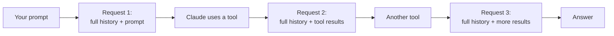
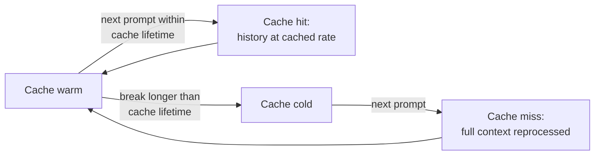
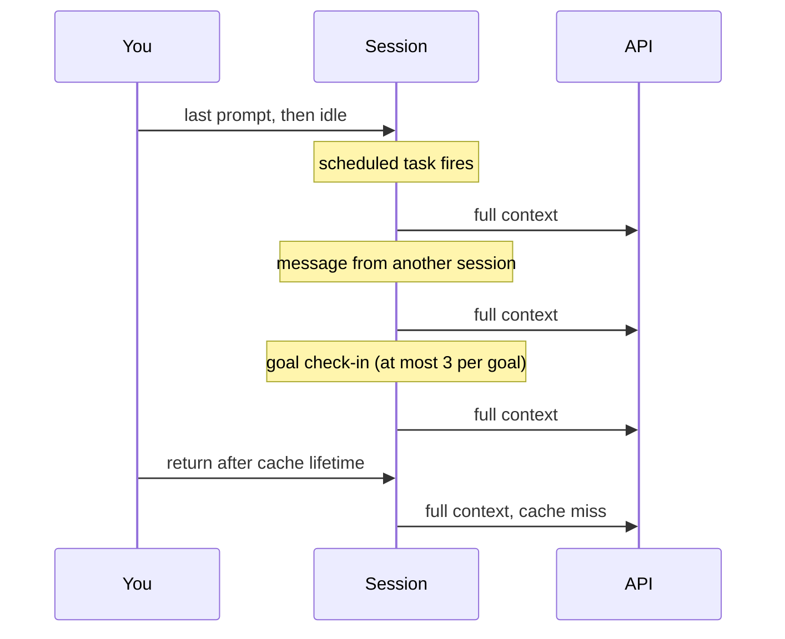

# Why Claude Code usage climbs in a long session: a summary

A summary of the section "Why usage climbs in a long session" in Claude Code's documentation page *Manage costs effectively*,[^why] with related guidance from the same page. Quotes are verbatim from the page as read on 2026-11-11. The docs change often; check the page before relying on version numbers.

## The claim

> "A session that has been open for hours can use far more of your plan limits than your activity suggests, usually for one of these reasons:"[^why]

The page gives eight reasons. Most come down to one mechanism: every request sends the full conversation again.

## The eight reasons

| Reason | What the page says | Runs while idle? |
| --- | --- | --- |
| Long context | "Claude Code sends your full conversation with every request, and each time Claude uses tools it sends another request carrying that batch of tool results."[^why] | No |
| Cache misses | "your first message after a break longer than the cache lifetime misses the cache and reprocesses your full context"[^why] | No, but triggered by idling |
| Scheduled tasks | "fires on its interval even while the session is idle, sending your full context each time"[^why] | Yes |
| Cross-session messages | "delivers a message from another of your sessions as a new turn when this session sits idle, sending your full context each time"[^why] | Yes |
| Goal check-ins | "asks Claude to check on that work even when the session sits idle, starting a new turn that sends your full context"[^why] | Yes |
| Subagents and workflows | "every subagent, and every agent a dynamic workflow spawns, sends its own requests on top of the main conversation's"[^why] | No |
| Agent teammates | "each active teammate keeps consuming tokens until it exits"[^why] | Yes, until it exits |
| Compaction | "`/compact` reads the conversation it summarizes, so compacting a large context is itself a large request"[^why] | No |

The last column is my reading of each quote, not a column in the docs.

### Caching lowers the cost of long context but doesn't remove it

> "With prompt caching, Claude Code re-reads that history at the cached token rate, so a one-line question in a session that has been open all day still draws usage for the whole conversation."[^why]

The page does not give a fixed cache lifetime. It links to the prompt caching page for that.[^cache] The `/usage` example shows a cache line reading `warm (1h TTL, last activity 40s ago)`, with the TTL "in effect" for that session.[^track]

### Some usage happens while you're away

Four of the reasons can start a turn, and send the full context, with no prompt from you.

Controls the page names for these:

- **Cross-session messages:** "To hold inbound messages instead of delivering them, set `crossSessionInbound` to `hold`."[^why]
- **Goal check-ins:** "Claude Code starts at most three idle check-ins per goal between your prompts. Before v2.1.246, idle check-ins were uncapped. To turn check-ins off, set `CLAUDE_CODE_GOAL_CHECKIN_MINUTES` to `0`."[^why]

## What to do about it

**Clear instead of compacting** when you don't need continuity:

> "When you want a fresh start instead of continuity, `/clear` costs nothing"[^why]

> "Use `/clear` to start fresh when switching to unrelated work. Stale context wastes tokens on every subsequent message. Use `/rename` before clearing so you can find the session later, then `/resume` to return to it."[^manage]

**Steer compaction** when you do:

> "`/compact Focus on code samples and API usage` tells Claude what to preserve during summarization."[^manage]

**Look before changing anything:**

- "Run `/context` to see what's consuming space."[^reduce]
- "To see what to change on a Pro, Max, Ultra, Team, or Enterprise plan, run `/usage` at the Claude Code prompt. Its breakdown recommends a change for behaviors behind 10% or more of your recent usage. Those behaviors include long context and cache misses."[^why]

The page's "Reduce token usage" section has more: choosing the model, MCP server overhead, moving instructions from CLAUDE.md to skills, extended thinking, delegating verbose operations to subagents and agent team costs.[^reduce]

## What it does not say

The page treats context size as a cost question only: "Token costs scale with context size: the more context Claude processes, the more tokens you use."[^reduce] It says nothing about whether a long context lowers answer quality. For that, see [Context Rot](context-rot.md).

## Why it matters here

The long-context reason names tool results directly: each tool use sends another request carrying them, on top of the full history.[^why] A fleet run that keeps full tool output in its window pays for it on every later request. Keeping that output in the `events` ledger, and giving the model a summary and an id, keeps it out of those requests.

## Sources

- Claude Code documentation, *Manage costs effectively*. <https://code.claude.com/docs/en/costs>
- Claude Code documentation, *Prompt caching* (linked from the costs page, not summarized here). <https://code.claude.com/docs/en/prompt-caching>

[^why]: *Manage costs effectively*, section "Why usage climbs in a long session". <https://code.claude.com/docs/en/costs#why-usage-climbs-in-a-long-session>
[^track]: *Manage costs effectively*, section "Track your costs", "Using the `/usage` command", "Prompt cache statistics". <https://code.claude.com/docs/en/costs#track-your-costs>
[^reduce]: *Manage costs effectively*, section "Reduce token usage". <https://code.claude.com/docs/en/costs#reduce-token-usage>
[^manage]: *Manage costs effectively*, section "Manage context proactively". <https://code.claude.com/docs/en/costs#manage-context-proactively>
[^cache]: *Prompt caching*, section on cache lifetime, as linked from the costs page. <https://code.claude.com/docs/en/prompt-caching#cache-lifetime>
