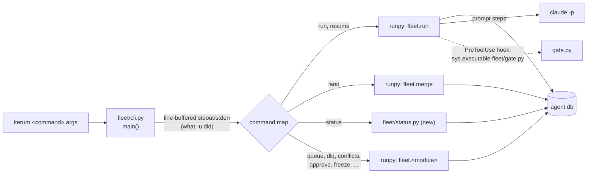
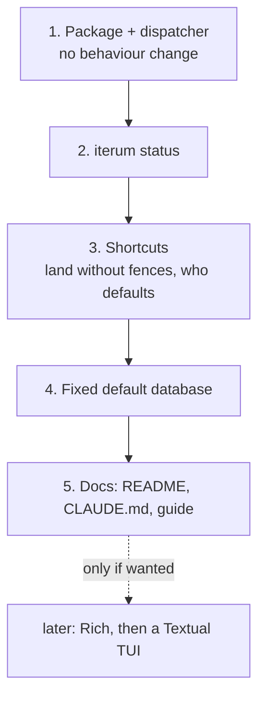
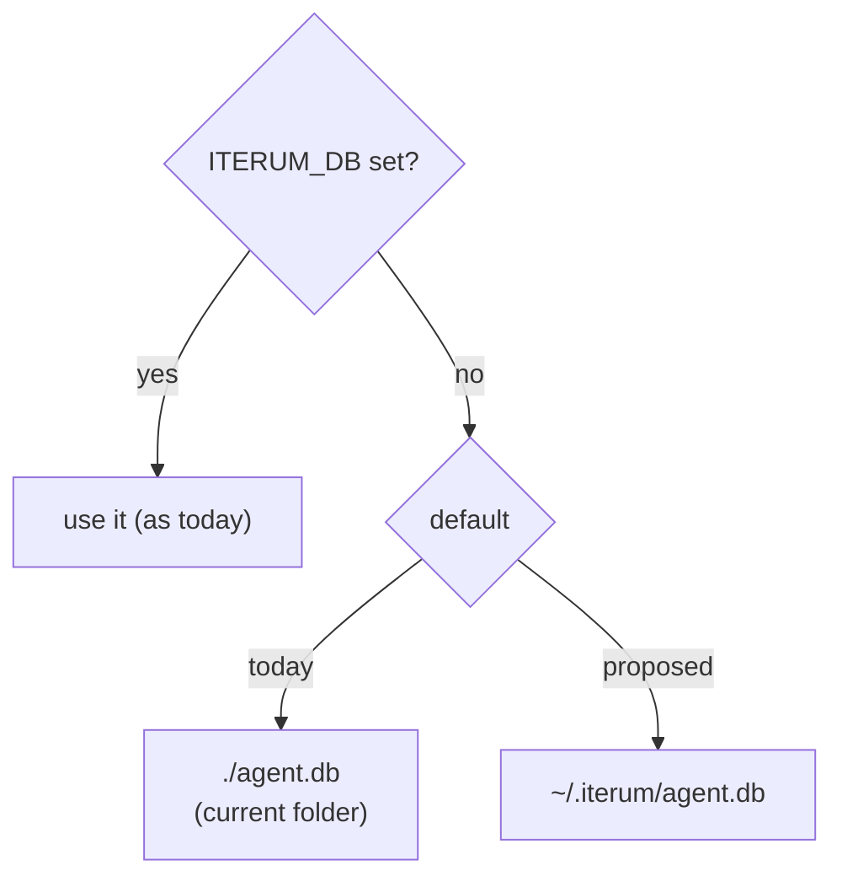

# Plan: one `iterum` command

Draft, 2026-11-13. Answers the open question "Should Iterum ship as one `iterum` command instead of `python -m fleet.*`?" (`open-questions.md`) with option (a), then (b). Increment 1 is built (decision log, 2026-11-13).

## Why

Today a run from the app repo needs four lines of setup, and every command carries flags that exist for the harness, not for the work:

```bash
export ITERUM_DB=<iterum>/agent.db ITERUM_DEVICE=<device> PYTHONPATH=<iterum>
source <iterum>/.env.example
uv run --project <iterum> python -u -m fleet.run --plan p.json --allow-claude 0.05
```

| Piece | Why it is there | After |
| --- | --- | --- |
| `python -m` | `fleet` is a namespace package; `python fleet/run.py` fails | gone: `iterum run` |
| `-u` | unbuffered output, so a killed run's last lines are not lost | set once in the entry point |
| `--project <iterum>` | so `uv` finds Iterum from the app folder | gone: installed once with `uv tool install` |
| `PYTHONPATH=<iterum>` | so `fleet` imports from the app folder | gone: the package is installed |
| absolute `ITERUM_DB` | the default is `agent.db` in the current folder, so the app repo would get a second database | increment 4: a fixed default |
| `ITERUM_DEVICE` | every event names its device | unchanged (out of scope) |
| `source .env.example` | Claude Code telemetry settings for paid runs | unchanged; `iterum run` already refuses without them (`check_receiver()`) |

After:

```bash
uv tool install --editable <iterum>     # once
export ITERUM_DEVICE=<device>           # once, in your shell profile
iterum run p.json --allow-claude 0.05
```

## How it fits together



The dispatcher runs each module as `__main__` with `runpy.run_module(name, run_name="__main__", alter_sys=True)` ([runpy](https://docs.python.org/3/library/runpy.html#runpy.run_module)), after setting `sys.argv`. That is close to `python -m` but not identical: `-m` goes through the private `runpy._run_module_as_main` (Python 3.14's `runpy.py`), so increment 1 runs every entry point both ways. Every module keeps its own argument parsing and nothing in it changes: `fleet/run.py`, `fleet/project.py` and `fleet/sync.py` keep their logic under `if __name__ == "__main__"`, and `fleet.view` and `fleet.worker` keep their own `main()` signatures.

Subprocesses already start Python as `sys.executable -m fleet.<module>` (the drills, `fleet.sweep`) or `sys.executable fleet/gate.py` (`gate_settings()`). Under an installed tool, `sys.executable` is the tool's Python, which has `fleet` installed, so these keep working from any folder, not only the repo root.

## Commands

| Today | `iterum` |
| --- | --- |
| `uv run python -u -m fleet.run --plan p.json [--allow-claude <usd>]` | `iterum run p.json [--allow-claude <usd>]` |
| `uv run python -u -m fleet.run --resume <id> [--force]` | `iterum resume <id> [--force]` |
| `uv run python -u -m fleet.run` (the built-in drill) | `iterum drill run` |
| `uv run python -m fleet.merge <branch> --run-id R --fence ... [--check CMD]` | `iterum land <branch> --run-id R --fence ... [--check CMD]`; increment 3 drops the fences |
| `uv run python -u -m fleet.telemetry [--port 4318]` | `iterum receiver [--port 4318]` |
| `uv run python -m fleet.view [trace R \| stages \| context]` | `iterum view [trace R \| stages \| context]` |
| (seven commands) | `iterum status` (increment 2) |
| `uv run python -m fleet.governor [set <usd>]` | `iterum budget [set <usd>]` |
| `uv run python -m fleet.recovery [...]` | `iterum recovery [...]` |
| `uv run python -u -m fleet.worker <name> [--budget-s N]` | `iterum worker <name> [--budget-s N]` |
| `uv run python -m fleet.dlq [redrive <id>]` | `iterum dlq [redrive <id>]` |
| `uv run python -m fleet.conflicts [resolve <id> "<d>"]` | `iterum conflicts [resolve <id> "<d>"]` |
| `uv run python -m fleet.approve [approve\|deny\|freeze\|thaw ...]` | `iterum approve ...`, `iterum freeze "<reason>"`, `iterum thaw` |
| `uv run python -m fleet.canary [...]` | `iterum canary [...]` |
| `uv run python -m fleet.sync sync\|export\|import` | `iterum sync [export\|import]` |
| `uv run python -m fleet.project` | `iterum project` |
| `uv run fleet/doctor.py` | `iterum doctor` |
| `uv run python -m fleet.eval [...]`, `fleet.scorecard`, `fleet.sweep` | `iterum eval`, `iterum scorecard`, `iterum sweep` |
| `uv run python -u -m fleet.kill_drill`, `claims_drill`, `merge_drill` | `iterum drill kill \| claims \| merge` |

Rules for the map: one word per command; a module's subcommands stay as they are; `run p.json` and `resume <id>` become `fleet.run --plan p.json` and `fleet.run --resume <id>` in the dispatcher, so `fleet/run.py` does not change; `freeze` and `thaw` are top-level because the 3 a.m. runbook should be short; the `who` argument of `freeze`, `thaw` and `approve` defaults to `ITERUM_DEVICE` (increment 3). `python -m fleet.*` keeps working throughout, so nothing breaks while docs catch up.

`scripts/seed-ledger.py` stays a script, run as today: it is not in `fleet/`, so the package does not include it.

## Increments

Each one ends with its checks passing, a report, and a stop for "commit it".



### 1. Package and dispatcher

Done 2026-11-13; check results in the decision log. Check 3 ran from the repo root: the built-in plan's `ls fleet` step needs it, and it writes `out/` in the current folder. Since then `fleet.run` refuses the built-in plan (run or resume) anywhere else (`check_drill_folder()`), before touching the database.

- `pyproject.toml`: a `[build-system]` using `uv_build`, `[tool.uv.build-backend]` with `module-name = "fleet"`, `module-root = ""` and `namespace = true` (the uv docs: "Namespace package modules are identified by a `.` in the `module-name`", and for a namespace root with several children, `module-name = "foo"` with `namespace = true`; [build backend](https://docs.astral.sh/uv/concepts/build-backend/)), and `[project.scripts] iterum = "fleet.cli:main"`. Entry points need a build system ([entry points](https://docs.astral.sh/uv/concepts/projects/config/#entry-points)). Use the `uv_build` version constraint `uv init` prints at the time, not one copied from here.
- `fleet/cli.py`: the command map, `sys.argv` rewrite, `runpy.run_module`, and `sys.stdout.reconfigure(line_buffering=True)` and the same for stderr ([io](https://docs.python.org/3/library/io.html#io.TextIOWrapper.reconfigure)) in place of `-u`.
- Install: `uv tool install --editable .` (`-e, --editable`: "Install the target package in editable mode", from `uv tool install --help`, uv 0.11.7). Editable keeps `fleet/schema.sql` and `fleet/gate.py` at their repo paths.

Checks:

1. `iterum --help` lists every command; `iterum <cmd> --help` shows the module's own help.
2. The three drills through `iterum drill ...` pass, from a folder outside the repo.
3. `iterum run` (the built-in drill) and a resume, on a scratch `ITERUM_DB`.
4. Kill a run under `iterum run` with Ctrl-C and SIGTERM: the exit code is -2 as today, and the last lines printed before the kill appear when output is piped to a file.
5. `uv run python -m fleet.<module>` still works for every module.
6. The gate hook: run the command `gate_settings()` builds, under the tool's Python, against a scratch database with a claimed file, and see it refuse (exit 2). No paid run needed.

### 2. `iterum status`

Progress 2026-11-13: the first slice is built (`fleet/status.py`: FLEET, SPEND, RUNS; exit 1 on a stale or failed run). QUEUE followed (counts by status; stranded = `in_progress` with an expired lease, not yet reaped; dead-lettered with how many wait on each; exit 1 on either). NEEDS A PERSON followed (`approve.pending()`, `queue.human_tasks()`; exit 1 on either; a conflict task also counts as `ready` under QUEUE). RECEIVER followed (not configured, not answering, up on another database, or up on this one; the same probe as `check_receiver()`; informational, no exit code, since `fleet.run` already refuses a paid plan without it). CANARY followed (`canary.check()` with its defaults, never logged; informational, since a fired canary cannot be cleared). Increment 2 done 2026-11-13. Found: `recovery.dead_runs()` returns every failed run ever, so the real `agent.db` exits 1 for two failed runs from 2026-11-12 and always will; to settle before the exit code means anything. Settled the same day: a failed run still needs a person, and `fleet.recovery halt <run_id> "<reason>"` closes one (refused unless `dead_runs()` lists it); a halted run leaves `status`.

One screen, read-only, exit 1 when something needs a person. Every line comes from an existing function except stranded tasks, a new query over `tasks` and `leases` (`in_progress` with an expired lease).

```text
iterum  black-mamba  ~/github/iterum/agent.db                   07:42

FLEET     not frozen
SPEND     ceiling 5.00  spent 1.2340  headroom 3.7660 USD
RECEIVER  up on :4318, writing to this database

RUNS      2 running   1 stale   1 failed   49 done
  stale    7c1e09a2b4f1  heartbeat 3m ago, step 2 proposed
  failed   12c0572d5ec1  step 3 failed

QUEUE     4 ready   1 in progress   0 stranded   1 dead-lettered   2 halted
  dead     task 9  shell  attempts 3/3  2 waiting

NEEDS A PERSON
  approval  71fb40d1c37e0cb4  payment.capture  task-7 step 3
  conflict  task 12

CANARY    quiet (24 runs in baseline, 3 in the last hour)
```

| Section | Source |
| --- | --- |
| FLEET | `approve.frozen(con)` |
| SPEND | `governor.status()` |
| RECEIVER | `GET /v1/logs` on `OTEL_EXPORTER_OTLP_LOGS_ENDPOINT`, which answers with the receiver's database |
| RUNS | counts from `runs`; detail from `recovery.dead_runs()` |
| QUEUE | counts from `tasks`; detail from `queue.dead_letters()`; stranded is new |
| NEEDS A PERSON | `approve.pending()`, `queue.human_tasks()` |
| CANARY | `canary.check()`, not logged |

Plain text first, standard library only. Checks: a scratch database seeded with one of each problem shows each line and exits 1; an empty one shows one line per section and exits 0; the real `agent.db` shows its 49 done and 2 failed runs. Confirm first that `recovery.dead_runs()` writes nothing.

### 3. Shortcuts

- `iterum land <branch>` reads the run's claims and fences from the database instead of a pasted `--fence` list; `--run-id` stays required unless the branch maps to one run.
- `who` defaults to `ITERUM_DEVICE` for `freeze`, `thaw` and `approve`.
- Each module's `prog=` shows `iterum <cmd>` in its usage line when run through the CLI.

Checks: `fleet.merge_drill` and `fleet.claims_drill` still pass; a land without `--fence` refuses exactly where the printed command would.

### 4. A fixed default database

Decide first, then build:



- Every module reads `db.DB`, set once at import from `ITERUM_DB`; `fleet/doctor.py` has its own copy of the default and must change with it.
- The drills and `fleet.scorecard` set `ITERUM_DB` themselves, so they are unaffected.
- Migration: move `<iterum>/agent.db` to the new default, or keep setting `ITERUM_DB`. `iterum status` prints the resolved path in its header so the change is visible.

Checks: from the app repo with no `ITERUM_DB`, `iterum status`, `iterum receiver` and `iterum run` all name the same file; `check_receiver()` still matches the receiver's database.

### 5. Docs

README (keep it short: install, then three commands), CLAUDE.md's command list, `nextjs-first-run.md`'s setup block, and the `gh-pages` guide, which has about 40 `python -m fleet` commands. Move this plan's outcome to `decision-log.md` and remove the open question.

## Not in this plan

- **A TUI.** Considered 2026-11-13 and set aside: it would keep every invocation and add a dependency. Rich for a prettier `iterum status`, and a Textual TUI on top of the same functions, are possible later steps.
- **A Go port.** A rewrite of about 4,700 lines with every drill proven again, for a distribution problem a single user does not have.
- **Config files and `ITERUM_DEVICE` defaults.** Environment variables stay the only settings.

## Risks

| Risk | Check |
| --- | --- |
| `runpy` differs from `-m` in some module | check 2 and 5 of increment 1 run every entry point both ways |
| Output lost on kill without `-u` | check 4 of increment 1 |
| The hook cannot find `gate.py` or import `fleet` | check 6 of increment 1 |
| A non-editable install leaves `schema.sql` out | out of scope: only `--editable` is supported until a wheel is checked for it |
| Two databases during the switch | increment 4 prints the resolved path everywhere it matters |
