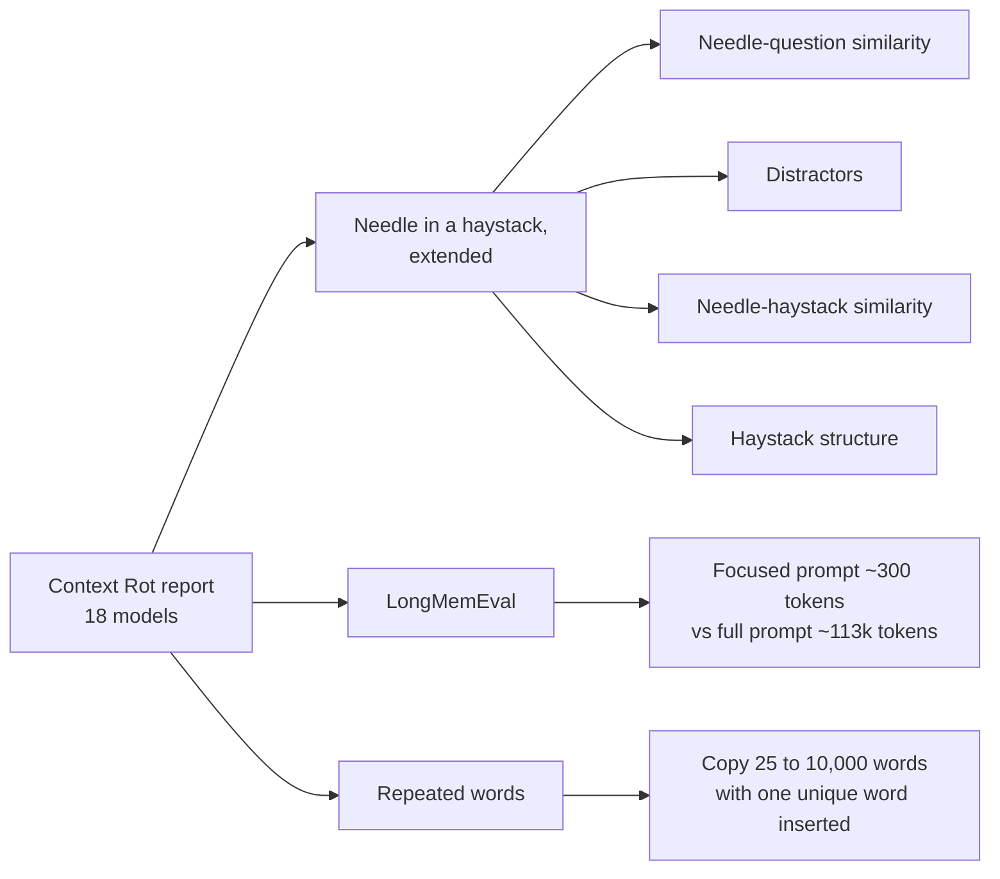
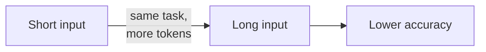
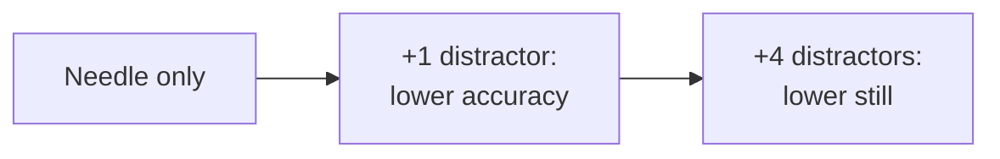
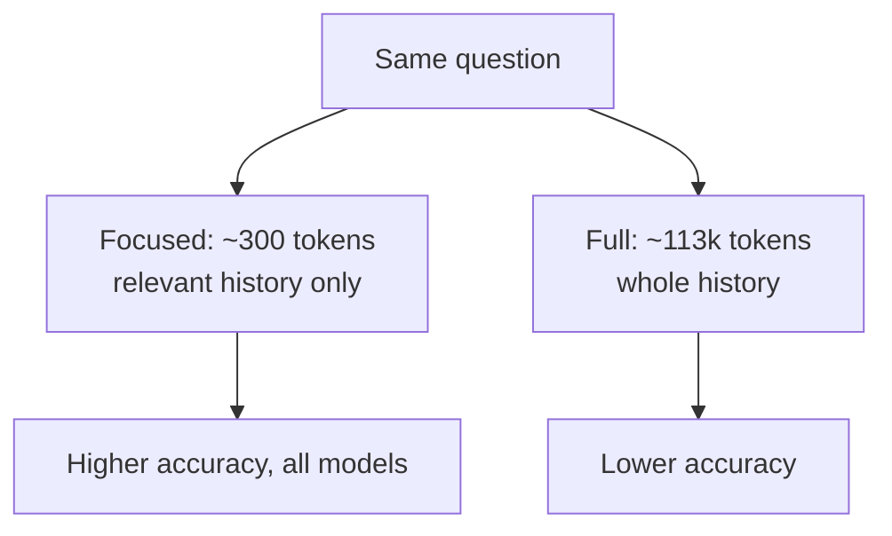

# Context Rot: a summary

A summary of Chroma's technical report *Context Rot: How Increasing Input Tokens Impacts LLM Performance*, by Kelly Hong, Anton Troynikov and Jeff Huber (July 14, 2025).[^report] The code is on GitHub.[^code]

Quotes are from the report; each footnote names the section a quote comes from. Items read only from a summary of the page, not word for word, are marked *(unverified)*. Footnotes marked "section not recorded" are quotes from the report whose section I did not note.

## The claim

> "models do not use their context uniformly; instead, their performance grows increasingly unreliable as input length grows."[^intro]

> "Across all experiments, model performance consistently degrades with increasing input length."[^page]

The tasks are "deliberately controlled to isolate the impact of context length alone":[^page] the question stays the same difficulty while the input grows.

## What was tested

The report evaluates "18 LLMs, including the state-of-the-art GPT-4.1, Claude 4, Gemini 2.5, and Qwen3 models."[^intro] Not every model appears in every experiment. The full list, by provider *(unverified)*: Anthropic 5, OpenAI 7, Google 3, Alibaba 3.

- **Needle in a haystack, extended.**[^niah] The model must find one fact (the needle) in long filler text (the haystack: Paul Graham essays or arXiv papers). Each setup ran at 8 input lengths and 11 needle positions. Unlike the classic test, the needle matches the question by meaning, not just by shared words.
- **LongMemEval.**[^lme] 306 conversational memory questions, each asked two ways: with only the relevant part of the history (about 300 tokens) or with the full history (about 113k tokens).
- **Repeated words.**[^rw] The model copies a long run of one word with a single different word inserted, such as "apple" with one "apples". Scored by edit distance.

## Findings

### Longer input, worse answers

Across every experiment, accuracy falls as the input grows, even on tasks this simple.[^page]

### The less the question resembles its answer, the faster accuracy falls

> "as needle-question similarity decreases, model performance degrades more significantly with increasing input length."[^nqs]

Lookups that match on exact words hold up best. Questions that need the model to connect related ideas fall off fastest.

### Distractors compound

A distractor is text "topically related to the needle, but do not quite answer the question."[^dist]

> "Even a single distractor reduces performance relative to the baseline (needle only), and adding four distractors compounds this degradation further."[^dist]

Not all distractors hurt equally. When distracted, "Claude models consistently exhibit the lowest hallucination rates" and "GPT models show the highest rates of hallucination."[^dist]

### Focused beats full

> "Across all models, we see significantly higher performance on focused prompts compared to full prompts."[^lme]

The full prompts "mostly consist of content irrelevant to the question, and sometimes distractors."[^lme]

### Structure, surprisingly, hurts

> "Surprisingly, we find that structural coherence consistently hurts model performance."[^hs]

Models found the needle more reliably when the haystack's sentences were shuffled than when they formed a logical, coherent text.[^hs]

## What it does not show

- **No agent sessions.** Every test is one fixed long input and one answer. There are no tool calls, tool output, retries or multi-turn loops. Agent tasks appear only as motivation: "Real applications, such as agent tasks or summarization, demand significantly more processing and reasoning."[^intro]
- **No cause.** The authors do not explain why performance degrades[^lim] *(unverified)*.
- **No harder tasks.** They expect complex multi-step tasks to degrade more, but did not test that[^lim] *(unverified)*.
- **Narrow in places.** "Testing across only two topics is insufficient to draw a generalizable conclusion."[^nhs]
- **No comparison with switching models.** Nothing in it measures whether trimming context matters more than changing the model.

## Why it matters here

A fleet agent's window grows with tool output and retries. The report doesn't test that kind of input directly. It does show that more tokens and more irrelevant text lower accuracy,[^page] and that a focused prompt beats the full history.[^lme] That supports keeping full tool output in the `events` ledger and giving the model a summary and an id, rather than the output itself.

## Sources

- Hong, K., Troynikov, A., Huber, J. *Context Rot: How Increasing Input Tokens Impacts LLM Performance*. Chroma Technical Report, July 2025. <https://www.trychroma.com/research/context-rot>
- chroma-core/context-rot, the code for the report. <https://github.com/chroma-core/context-rot>

[^report]: Hong, Troynikov, Huber, *Context Rot*, Chroma, 2025. <https://www.trychroma.com/research/context-rot>
[^code]: <https://github.com/chroma-core/context-rot>
[^intro]: *Context Rot*, section "Introduction". <https://www.trychroma.com/research/context-rot>
[^page]: *Context Rot*, section not recorded. <https://www.trychroma.com/research/context-rot>
[^niah]: *Context Rot*, section "Needle in a Haystack Extension". <https://www.trychroma.com/research/context-rot>
[^nqs]: *Context Rot*, section "Needle-Question Similarity". <https://www.trychroma.com/research/context-rot>
[^dist]: *Context Rot*, section "Impact of Distractors". <https://www.trychroma.com/research/context-rot>
[^nhs]: *Context Rot*, section "Needle-Haystack Similarity". <https://www.trychroma.com/research/context-rot>
[^hs]: *Context Rot*, section "Haystack Structure". <https://www.trychroma.com/research/context-rot>
[^lme]: *Context Rot*, section "LongMemEval". <https://www.trychroma.com/research/context-rot>
[^rw]: *Context Rot*, section "Repeated Words". <https://www.trychroma.com/research/context-rot>
[^lim]: *Context Rot*, section "Limitations & Future Work". <https://www.trychroma.com/research/context-rot>
