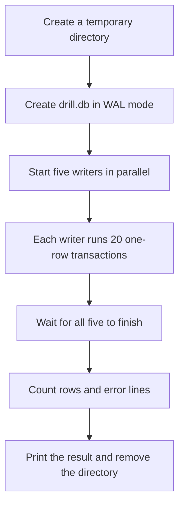
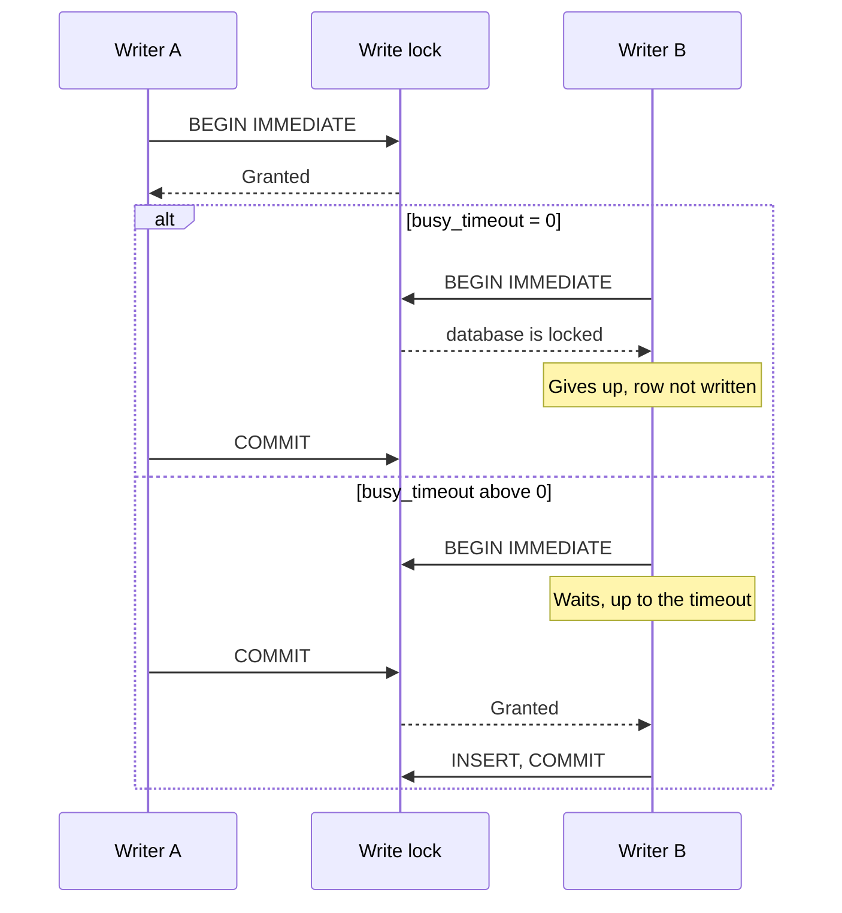
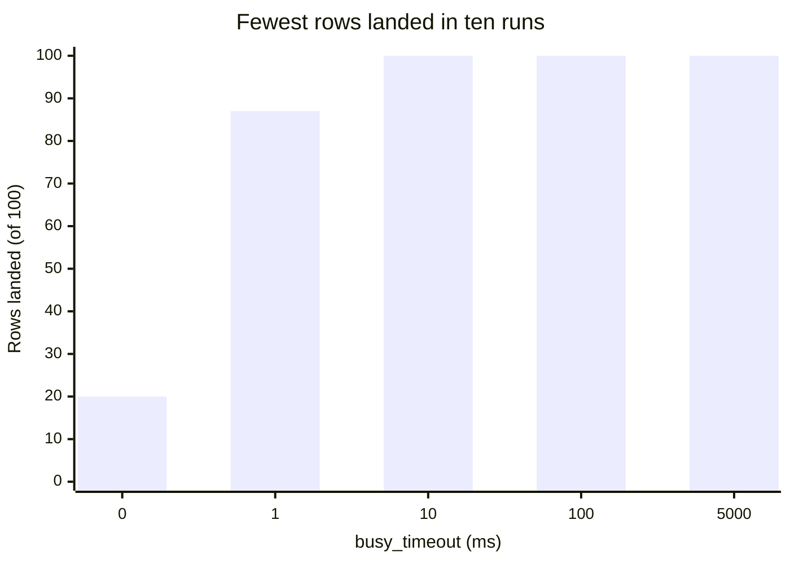
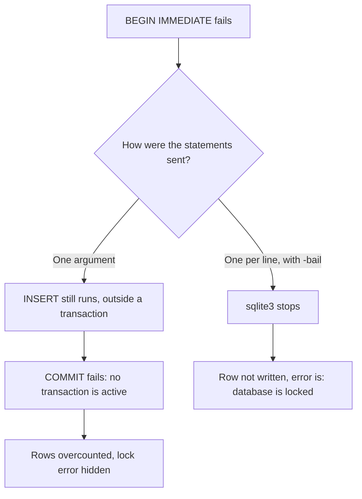
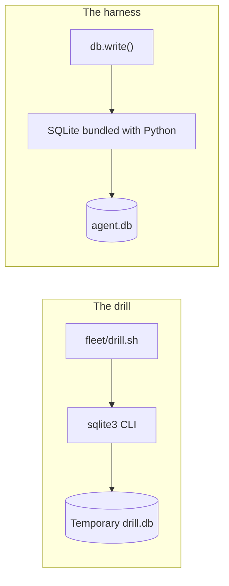

# The `busy_timeout` drill

[`fleet/drill.sh`](../fleet/drill.sh) starts five writers against one SQLite database and shows what happens when they do and do not wait for each other.

```bash
./fleet/drill.sh          # busy_timeout=0, no waiting
./fleet/drill.sh 5000     # wait up to 5000 ms for the write lock
```

It needs `sqlite3` and `python3` on `PATH`. It works in a temporary directory and removes it on exit, so it never touches `agent.db` and is safe to run from anywhere.

## What it does

Each transaction is a new `sqlite3` process, so one run starts 100 of them.



## Why writers collide

SQLite's WAL mode lets readers and a writer run together, but [there can only be one writer at a time](https://www.sqlite.org/wal.html). `BEGIN IMMEDIATE` asks for the write lock up front. `busy_timeout` decides what a writer does when another writer already has it.



## Results

Ten runs at each timeout, on one macOS machine with the `sqlite3` 3.54.0 CLI, on 2026-11-09. Your numbers will differ, so run it several times on your own machine.

| `busy_timeout` (ms) | Rows landed (of 100) | Errors | Wall time (s) |
| --- | --- | --- | --- |
| 0 | 20 to 22 | 78 to 80 | 0.140 to 0.152 |
| 1 | 87 to 100 | 0 to 13 | 0.146 to 0.155 |
| 10 | 100 | 0 | 0.149 to 0.170 |
| 100 | 100 | 0 | 0.147 to 0.163 |
| 5000 | 100 | 0 | 0.147 to 0.161 |

The chart shows the worst of the ten runs at each setting. The timeouts are categories, not a linear scale.



Rows and errors added up to 100 in all 50 runs. With no timeout, about 80 writes failed, and the run took about as long as the runs where every write landed.

**What this shows:** waiting matters, and a small timeout was enough for this load.

**What this does not show:** whether 5000 ms is the right value. Each transaction here is one insert, so the lock is held briefly. A writer that holds the lock for longer than the timeout will still make others fail.

## Why statements are piped one per line

With every statement in a single command-line argument, the CLI continued after a failed `BEGIN IMMEDIATE`, and `-bail` did not stop it. This was tested on `sqlite3` 3.54.0 and 3.53.4. The [CLI documentation](https://sqlite.org/cli.html) describes `.bail` as "Stop after hitting an error" and does not cover this case.



The single-argument version once printed `rows=100/100` alongside 23 errors at `busy_timeout=1`.

## How it relates to the harness

The drill stands alone. It shares the idea with `fleet/db.py`, but none of the code, and it runs a different SQLite build.



| | Drill | Harness |
| --- | --- | --- |
| Timeout | Set by argument, default 0 | Fixed at 5 seconds in `db.connect()` |
| SQLite | The `sqlite3` CLI on `PATH` | Bundled with Python, pinned in `.python-version` |
| Transaction | One insert | A state change and its `db.log()` event |

Python's [`sqlite3.connect()` waits five seconds by default](https://docs.python.org/3/library/sqlite3.html#sqlite3.connect), so Python code gets a timeout without setting the pragma.

## Limits

- It runs five writers on one machine, so it says nothing about how many agents SQLite can support.
- [WAL does not work over a network filesystem](https://www.sqlite.org/wal.html): "All processes using a database must be on the same host computer."
- Wall time includes about 10 ms of Python startup, because `python3` reads the clock.
- If `python3` is missing, the script still exits 0 and prints `wall=0.000s`.
