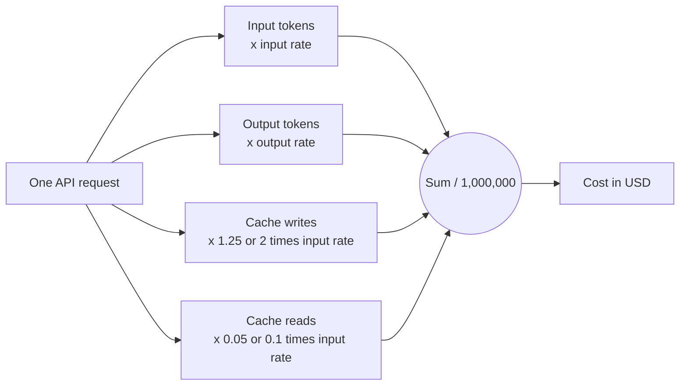
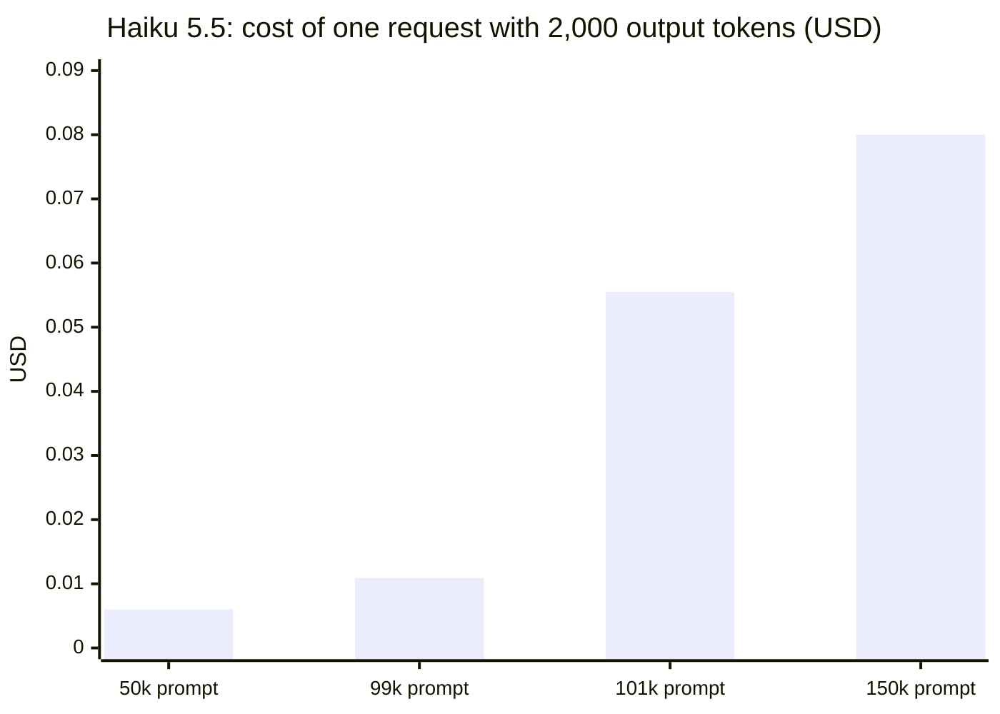
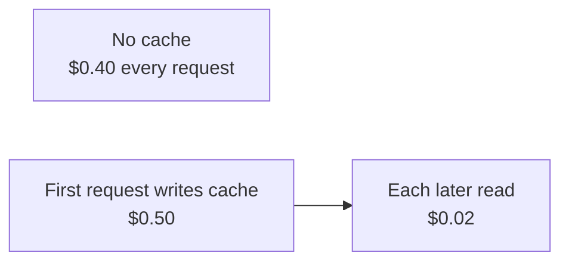

# Model Pricing

What each current Claude model costs, in dollars per million tokens (MTok). This document explains how a request's cost is worked out, why one rate per model is not enough, and what the fleet counts instead.

Every price here comes from Anthropic's [pricing page](https://platform.claude.com/docs/en/about-claude/pricing), read 2026-11-11. Prices change; read the page again before trusting this file.

## The rates

| Model | Input $/MTok | Output $/MTok |
| --- | --- | --- |
| Claude Haiku 5.5 | 0.10 | 0.50 |
| Claude Sonnet 5.5 | 2.00 | 10.00 |
| Claude Opus 5.5 | 4.00 | 20.00 |

Output costs five times input on all three. Opus costs twice Sonnet, and Sonnet twenty times Haiku.

```mermaid
xychart-beta
    title "Price per million tokens (USD)"
    x-axis ["Haiku 5.5", "Sonnet 5.5", "Opus 5.5"]
    y-axis "USD" 0 --> 22
    bar [0.50, 10, 20]
    bar [0.10, 2, 4]
```



The taller bar in each pair is output, the shorter is input.

## How a request is priced

A request is billed per token in up to four buckets, each with its own rate.



Worked example: 50,000 input tokens and 2,000 output tokens, no caching.

| Model | Input | Output | Total |
| --- | --- | --- | --- |
| Opus 5.5 | 0.05 x $4 = $0.200 | 0.002 x $20 = $0.040 | $0.240 |
| Sonnet 5.5 | 0.05 x $2 = $0.100 | 0.002 x $10 = $0.020 | $0.120 |
| Haiku 5.5 | 0.05 x $0.10 = $0.005 | 0.002 x $0.50 = $0.001 | $0.006 |

(Token counts in millions: 50,000 is 0.05 MTok.)

## Where one rate per model falls short

### Haiku 5.5 has a price cliff at 100,000 tokens

Haiku 5.5 is priced by prompt length. A prompt over 100,000 tokens pays $0.50 input and $2.50 output, five times the normal rate, for the whole request. The prompt length counts cache reads and writes too. A cost worked out from the lower rate alone under-counts long Haiku prompts.



Two thousand more tokens of prompt, from 99,000 to 101,000, take the cost from about $0.011 to $0.056.

### Caching changes the input rate

| | 5-minute write | 1-hour write | Cache read |
| --- | --- | --- | --- |
| Multiplier on input rate | 1.25x | 2x | 0.05x (Opus 5.5, Sonnet 5.5), 0.1x (Haiku 5.5) |
| Opus 5.5, $/MTok | 5.00 | 8.00 | 0.20 |
| Sonnet 5.5, $/MTok | 2.50 | 4.00 | 0.10 |
| Haiku 5.5, $/MTok | 0.125 | 0.20 | 0.01 |

Example on Opus 5.5 with a 100,000-token prefix reused across requests:



The write costs $0.10 more than an uncached request; the first read saves $0.38. A 5-minute cache pays for itself after one read.

### Other modifiers

| Modifier | Effect | Source |
| --- | --- | --- |
| Batch API | Half price on input and output | [Batch processing](https://platform.claude.com/docs/en/about-claude/pricing#batch-processing) |
| Fast mode, Opus 5.5 | $8 input, $40 output | [Fast mode pricing](https://platform.claude.com/docs/en/about-claude/pricing#fast-mode-pricing) |
| US-only inference (`inference_geo`) | 1.1x on every bucket | [Data residency pricing](https://platform.claude.com/docs/en/about-claude/pricing#data-residency-pricing) |

These stack: caching multipliers apply on top of batch, fast mode and data residency.

### Older models in a family cost more

A model's name, not its family, sets its price. Older versions cost more:

| Model | Input $/MTok | Output $/MTok |
| --- | --- | --- |
| Opus 5, 4.8, 4.7, 4.6, 4.5 | 5.00 | 25.00 |
| Sonnet 5 | 2.00 | 10.00 |
| Sonnet 4.6, 4.5 | 3.00 | 15.00 |
| Haiku 4.5 | 1.00 | 5.00 |

Sonnet 5's $2 / $10 started as an introductory price; Anthropic has made it permanent and cancelled the planned rise to $3 / $15.

## Use in the fleet

Nothing in the code uses these rates. Because of the modifiers above, the fleet does not work out cost from tokens. It counts the `cost_usd` that Claude Code reports for each API request, which `fleet/telemetry.py` logs as a `spend.reported` event alongside `input_tokens`, `output_tokens`, `cache_read_tokens` and `cache_creation_tokens` (see [Claude Code Telemetry](telemetry/claude-code-telemetry.md)). Claude Code's docs describe that field as "Estimated cost in USD", so it is an estimate, not the bill.

`fleet/governor.py` sums those events against a fleet-wide ceiling:

```bash
uv run python -m fleet.governor            # ceiling, spend since it was set, headroom
uv run python -m fleet.governor set 5.00   # set or change the ceiling in USD
```

Spend counts only while the telemetry receiver is running, and only from the time the ceiling was first set. `fleet.run` does not check the ceiling yet.

The token counts in each event and the rates here could check Claude Code's estimate by hand. This document's numbers are as of the date above and nothing updates them.

## Sources

- [Anthropic pricing](https://platform.claude.com/docs/en/about-claude/pricing): model table, cache multipliers, batch, fast mode, data residency, long context pricing for Haiku 5.5. Read 2026-11-11.
