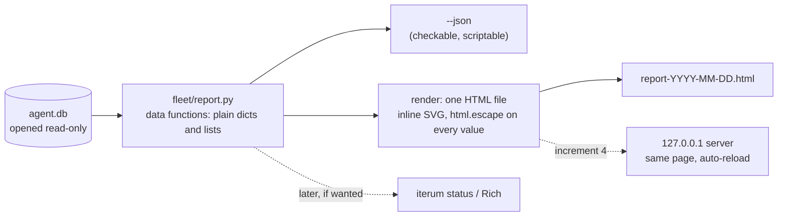
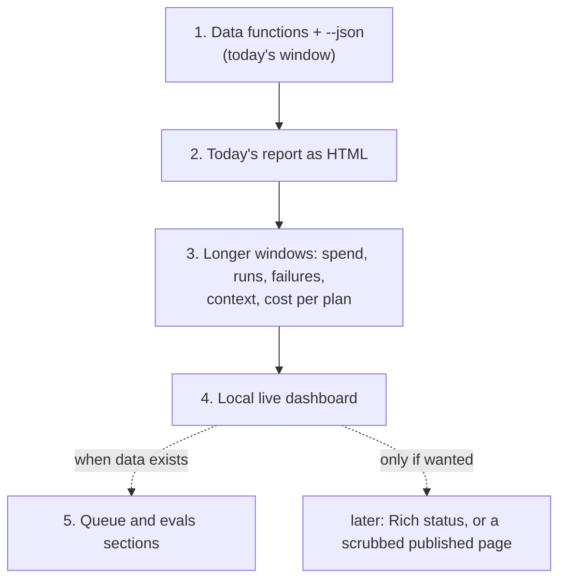

# Plan: reports and dashboards

Draft, 2026-11-13. Nothing here is built yet. It adds an open question (`open-questions.md`, "What should Iterum's reports look like, and where?"). First target: an HTML file of the current day's work.

## Why

Everything Iterum knows is in `agent.db`, but the only way to see it is text, spread over seven commands (`fleet.view`, `recovery`, `governor`, `dlq`, `conflicts`, `approve`, `canary`). Text answers "what is the state now". It is poor at "how is this changing": spend per day against the ceiling, whether context grows within a session, whether one plan costs less than another across repeats. Those are the questions an unattended night raises in the morning (`overnight-design.md`).

## What there is to show

Counts from the real `agent.db` on 2026-11-13: 51 runs (49 `done`, 2 `failed`), 1,054 events over about six days, 219 `spend.reported`, 69 `claude.finished`, 19 merges (18 landed, 1 refused); no queue tasks, eval cases or approvals yet. Small numbers: any rate in a report must show its denominator (as `fleet.view stages` already warns).

| Report | Question it answers | Source | Exists as text |
| --- | --- | --- | --- |
| Spend | What did the fleet spend per day, and how close is the ceiling? | `spend.reported.cost_usd` by day and `model`; `governor.status()` | `fleet.governor` (total only) |
| Runs | How many runs ended in each status, per day? How long did they take? | `runs.status`, `started_at`, `ended_at` | `fleet.view` (counts only) |
| Failures by stage | Where do runs go wrong? | `events.stage`, `view.is_failure()` | `fleet.view stages` |
| Run timeline | What did one run do, step by step, and where did it stop? | `steps.started_at`, `ended_at`, `status`; the run's events | `fleet.view trace` |
| Context growth | Does context grow within a session? | `spend.reported` token fields, the same query as `view.CONTEXT_SQL` | `fleet.view context` |
| Cost per plan | Which plan is cheaper, and does it still pass? | `runs.task`, `runs.status`, `spend.reported` per run | `fleet.sweep` (only for its own runs) |
| Merge gate | How often does `--check` or a stale fence refuse a landing? | `merge.landed`, `merge.refused` | none |
| Queue | Ready, in progress, dead-lettered, halted | `tasks`, `leases`; `queue.dead_letters()` | `fleet.dlq` |
| Evals | Pass rate per case over time | `eval_results` | `fleet.eval` |

The last two have no data yet, so they come last.

## Where it could live

| Option | What it is | For | Against |
| --- | --- | --- | --- |
| **A. Static HTML report** | `fleet.report` writes one self-contained `.html` from `agent.db`: inline SVG charts and tables, no scripts from the network | Standard library only; nothing leaves the machine; opens offline; a file you can keep per morning | A snapshot; rerun to refresh |
| **B. Local live dashboard** | The same page served from `127.0.0.1` with `http.server` (as `fleet.telemetry` already does), reloading every few seconds | Watch a run as it happens | `http.server` "is not recommended for production. It only implements basic security checks" ([http.server](https://docs.python.org/3/library/http.server.html)), so localhost only; one more long-running process |
| **C. Rich terminal** | A coloured `iterum status` with bars and tables ([Rich](https://rich.readthedocs.io/)) | Stays in the terminal | Iterum's first dependency (`dependencies = []`); terminal charts are coarse |
| **D. Textual TUI** | A live terminal app ([Textual](https://textual.textualize.io/)) | Live, in the terminal | Set aside 2026-11-13 (`cli-plan.md`, "Not in this plan"); a dependency and a second UI to maintain |
| **E. Published page** | A claude.ai Artifact made from a snapshot | Shareable, phone-friendly | Sends run data off the machine; `runs.task` holds absolute local paths and `claude.finished` holds session ids, so it needs scrubbing first; not live |

Recommendation: **A first, shaped as a daily report, then B on top of it.** B reuses A's page, so it costs little once A exists. C and D wait for a reason; E only if someone else needs to read a report, with a scrub step designed first.

## The first target: today's report

The user's framing (2026-11-13): Iterum generates an HTML file of the current day's efforts and shows it back. That is option A with a window of one day, and it is the first thing to build; the longer-range charts come after.

`python -m fleet.report` with no arguments covers local midnight to now, writes `report-YYYY-MM-DD.html`, and prints its path (and opens it with `open` on macOS when given `--open`). `--date YYYY-MM-DD` reports a past day. One page, top to bottom:

| Section | Shows | Source |
| --- | --- | --- |
| Header | date, device, resolved database path, generated-at time | `ITERUM_DEVICE`, `db.DB` |
| Needs a person | stale or failed runs, refused merges, pending approvals, conflicts; "nothing" when empty | `recovery.dead_runs()`, `merge.refused`, `approve.pending()`, `queue.human_tasks()` |
| Today in numbers | runs started, done, failed; steps committed; merges landed and refused; spend today and headroom | `runs`, `events`, `governor.status()` |
| Runs | one row per run started today: plan name (file name only, not its path), status, duration, cost, steps as a small timeline | `runs`, `steps`, `spend.reported` per run |
| Spend by hour | bars, split by model | `spend.reported` |
| Landed | each `merge.landed`: branch, files, whether `--check` ran | `merge.*` events |

A day with no activity produces a one-line page saying so. The same data functions back `--days N` later.

## How it fits together

Today `fleet/view.py` queries and prints in the same function. Reports need the data without the printing, so the first step separates them.

- **Read-only.** Open the database as `file:<path>?mode=ro` with `uri=True` ([sqlite3 URIs](https://docs.python.org/3/library/sqlite3.html#how-to-work-with-sqlite-uris)), so a report can never write, and does not call `db.init()`. To verify first: that a read-only connection sees rows a running `fleet.run` has committed while the report runs (WAL mode).
- **Charts.** Inline SVG written by Python: bars, a stacked bar, a line, and a step timeline cover every report above. No chart library, no CDN, so the file opens offline and stays readable in a year. Colours as CSS variables with a dark-mode variant.
- **Escaping.** Intents, plan paths and error text are ledger data; every value goes through `html.escape` ([html](https://docs.python.org/3/library/html.html#html.escape)).
- **Fits the CLI plan.** Runs as `uv run python -m fleet.report` until `cli-plan.md` increment 1 lands, then as `iterum report`. Neither blocks the other.

## Increments

Each ends with its checks passing, a report, and a stop for "commit it".

### 1. Data functions and `--json`

Done 2026-11-13: `fleet/report.py`, `iterum report --json [--date D]`. A run belongs to the day it started (decision 3, as proposed). Two departures, from evidence: it opens the database with `db.connect()` and only reads, as `iterum status` does, because a `mode=ro` connection left an empty `-wal` and a 32 KB `-shm` beside `agent.db` every time (it cannot remove them on close; a normal connection does); and "whether `--check` ran" is left out, because `merge.landed` does not record it. Checks: for 2026-11-12 on the real database, runs started (38), runs by status, steps committed (153), merges landed (9) and refused (1), and spend ($2.26853513) all equal hand-written SQL, and spend by hour sums to the same; plan names are file names only; `agent.db`'s time and size unchanged and no files left beside it; an empty database gives empty sections; a missing one is refused and not created.

`fleet/report.py` with one function per section of today's report, each taking a connection and a time window (start, end) and returning plain data; `python -m fleet.report --json [--date D]` prints them all. Reuse `view.is_failure()`, `recovery.dead_runs()` and `governor.status()` rather than copying their queries. Confirm first that `recovery.dead_runs()` writes nothing (the same check `cli-plan.md` increment 2 needs).

Checks: for a past day with known activity in the real `agent.db`, the counts match a hand-written SQL query; spend matches the sum of that day's `spend.reported`; on an empty scratch database every section is empty and nothing raises; the database file's modification time does not change.

### 2. Today's report as HTML

Done 2026-11-13 (decision log, "A day's report is a static page beside the database"): `fleet/report_html.py` renders the page; `iterum report [--date D] [--out path] [--open]` writes it to `reports/` beside the database and prints the path. Colours are the dataviz reference palette, models in fixed slots validated light and dark (slot 3 is under 3:1 on the light surface, so the spend chart carries a table view); step and status colours always sit beside a text label; hover is native SVG `<title>`. Found while checking: current state shown on past days (fixed: only today's report shows it). Haiku's spend is barely visible beside an Opus peak on the linear scale; the table and hover give its values.

`python -m fleet.report [--date D] [--out path] [--open]` writes the page described in "The first target".

Checks: a day with runs, a day with a failed run (it shows under "Needs a person"), and a day with nothing; open each in a browser, light and dark; numbers on the page match increment 1's `--json`; an intent containing `<script>` shows as text; the page names the plan file, never its full path.

### 3. Longer windows

`--days N`: spend per day against the ceiling, runs per day by status, failures per stage (counts, not only rates), context growth per session, cost per plan (one dot per run, pass or fail marked). A run's own page (`--run <id>`) draws the step timeline from today's report at full size.

Checks: failures per stage match `fleet.view stages N`; context peaks match `fleet.view context`; a failed run's page names the same stage as `fleet.view trace`.

### 4. Local live dashboard

`python -m fleet.report --serve [--port N]` binds `127.0.0.1` only and serves the same page, rebuilt per request, with a meta refresh.

Checks: start a scratch `fleet.run`, watch its steps appear; the server refuses connections on any other interface; Ctrl-C stops it cleanly.

### 5. Queue and evals

Only once `tasks` and `eval_results` hold real rows. Checks as in increment 2.

## Decisions to make before building

1. Confirm today's report (A, one day) as the first target, and whether B, C, D or E follow at all.
2. Where reports are written: the current folder, or a fixed place such as `~/.iterum/reports/` (ties to `cli-plan.md` increment 4, the fixed default database).
3. What "today" means for a run that spans midnight: the day it started (proposed), or every day it had events.
4. Whether `fleet.run` should write the report itself when a run ends, or it stays a command you run. Proposed: a command first; automatic later, since writing a file at the end of every run is a side effect the drills would also trigger.

## Not in this plan

- Writing anything to `agent.db`, or a new table for reports. Reports are derived and rebuilt each time.
- Alerts. `fleet.canary` already flags change; a report shows it, it does not page anyone.
- A JavaScript chart library or a front-end build.

## Risks

| Risk | Check |
| --- | --- |
| A report locks or writes the database a live run uses | read-only URI; increment 1 checks the file is untouched |
| Ledger text breaks or injects into the page | `html.escape` everywhere; increment 2's `<script>` check |
| Rates on tiny denominators mislead | every rate shows its count |
| A shared page leaks local paths or session ids | E is out of this plan until a scrub step is designed |
| Two databases after the CLI plan's increment 4 | the page header prints the resolved database path |
