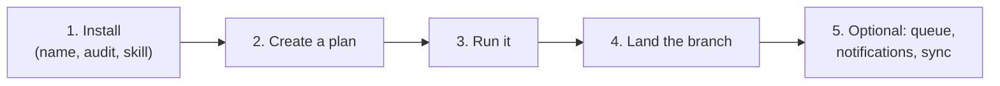
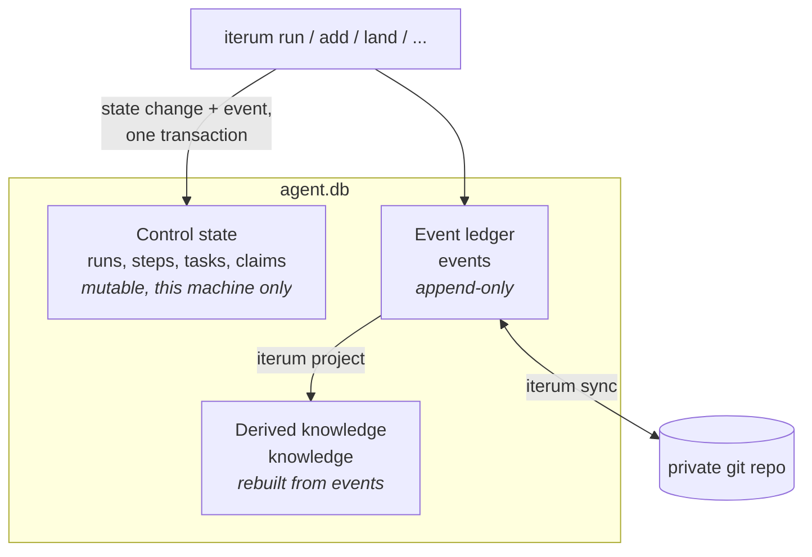
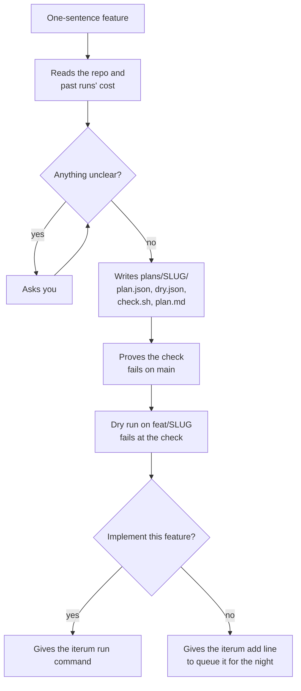
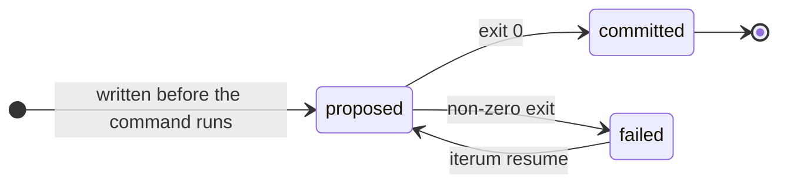
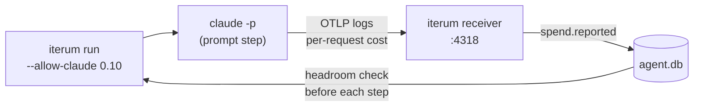
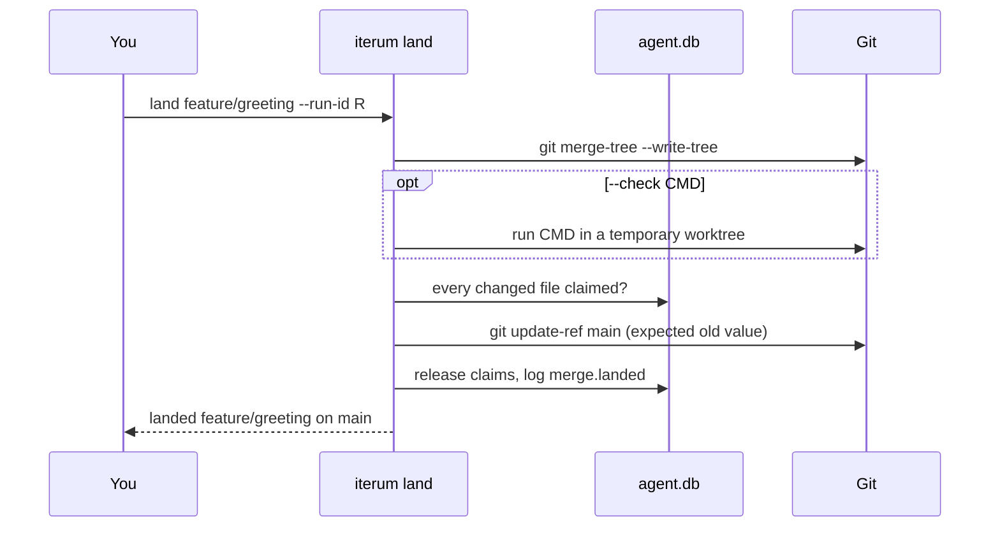

# Setup guide

This guide takes you from a fresh clone to a first run you can kill, resume and land. Each part ends with a check, so you know it worked before moving on. The command output shown here comes from a run against a scratch database on 2026-11-14.



## What you need

| Requirement | Why | Get it |
| --- | --- | --- |
| Python 3.14 | `uuid.uuid7()` and newer syntax in `fleet/doctor.py` and `fleet/view.py` | [python.org](https://www.python.org/downloads/) or `uv python install 3.14` |
| [uv](https://docs.astral.sh/uv/) | Installs the `iterum` command | [Installing uv](https://docs.astral.sh/uv/getting-started/installation/) |
| git | Plans run on branches; `iterum land` merges them | [git-scm.com](https://git-scm.com/) |
| [Claude Code](https://code.claude.com/docs) (`claude`) | Runs the `fleet-plan` skill and prompt steps; the doctor also checks for it | [Quickstart](https://code.claude.com/docs/en/quickstart) |

## How the pieces fit

Everything Iterum knows lives in one SQLite file, `agent.db`. It keeps three kinds of data apart:



You never write to the ledger by hand. The commands do it, and `iterum project` proves the knowledge table can be rebuilt from the ledger alone.

## 1. Install

```bash
git clone https://github.com/shaynemeyer/iterum.git && cd iterum
./install.sh
```

`install.sh` stops at the first step that fails. In order, it:

1. Asks for a name for this machine, offering its hostname. Every event records the device that wrote it, and any command that writes an event refuses to run without one. Set `ITERUM_DEVICE` first to skip the question; without a terminal to ask on, the script requires it.
2. Installs the `iterum` command with `uv tool install --editable .`. The install is editable, so a later `git pull` updates the command.
3. Audits this machine (`iterum doctor`, which writes `./harness-audit.json`) and records the audit as the first events in the ledger (`uv run scripts/seed-ledger.py`).
4. Builds knowledge from the ledger (`iterum project`). The first run reports DRIFT, because the knowledge table starts empty; the script runs it again and expects MATCH.
5. Installs the Claude Code plugin from this checkout, which adds the `/iterum:fleet-plan` skill ([Claude Code plugin docs](https://code.claude.com/docs/en/plugins/publish.md)). If `claude` is not installed, it skips this and prints the two commands to run later.

The doctor grades seven layers of your Claude Code setup. On a fresh machine most say `NOTHING`, which is expected:

```text
execution      IMPLEMENTED  2.1.325 (Claude Code)
tooling        NOTHING      no .claude/agents/*.md
...
6 of 7 layers: NOTHING
wrote harness-audit.json
```

At the end it prints the lines to add to your shell profile (for example `~/.zshrc`). Add them, then open a new terminal:

```bash
export ITERUM_DEVICE=laptop            # the name you gave
export ITERUM_HOME=/path/to/iterum     # printed only if you cloned somewhere other than ~/github/iterum
```

The skill writes plans to `$ITERUM_HOME/plans/` (gitignored). If your shell cannot find `iterum`, run `uv tool update-shell` and open a new terminal.

The database goes to `~/.local/share/iterum/agent.db` (or `$XDG_DATA_HOME/iterum/agent.db`). Set `ITERUM_DB` only if you want it elsewhere.

> **Trying things out?** Point `ITERUM_DB` at a throwaway file, such as `ITERUM_DB=/tmp/scratch.db`, and nothing touches your real database.

**Check:** `iterum status` prints one screen and exits 0:

```text
FLEET     not frozen
SPEND     no ceiling set
RECEIVER  not configured (OTEL_EXPORTER_OTLP_LOGS_ENDPOINT unset; source .env.example)
...
NEEDS A PERSON  nothing
```

`claude plugin list` shows `iterum@iterum` with `Status: ✔ enabled`, and typing `/iterum:fleet-plan` in a Claude Code session started from your app repo offers the skill. It is the preferred way to create a plan: it turns a one-sentence feature request into a plan, a check script and a plain-words summary, and proves the plan for free before anything is billed.

## 2. Create a plan

A plan is a JSON list of steps: `[seq, intent, command, [resources]]`. A command is a shell string or a prompt, `{"prompt": "...", "model": "..."}`. Resources are the files the run claims, such as `"file:app/page.tsx"`.

### With `/iterum:fleet-plan` (preferred)

Start Claude Code from the root of the app repo the feature is for, and describe the feature in one sentence:

```text
/iterum:fleet-plan tag names on a note link to that tag's page
```



What it does, in order:

1. **Asks until nothing is open.** It writes no file while a question is unresolved: which files change, what counts as done, the model and the cap per prompt step.
2. **Keeps the plan small.** One prompt step touching one to three files. A bigger feature gets a list of chunks, and you pick one.
3. **Writes four files** in `plans/<slug>/`: `plan.json` (prompt, build, check, commit, every step claiming the same files), `dry.json` (the same with the prompt replaced by `echo dry`), `check.sh` (exits 0 when the feature is there, and lists every miss otherwise) and `plan.md`.
4. **Proves it for free.** The check must fail on `main`, and the dry run must fail at the check, on a scratch database.
5. **Asks before spending.** It shows `plan.md` and gives you the commands; it never starts the paid run itself.

The command it gives looks like this:

```bash
iterum run ~/github/iterum/plans/<slug>/plan.json --allow-claude <cap> --fix-retries 2 \
  --land-check "<install> && <build>"
```

The skill's own instructions are in [`plugins/iterum/skills/fleet-plan/SKILL.md`](../plugins/iterum/skills/fleet-plan/SKILL.md).

### By hand

Write the JSON yourself when you want to learn the mechanics or need a shell-only plan. This one is free and is used in the rest of this guide. Save it as `hello.json` outside your app repo:

```json
[[1, "write the greeting", "echo 'hello, iterum' > hello.txt", ["file:hello.txt"]],
 [2, "check it", "grep -q iterum hello.txt", ["file:hello.txt"]],
 [3, "commit it", "git commit -qam 'Greeting'", ["file:hello.txt"]]]
```

## 3. Run it

Iterum records each step as `proposed` before it runs and `committed` after, so a run killed at any point can resume where it stopped.



Run plans from the repo they work on, not from this one. A plan that declares files must run on a branch other than `main`, so the merge gate can land it later:

```bash
git switch -c feature/greeting
iterum run /path/to/hello.json
```

```text
run 2fe23f9e2eaa started
  step 1  write the greeting  -> committed
  step 2  check it  -> committed
  step 3  commit it  -> committed
run 2fe23f9e2eaa done
land with: iterum land feature/greeting --run-id 2fe23f9e2eaa --fence file:hello.txt=1
```

### When a step fails

A failed step stops the run and exits 1. Fix the step's command in the plan and resume. Committed steps are skipped:

```text
run a28210717b79 failed: step failed with exit 1:
```

```bash
iterum resume a28210717b79 --plan /path/to/fail.json
```

```text
resuming a28210717b79, 1 step(s) already committed
  step 1  already committed, skipping
  step 2  check  -> committed
  step 3  commit  -> committed
run a28210717b79 done
```

Resume refuses if the plan's intents changed, or a committed step's command changed. `iterum recovery` lists runs that died.

### Prompt steps (billed)

Plans from `/iterum:fleet-plan` start with a prompt step. It runs `claude -p` with only `Read`, `Edit` and `Write`, file tools confined to the working directory, and is billed to your account. A prompt step must declare the files it may edit, and the run needs `--allow-claude <usd>`, the cap per step. With `--fix-retries N`, a failed build or check after the prompt step reruns the prompt with the error appended, up to N times (each billed).

Under a spend ceiling, the run also needs the telemetry receiver, so spend is recorded:



```bash
iterum budget set 1.00                      # fleet-wide ceiling, in USD
iterum receiver                             # in its own terminal
source ~/github/iterum/.env.example         # telemetry settings for Claude Code
iterum run plan.json --allow-claude 0.10
```

The receiver answers `GET /v1/logs` with the database it writes to, which must match the run's. See [telemetry/claude-code-telemetry.md](telemetry/claude-code-telemetry.md) and [claude-step-design.md](claude-step-design.md).

## 4. Land the branch

`iterum land` merges the branch only while every changed file still has a live claim from the run. Run it from the repo, on `main` or detached at it: it detaches a clean `main` checkout itself, lands, and leaves you on `main` with the new commit. It refuses when `main` has local changes, or is checked out in another worktree.



```bash
iterum land feature/greeting --run-id 2fe23f9e2eaa --fence file:hello.txt=1
```

```text
landed feature/greeting on main as a8fc15f9c463
checkout on main at a8fc15f9c463
```

Add `--check "<install> && <build>"` to run your build on the merged tree before landing. The check runs in a fresh copy with no dependencies, so it must install them first. A failing check refuses the landing and keeps the claims. A run started with `--land-check` prints the whole command for you.

**Check:** `iterum report --open` shows the day's runs as an HTML page, with unlanded runs under Ready to land.

## 5. Optional extras

### The work queue

Queue a plan and let a worker run it. When you answer no to "Implement this feature?", `/iterum:fleet-plan` gives you this line ready-made:

```bash
iterum add --plan /path/to/plan.json --allow-claude 0.05 --fix-retries 2 --repo . --branch feature/queued
iterum budget suggest
iterum worker w1 --budget-s 1800 --until-empty --max-usd 0.50
```

`iterum budget suggest` prints each queued task's worst case, (prompt steps + fix retries) x cap, its typical cost from past prompt steps on the same model, and the worker line with `--max-usd` at the sum of the worst cases. It changes nothing. `--max-usd` is the most the worker's own runs may spend; interactive sessions do not count. It stops before a claim, or before a step, that would pass it, and leaves the rest queued. It needs the telemetry receiver, as a ceiling does.

```text
task 1 queued: iterum run --plan /path/to/plan.json --allow-claude 0.05 --fix-retries 2
w1  night de79f0a7fb33: at most 0.50 USD
w1  task 1 (shell)  done
w1  queue empty, stopping
w1  report: ~/.local/share/iterum/reports/report-<date>.html
```

`--until-empty` stops the worker once no task is ready or in progress, with no time limit unless you also give `--budget-s`. Without it, the worker keeps polling until `--budget-s` (default 12 seconds) runs out; a task already running finishes, and the worker prints how many tasks it left queued. Either way, it writes today's report when it stops.

With `--repo` and `--branch`, the worker creates the branch from `main`, runs the command on it, then leaves the repo detached at `main`, ready for `iterum land`. `iterum dlq` lists tasks that ran out of attempts.

### Notifications

Set `ITERUM_NOTIFY` to a shell command, and each worker runs it once when it stops, after writing the report, with a short summary on stdin:

```text
Iterum: w1 stopped
runs: 1 done, 1 failed
ready to land: 0
needs a person: 2
spend today: $0.42 (runs $0.30)
report: ~/.local/share/iterum/reports/report-<date>.html
```

The numbers are today's, as on the report page. A failure counts under "needs a person" once as a failed run and once as a dead-lettered task. Unset, nothing is sent. A command that fails prints `notify: exit <code>`; one still running after 30 seconds is killed, with anything it started, and prints `notify: timed out after 30s`. Neither changes the worker's exit code.

On macOS, a desktop notification (tested):

```bash
export ITERUM_NOTIFY='osascript -e "on run argv" -e "display notification (item 1 of argv) with title \"Iterum\"" -e "end run" "$(cat)"'
```

It shows as from **Script Editor**: `display notification` has no option to change the sender ([Apple: Displaying Notifications](https://developer.apple.com/library/archive/documentation/LanguageUt/Conceptual/MacAutomationScriptingGuide/DisplayNotifications.html)). If nothing appears, allow notifications for Script Editor in System Settings, Notifications. It reaches you only at that Mac; overnight it waits in Notification Center.

Other channels, not tested here:

```bash
export ITERUM_NOTIFY='notify-send Iterum "$(cat)"'          # Linux desktop
export ITERUM_NOTIFY='mail -s Iterum you@example.com'      # needs a working mail setup
export ITERUM_NOTIFY='jq -Rs "{text: .}" | curl -s -H "Content-Type: application/json" --data @- "$SLACK_WEBHOOK_URL"'   # Slack incoming webhook
```

The summary never carries code, file contents or error text, but it does carry the report's path, which names your home folder.

### Sync across machines

`iterum sync` shares the ledger through a private git repo. Each device writes only its own events file, so git never has a conflict. See [sync.md](sync.md).

## Settings

| Variable | Default | Purpose |
| --- | --- | --- |
| `ITERUM_DEVICE` | required | Names this device in every event |
| `ITERUM_DB` | `~/.local/share/iterum/agent.db` | Database path |
| `ITERUM_SYNC_DIR` | `~/private-data/iterum` | Folder for exported events, inside a private git repo |
| `ITERUM_CLAIM_TTL` | `300` | Seconds a file claim lasts between renewals |
| `ITERUM_IDLE_SECONDS` | `60` | Heartbeat age after which a running run counts as dead |
| `ITERUM_MAX_ATTEMPTS` | `3` | Attempts at one step before `iterum recovery` halts the run |
| `ITERUM_NOTIFY` | unset | A shell command each worker runs when it stops, with a summary on stdin ([Notifications](#notifications)) |
| `FLEET_TASK_TIMEOUT_S` | `600` | Seconds one queue task's command, usually a whole `iterum run`, may run; then it is killed and the task fails |
| `FLEET_WORKER_BUDGET_S` | `12` | `iterum worker`'s default `--budget-s`, used when neither `--budget-s` nor `--until-empty` is given |
| `FLEET_WORK_MODULE` | unset | A module exporting `do_work(task)`, used by `iterum worker` instead of the task's shell command |

## Troubleshooting

| Symptom | Cause and fix |
| --- | --- |
| `iterum: command not found` | Run `uv tool update-shell` and open a new terminal |
| A command complains about `ITERUM_DEVICE` | Set it in your shell profile (step 1) |
| First `iterum project` says DRIFT | Expected after new audit events, such as a first seed; run it again and it says MATCH |
| "a plan that declares files must not run on main" | Switch to another branch |
| `iterum land` refuses | `main` has local changes or is checked out in another worktree, or a changed file has no live claim |
| `iterum worker` stops: "a spend limit is set, but claude would not report its spend" | With a ceiling or `--max-usd` set, `source .env.example` and run `iterum receiver` first |
| `/iterum:fleet-plan` is not offered | Run `claude plugin list`; install it (step 1) and start a new session |
| The skill cannot find Iterum | Set `ITERUM_HOME` to your checkout |
| `RECEIVER not configured` in status | Only matters for prompt steps; `source .env.example` and start `iterum receiver` |

[CLAUDE.md](../CLAUDE.md) lists every command and flag.
