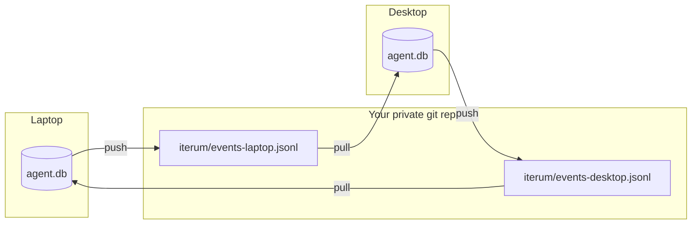

# Cross-device sync: user guide

Use Iterum on more than one computer and keep every machine's history in step. Sync is optional; Iterum works on a single machine without it.

## How it works, in one minute

Each computer keeps its own `agent.db`. The database file itself never moves. Instead, each computer writes the **events** it created to a small text file in a **private git repo**, and reads every other computer's file from there.



Each computer writes only its own file, so git never has a conflict to resolve. Events are never edited, so merging is simply adding the events a computer hasn't seen yet. One command does all of it:

```bash
uv run python -m fleet.sync sync
```

## Before you start

You need:

- **Iterum set up on your first computer,** following the [README](../README.md#setup).
- **git,** with access to a host that offers private repos, such as GitHub.
- **Optionally, the [GitHub CLI](https://cli.github.com/) (`gh`)** signed in with `gh auth login`. The steps below use it, and each step that does includes a manual alternative.

## Part 1: Set up your first computer

### Step 1. Name this computer

Choose a short name that's unique to this machine, such as `laptop` or `work-mac`. Add it to your shell profile, for example `~/.zshrc` or `~/.bashrc`:

```bash
export ITERUM_DEVICE=laptop
```

Open a new terminal, then check it:

```bash
echo $ITERUM_DEVICE
```

You should see `laptop`.

> **Choose carefully.** The name is stored permanently in every event this computer writes, and two computers must never share a name.

### Step 2. Create the private data repo

By default, Iterum keeps sync files in `~/private-data/iterum`. The repo can hold other projects' data as well; Iterum only ever commits its own file.

```bash
git init -b main ~/private-data
git -C ~/private-data commit --allow-empty -m "Initial commit"
gh repo create private-data --private --source ~/private-data --push
```

**Without `gh`:** create an empty **private** repo on your git host, then run:

```bash
git -C ~/private-data remote add origin <your-private-repo-url>
git -C ~/private-data push -u origin main
```

Check that it's connected:

```bash
git -C ~/private-data status -sb
```

You should see `## main...origin/main`.

> **Keep this repo private.** It contains everything your agents did.

To keep sync files somewhere else, set `ITERUM_SYNC_DIR` to a folder inside any git repo that has a remote.

### Step 3. Run your first sync

From the Iterum folder:

```bash
uv run python -m fleet.sync sync
```

You should see something like:

```text
exported 9 new events to /Users/you/private-data/iterum/events-laptop.jsonl (9 total)
imported 0 new events from 1 files in /Users/you/private-data/iterum
knowledge rebuilt
```

Your events are now in the private repo. Check with:

```bash
git -C ~/private-data log --oneline
```

The newest commit should be `iterum: sync laptop`.

## Part 2: Add another computer

On the second computer:

### Step 1. Get both repos

```bash
git clone <your-private-repo-url> ~/private-data
```

Then clone Iterum and install it as described in the [README](../README.md#setup). You can skip the `doctor` and `seed-ledger` steps; sync brings the history across.

### Step 2. Give it its own name

Add a **different** name to this computer's shell profile, then open a new terminal:

```bash
export ITERUM_DEVICE=desktop
```

### Step 3. Sync

```bash
uv run python -m fleet.sync sync
```

You should see the first computer's events arrive:

```text
exported 0 new events to /Users/you/private-data/iterum/events-desktop.jsonl (0 total)
imported 9 new events from 2 files in /Users/you/private-data/iterum
knowledge rebuilt
```

`sync` creates `agent.db` on this computer if it doesn't exist yet.

### Step 4. Check both computers agree

Run `sync` once more on **each** computer, then run this on each:

```bash
sqlite3 agent.db "select device, count(*) from events group by device"
```

Both computers should show the same devices and the same counts.

## Day to day

Run `sync` whenever you want your computers to catch up, for example when you start or finish working:

```bash
uv run python -m fleet.sync sync
```

What it does, in order:

| Step | What happens |
| --- | --- |
| 1. Export | Adds this computer's new events to `events-<ITERUM_DEVICE>.jsonl`; events already in the file are always kept |
| 2. Commit | Commits **only** that file, and only if it changed |
| 3. Pull | Fetches other computers' files; your other uncommitted work in the repo is set aside and restored |
| 4. Push | Sends this computer's file |
| 5. Import | Adds events this computer hasn't seen; events it already has are skipped |
| 6. Rebuild | Rebuilds the `knowledge` table from all events |

Every step is safe to repeat. If anything fails, fix the problem and run `sync` again.

Sync isn't live: a computer sees another's events only after **both** have run `sync`.

## Recovering a computer

If a computer loses its `agent.db`, run `sync` again. It recreates the database and imports every event, including the ones that computer wrote itself. Export only ever adds to a file, so an empty database can't wipe the computer's history from the repo.

If the computer is rebuilt from scratch, follow [Part 2](#part-2-add-another-computer). You can reuse its old name if the old machine is gone for good.

## Rules

- **Every computer needs a unique `ITERUM_DEVICE`.** Two machines sharing a name write the same file and will conflict in git.
- **Never edit or delete `events-*.jsonl` by hand.** A retired computer's file is the only shared copy of its events.
- **Keep the data repo private.**

## What syncs and what doesn't

| Data | Synced? |
| --- | --- |
| `events` | Yes |
| `knowledge` | Rebuilt on each computer from the events |
| `runs`, `steps`, `receipts` | No: they're updated in place, so they can't be merged this way |
| `claims`, `fences`, `leases`, `tasks`, `budgets`, `approvals`, `evals`, `eval_results` | No: they coordinate work on one computer |

## Troubleshooting

| You see | Why | Fix |
| --- | --- | --- |
| `RuntimeError: ITERUM_DEVICE is not set` | No device name in this terminal | Add it to your shell profile and open a new terminal |
| `fatal: not a git repository`, then `git add failed` | The sync folder isn't inside a git repo | Do [Step 2](#step-2-create-the-private-data-repo), or point `ITERUM_SYNC_DIR` at a repo |
| `There is no tracking information for the current branch`, then `git pull failed` | The repo has no remote, or `main` isn't linked to it | `git -C ~/private-data push -u origin main` |
| `git push failed` | Usually another computer pushed between your pull and push | Run `sync` again |
| `sqlite3.IntegrityError` or `ProgrammingError` during import | A damaged line in an `events-*.jsonl` file | Nothing was imported. Find the change with `git -C ~/private-data log -p` and restore the file from history |
| `fleet.project` reports DRIFT after an import | New events produced new knowledge | Expected; the next run reports MATCH |

## Single steps

For when you want just one part of `sync`:

```bash
uv run python -m fleet.sync export    # write this computer's events
uv run python -m fleet.sync import    # merge every computer's events
uv run python -m fleet.project        # rebuild knowledge
```

## Settings

| Variable | Default | Purpose |
| --- | --- | --- |
| `ITERUM_DEVICE` | required | This computer's unique name |
| `ITERUM_SYNC_DIR` | `~/private-data/iterum` | Folder for sync files, inside a git repo with a remote |
| `ITERUM_DB` | `agent.db` | Path to this computer's database |
