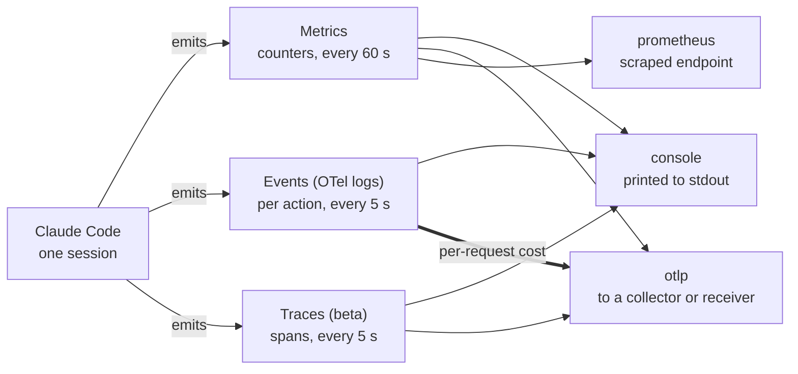
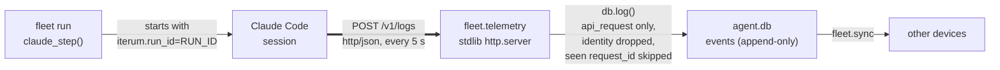

# Claude Code Telemetry

Claude Code can export what a session does, including the cost of every API request, through OpenTelemetry. This document covers what it emits, how to turn it on, which fields arrive, what is private by default, and how the iterum fleet records spend from it.

Every claim carries a tag: **[Docs]** for the monitoring documentation, **[T1]**–**[T7]** for seven local tests. See [Sources](#sources).

Claude Code 2.1.322. Tests run 2026-11-10.

## The pipeline

A session produces three signals. Each signal has its own exporter setting, and each exporter sends to a different kind of destination. Telemetry is turned on with `CLAUDE_CODE_ENABLE_TELEMETRY=1` [T1].



Each signal picks its exporters with its own variable, and `none` turns a signal off. OTLP takes `grpc`, `http/json` or `http/protobuf`. Prometheus is listed for metrics only. Events over OTLP carry per-request cost and are the path iterum plans to use. Intervals are the documented defaults [Docs].

## Turning it on

Configuration is entirely environment variables, read when Claude Code starts. The quickest way to see output is the console exporter, which is how the first two tests ran [T1] [T2]:

```bash
export CLAUDE_CODE_ENABLE_TELEMETRY=1
export OTEL_METRICS_EXPORTER=console
export OTEL_LOGS_EXPORTER=console
export OTEL_METRIC_EXPORT_INTERVAL=1000   # ms, shortened for testing
export OTEL_LOGS_EXPORT_INTERVAL=1000
export OTEL_RESOURCE_ATTRIBUTES=iterum.run_id=test123
```

To send only events to the iterum receiver, use the settings in the repo's `.env.example`. Test T3 used the same transport against a throwaway server [T3]; the shorter interval comes from the kill tests [T5] [T6]:

```bash
export CLAUDE_CODE_ENABLE_TELEMETRY=1
export OTEL_METRICS_EXPORTER=none
export OTEL_LOGS_EXPORTER=otlp
export OTEL_EXPORTER_OTLP_LOGS_PROTOCOL=http/json
export OTEL_EXPORTER_OTLP_LOGS_ENDPOINT=http://127.0.0.1:4318/v1/logs
export OTEL_LOGS_EXPORT_INTERVAL=1000   # ms; a kill -9 loses at most one interval
```

| Variable | Values | Default | Source |
| --- | --- | --- | --- |
| `CLAUDE_CODE_ENABLE_TELEMETRY` | `1` to turn telemetry on | | T1 |
| `OTEL_METRICS_EXPORTER` | `console`, `otlp`, `prometheus`, `none`; comma-separated for several | | Docs |
| `OTEL_LOGS_EXPORTER` | `console`, `otlp`, `none` | | Docs |
| `OTEL_TRACES_EXPORTER` | `console`, `otlp`, `none` (beta) | | Docs |
| `OTEL_EXPORTER_OTLP_PROTOCOL` | `grpc`, `http/json`, `http/protobuf`; applies to all signals | none: "Claude Code has no default protocol" | Docs |
| `OTEL_EXPORTER_OTLP_LOGS_PROTOCOL`, `OTEL_EXPORTER_OTLP_METRICS_PROTOCOL` | Same three values; override the general setting | | Docs, T3 |
| `OTEL_EXPORTER_OTLP_ENDPOINT` | Collector endpoint for all signals, e.g. `http://localhost:4317` | | Docs |
| `OTEL_EXPORTER_OTLP_LOGS_ENDPOINT`, `OTEL_EXPORTER_OTLP_METRICS_ENDPOINT` | Per-signal full URL, e.g. `http://localhost:4318/v1/logs` | | Docs, T3 |
| `OTEL_METRIC_EXPORT_INTERVAL` | milliseconds | 60000 | Docs |
| `OTEL_LOGS_EXPORT_INTERVAL` | milliseconds | 5000 | Docs |
| `OTEL_TRACES_EXPORT_INTERVAL` | milliseconds (beta) | 5000 | Docs |
| `OTEL_RESOURCE_ATTRIBUTES` | Your own `key=value` pairs, comma-separated | | Docs, T1 |

The docs also cover mTLS, dynamic headers and managed settings for organizations. Those are out of scope here.

## Two views of the same cost

Cost arrives twice. The metric `claude_code.cost.usage` (unit USD) is a counter "incremented after each API request" [Docs]. Each exported datapoint is the running total for the session so far [T2]. The event `claude_code.api_request` arrives once per request and carries that request's `cost_usd`, described as "Estimated cost in USD" [Docs].

In a four-request session, the four event costs summed exactly to the counter's final value, $0.00541548 [T2]. The events alone account for the whole session.

Test T2: one Haiku session that read three files, four API requests.

| Request | request_id (truncated) | cost_usd | Counter after |
| --- | --- | ---: | ---: |
| 1 | `req_011CguT5T45v…` | 0.00427264 | 0.00427264 |
| 2 | `req_011CguT5bnT5…` | 0.00041860 | 0.00469124 |
| 3 | `req_011CguT5hZip…` | 0.00038906 | 0.00508030 |
| 4 | `req_011CguT5oQTN…` | 0.00033518 | 0.00541548 |

The first request cost about ten times as much as each later one. The counter's datapoints at each export matched the running sum.

- **Metric `claude_code.cost.usage`:** a cumulative counter per session, exported every 60 s by default. The right shape for a dashboard that shows totals. Re-exporting the same total every interval makes it the wrong shape for an append-only log.
- **Event `claude_code.api_request`:** one record per request, exported every 5 s by default, with model, token counts, duration and a `request_id`. Each record can be stored once and summed later.

Use `cost_usd`, not `cost_usd_micros`, when summing. The micros field is rounded per request: T1 reported `4125` for `0.00412534` [T1]. The float carries noise such as `0.004272639999999999` [T2], so round only when displaying.

## One `api_request` record

An OTel log record has two layers. Resource attributes describe the process that sent it. Record attributes describe the event. Below is the record from test T1, with identity fields shown by name only [T1].

**Resource attributes** (same for every record from the session):

| Key | Value |
| --- | --- |
| `iterum.run_id` | `"test123"` |
| `service.name` | `"claude-code"` |
| `service.version` | `"2.1.322"` |
| `os.type` | `"darwin"` |
| `host.arch` | `"arm64"` |

`iterum.run_id` came from `OTEL_RESOURCE_ATTRIBUTES`. It also appeared on the record's own attributes.

**Record attributes** (body: `claude_code.api_request`):

| Key | Value |
| --- | --- |
| `iterum.run_id` | `"test123"` |
| `session.id` | `"937aa3ad-…"` |
| `event.name` | `"api_request"` |
| `event.sequence` | `17` |
| `prompt.id` | `"d3b13c09-…"` |
| `model` | `"claude-haiku-5-5"` |
| `input_tokens` | `2` |
| `output_tokens` | `4` |
| `cache_read_tokens` | `9074` |
| `cache_creation_tokens` | `20162` |
| `cost_usd` | `0.00412534` |
| `cost_usd_micros` | `4125` |
| `duration_ms` | `1571` |
| `ttft_ms` | `1559` |
| `request_id` | `"req_011CguSu…"` |
| `query_source` | `"sdk"` |
| `user.email`, `user.id`, `user.account_uuid`, `user.account_id`, `organization.id` | present on every record, values omitted here |

Over OTLP `http/json`, the same fields arrive as typed values: `cost_usd` as `doubleValue`, token counts as `intValue`, ids as `stringValue` [T3]. On the same requests, `query_source` was `"sdk"` on the event and `"main"` on the metric datapoint [T2], so it is not a join key.

## Attributes

Attributes are what let a record be tied back to a session, a user, or your own unit of work. The docs group them by whether they are on by default [Docs].

| Attribute | Controlled by | Default |
| --- | --- | --- |
| `session.id` | `OTEL_METRICS_INCLUDE_SESSION_ID` | on [T1] |
| `user.account_uuid`, `user.account_id` | `OTEL_METRICS_INCLUDE_ACCOUNT_UUID` | on [T1] |
| Keys from `OTEL_RESOURCE_ATTRIBUTES` | `OTEL_METRICS_INCLUDE_RESOURCE_ATTRIBUTES` | on [T1] |
| `user.id`, `user.email`, `organization.id`, `terminal.type` | none | always, when available [T1] |
| `app.version` | `OTEL_METRICS_INCLUDE_VERSION` | off |
| `app.entrypoint` | `OTEL_METRICS_INCLUDE_ENTRYPOINT` | off |
| `vcs.repository.url.full` and other `vcs.*` | `OTEL_METRICS_INCLUDE_REPOSITORY` | off |
| `prompt.id`, `event.sequence`, `agent_id`, `parent_agent_id` and others | none | events only, never on metrics |

The docs explain the last row: those attributes are "never attached to metrics because they would cause unbounded cardinality" [Docs]. A metric store keeps one series per distinct attribute set, and an id that changes every prompt would create a series per prompt.

### Adding your own key

`OTEL_RESOURCE_ATTRIBUTES` takes comma-separated `key=value` pairs. The documented rules [Docs]:

- Values cannot contain spaces, and wrapping them in quotes does not help. Percent-encode anything outside plain ASCII, for example `%20`.
- If one value is malformed, Claude Code "copies none of the keys onto events or datapoints and reports no error".
- A custom key cannot replace a built-in one: "when a key collides, Claude Code keeps the built-in value."

Tested: `iterum.run_id=test123` appeared on the resource, on every event, and on every metric datapoint, including both cost records [T1] [T2].

## Privacy defaults

Content is off by default. Identity is on [Docs].

**Off unless you opt in:**

- `OTEL_LOG_USER_PROMPTS`: "User prompt content is not collected by default. Only prompt length is recorded."
- `OTEL_LOG_TOOL_DETAILS`: tool input arguments and parameters are not logged by default.
- `OTEL_LOG_ASSISTANT_RESPONSES`, `OTEL_LOG_TOOL_CONTENT`, `OTEL_LOG_RAW_API_BODIES`: also disabled by default.

**On by default:** user email, user and account ids, and organization id. In tests T1 and T2, all five identity fields were on every single record [T1]. Anything that stores or forwards these records should decide which of these fields to keep before writing anything.

## How iterum records spend

Decision recorded 2026-11-10 in [decision-log.md](../decision-log.md). Spend becomes ledger events, one per `api_request`. The ledger's `events` table is the only one that syncs between devices, and it is append-only, which matches one record per request.

`fleet/telemetry.py` is the receiver. Start it with `uv run python -m fleet.telemetry` (port 4318), and give Claude Code the settings in `.env.example`, which also shortens the logs export interval to 1000 ms (see [T5]–[T6]). Each `api_request` becomes one `spend.reported` event with stage `governance`, which `fleet.view stages` leaves out because spending is not a failure. The payload keeps `request_id`, `model`, `cost_usd`, token counts, `duration_ms` and `session_id`.



`claude_step()` sets `OTEL_RESOURCE_ATTRIBUTES=iterum.run_id=<run_id>` in the session's environment, so every cost record names the run that paid for it (wired in 2026-11-11; seen in the first paid run, [T7]). Sessions that fleet did not start are logged under `session-<session.id>` [T4].

Two options were rejected. Writing `runs.cost_usd` would keep spend on one machine, because `runs` never syncs, and an update keeps no history. Importing the `cost.usage` metric would store a running total that the events already add up to.

## The tests

All ran `claude -p` on Haiku in a scratch directory with Claude Code 2.1.322. T1–T4 together cost about $0.018; T7 cost $0.0172.

| Test | Setup | Result |
| --- | --- | --- |
| T1 | One request. Console exporters for metrics and logs, 1 s intervals, `iterum.run_id=test123`. | `iterum.run_id` and `session.id` on every record. One `api_request` with `cost_usd` 0.00412534, `cost_usd_micros` 4125. Five identity fields on every record. |
| T2 | Read three files, one Read call per turn. Same exporters, `iterum.run_id=multi1`. | Four `api_request` events, four distinct `request_id`s. Costs summed to 0.00541548, equal to the counter's last datapoint. |
| T3 | Metrics `none`. Logs `otlp` over `http/json` to a standard-library `http.server` on 127.0.0.1:14318. | Three POSTs to `/v1/logs`, all `application/json`. The `api_request` record carried `iterum.run_id`, `request_id` and `cost_usd`. Nothing else was sent. |
| T4 | Read two files. Logs sent to `fleet.telemetry` with the `.env.example` settings, `iterum.run_id=real1`. | Three requests became three `spend.reported` events under `real1`, each with its own `request_id`. No identity field was stored. A synthetic body sent twice, with a duplicate `request_id` and a record without `iterum.run_id`, wrote each request once and logged the second under `session-<session.id>`. |
| T5 | Read files one per turn, logs to `fleet.telemetry` at the default 5000 ms interval, SIGKILL at 10 s. | Three requests completed (by `requestId` in the session transcript); 1 reached the ledger. The two that finished 2.3 s and 4.2 s after the first were lost. |
| T6 | Same as T5 with `OTEL_LOGS_EXPORT_INTERVAL=1000`. | Three requests completed; 3 reached the ledger. |
| T7 | The first paid `fleet.run` prompt step (`claude-step-design.md` section 6): Haiku 5.5, `.env.example` settings, a normal exit. | Three `spend.reported` events under the run's id, the last written 0.28 s before `claude_step()` logged `claude.finished`. Their `cost_usd` summed to 0.01722868, equal to the envelope's `total_cost_usd`. |

## What a killed session loses

Claude Code buffers events and posts them once per export interval. A `kill -9` loses everything that finished since the last post. Two runs, each killed at 10 s after three completed requests, show the effect of the interval [T5] [T6]:

| Run | Logs export interval | Requests completed | Reached the ledger | Lost |
| --- | --- | ---: | ---: | ---: |
| T5 | 5000 ms (default) | 3 | 1 | 2 |
| T6 | 1000 ms | 3 | 3 | 0 |

iterum's `.env.example` sets `OTEL_LOGS_EXPORT_INTERVAL=1000`, so a hard kill loses at most about one second of spend. This is one run per setting, and a request still running at the kill appears in neither the transcript nor telemetry.

## Not yet known

- **A request in flight when a session is killed.** A SIGKILL loses what finished since the last export: two of three requests at 5000 ms, none at 1000 ms, one run each [T5] [T6]. A request still running at the kill appears in neither the transcript nor telemetry. A normal exit lost nothing in one run [T7]: every request was in the ledger before `claude_step()` returned.
- **Sessions with more than one model,** such as a subagent on a different model. All tests used one model.
- **Whether `request_id` is guaranteed unique.** It was unique in every request seen so far (seven across T2 and T4). The docs were not checked on this point.
- **How exact the figures are.** The field is labeled "Estimated cost in USD". Treat the numbers as a way to compare agents, not as billing.

## Sources

1. **[Docs]** [Monitoring usage, Claude Code docs](https://code.claude.com/docs/en/monitoring-usage). Read on 2026-11-10 through an automated fetch. The configuration table, exporter and protocol values, export intervals, attribute rules and privacy settings were read word for word. A middle part of the page, covering example configurations and part of the event reference, came back only as a summary, so nothing here relies on that part alone.
2. **[T1]–[T7]** Local runs on 2026-11-10 (T1–T6) and 2026-11-11 (T7), Claude Code 2.1.322, described above. Raw output stayed on the test machine because it contains account identifiers.
3. [decision-log.md](../decision-log.md), entry "Claude Code spend lands in the ledger, one event per API request" (2026-11-10).
