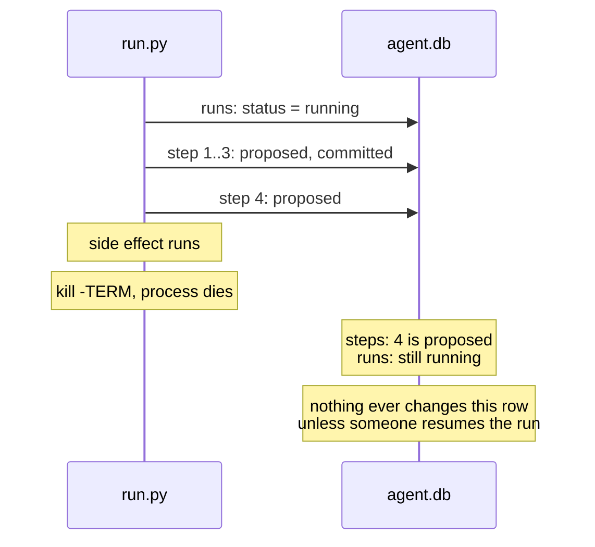
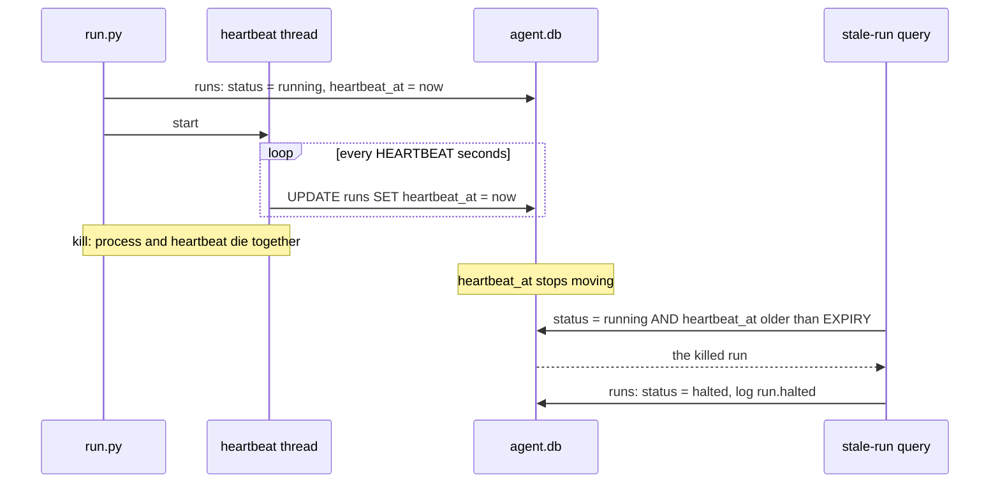

# TODO

## Bug: a killed run stays `running` forever

### What happens

`fleet/run.py` sets a run's status in only two ways: `record_failure()` marks it `failed` when a step's command fails, and `db.finish_run()` marks it `done` when every step has committed. Both run inside the process. When the process itself is killed (SIGTERM, SIGKILL, out-of-memory, power loss), neither runs, so the `runs` row keeps saying `running` until someone resumes it. If nobody does, it says `running` forever, and nothing in the repo looks for such rows.



### How to reproduce

From the repo root (the drill's step 2 lists `fleet/`). The drill writes an `out/` folder there; delete it afterwards.

```bash
export ITERUM_DB=/tmp/stale.db ITERUM_DEVICE=test
uv run python -u -m fleet.run & sleep 2
pkill -TERM -f fleet.run
sqlite3 /tmp/stale.db "SELECT run_id, status FROM runs"
```

The run is listed as `running`, although no process is working on it. Step 4 is `proposed`, and `out/step4.txt` exists.

### Why a shutdown handler is not enough

Catching SIGTERM and marking the run on the way out would cover a polite `kill`, but not SIGKILL, an out-of-memory kill or a power cut. The state has to be correct without the dying process doing anything.

## Plan: a heartbeat and an expiry

A running process keeps proving it is alive. A row whose proof has gone stale is treated as dead, whatever its status says.



### Steps

1. **Schema.** Add `heartbeat_at REAL` to `runs` in `fleet/schema.sql`.
2. **Migration.** `CREATE TABLE IF NOT EXISTS` does not add columns to an existing table, and `ALTER TABLE ... ADD COLUMN` fails if the column is already there. In `db.init()`, check `PRAGMA table_info(runs)` and run the `ALTER TABLE` only when `heartbeat_at` is missing.
3. **Heartbeat.** In `run.py`, set `heartbeat_at` when the run starts or resumes, and run a daemon thread that updates it every `HEARTBEAT` seconds until `execute()` returns. It needs its own connection, since SQLite connections are not shared across threads by default. A thread is needed because a single step can run far longer than the expiry (the drill's step 5 sleeps 20 seconds; a `claude_step()` call can take minutes).
4. **Find stale runs.** Add a query, and a command to run it:

   ```sql
   SELECT run_id, agent, task, heartbeat_at FROM runs
   WHERE status = 'running' AND heartbeat_at < :now - :expiry;
   ```

5. **Mark them.** Set each stale run's status to `halted` (already allowed by the `runs` CHECK constraint) and log a `run.halted` event in the same transaction. Note: `check_resumable()` now refuses `halted` without `--force`, because `fleet/recovery.py` uses `halted` to mean "needs a human". Decide whether a stale run should share that status.
6. **Verify.** Kill the drill, wait past the expiry, and confirm the run is listed, then marked `halted`, then resumes to `done`. Also confirm that a live run with a long step (the drill's step 5) is never listed.

### Open questions

- **Values for `HEARTBEAT` and `EXPIRY`.** The expiry must be several heartbeats long, so one slow write is not mistaken for a death.
- **Who runs the stale-run check:** a command you run by hand, a step at the start of every `run.py` invocation, or a scheduler.
- **Not the `leases` table.** `leases` already has `heartbeat_at` and `expires_at`, but it is keyed by `task_id` and references `tasks`, so it does not cover rows in `runs`.
