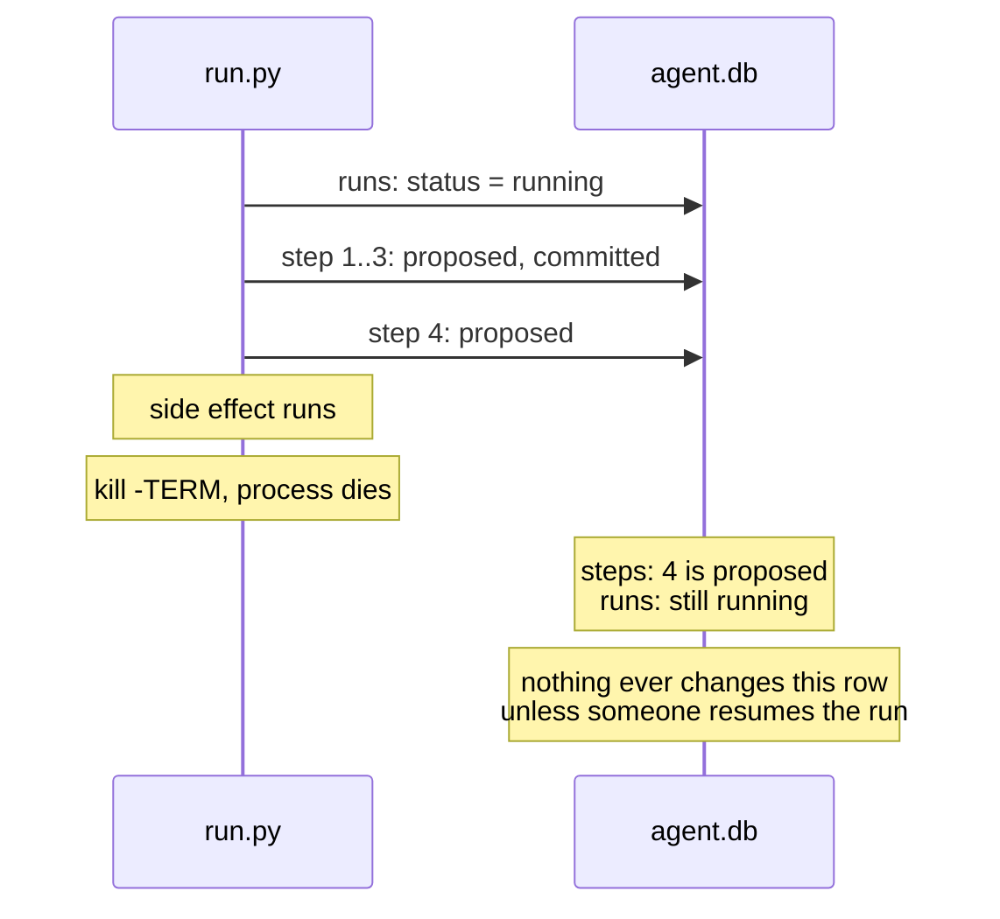

# Work completed

Items moved here from `todo.md` once done. Newest first.

## The worker leaves the app detached, so landing works

Completed 2026-11-14. Moved from `todo.md` (Overnight queue, from the first real night):

> **The worker leaves the app on the base branch, so every landing is refused** ("main is checked out in a worktree"). Return to the base detached instead. Free test: today's scratch-repo tasks, then an `iterum land` that must succeed without a manual detach.

**Change.** `fleet/worker.py`, `_on_branch()`: after a task, the worker runs `git switch --detach <base>` instead of `git switch <base>`, on both the failed and the finished path. `iterum land` refuses a target that is checked out ("main is checked out in a worktree; landing would leave its index behind"), and the worker had been leaving every night on `main`.

**Evidence.** Scratch repo and database. Before: one queued plan finished, the app was on `main`, and `iterum land night/a` was refused (exit 1, `main` unchanged). After: a finished task and a failed one (its edit committed on `night/b` as "iterum: what task 2 left behind"), the app detached at the base commit with a clean tree, `iterum land night/a` landed at once (`17e6122`); a stray edit still stopped the worker (exit 1, task handed back). `iterum drill kill` passes.

## The fix loop's paid test

Completed 2026-11-14. Moved from `todo.md` (Fix loop follow-ups, its only item):

> **Paid test**, with the user's OK: one Haiku feature with `--fix-retries`, to see whether a retry fixes a real mistake. The tags page (2026-11-13) passed first try, so no retry ran; Since then the tag pages, tag links and tag counts (2026-11-14) also passed first try under `--fix-retries 2`: four Haiku runs, no retry. Next: an induced mistake (decision log, 2026-11-14): a check that requires something the prompt does not say.

**Result.** Run `663ba8f2873c` (`nextjs-first-run.md`, "Results: a footer on note pages"): with an induced mistake, Haiku failed the check twice, each `fix.retry` fed back the check's message, each retry fixed exactly what it named, and the third try passed. $0.00277 for three prompt steps. Shows a real model acting on the fed-back error; a model fixing a mistake of its own, unprompted by a planted requirement, is still unseen (decision log, 2026-11-14).

## A page per tag, the second paid `--fix-retries` run

Completed 2026-11-13 (moved 2026-11-14, when it was found still listed). Moved from `todo.md` (item 5):

> **Next paid fix-loop test: a page per tag** at `/notes/tags/[tag]`, a dynamic route under Cache Components, which tripped a model on 2026-11-12 (the eleventh run), so a first-try mistake and a real `fix.retry` are likelier. Same pattern as the tags page (`work-completed.md`, 2026-11-13). Plan, dry plan and check written 2026-11-13 in `docs/.local-only/` (`tag-pages.json`, `tag-pages-dry.json`, `check-tag-pages.sh`): one new file, `app/notes/tags/[tag]/page.tsx`; the prompt gives no hint about this Next.js version, as in the eleventh run. The check fails on `main` ("/notes/tags/claims did not answer 200"), passes on a hand-written correct page, and fails two wrong ones that build cleanly: `params` not awaited ("did not answer 200") and every note under every tag ("/notes/tags/queue links to /notes/resume"). The dry run on `feat/tag-pages` failed at step 3. Next: the paid run, `--allow-claude 0.05 --fix-retries 2`, after the user confirms the cap.

**Result.** Run `22cee9881c5c`: all 4 steps committed on the first try, no `fix.retry`, $0.00166; landed as `cc81006` after the expired-claim fix (`nextjs-first-run.md`, "Results: a page per tag"). The fix loop is still untested on a real mistake (`todo.md`, Fix loop follow-ups).

## A queue task is linked to its run

Completed 2026-11-14. Moved from `todo.md` (Overnight queue, the last of its five items):

> **Nothing links a task to its run.** `status` lists task 1 and run `3c79b05dfdcf` apart; the morning view cannot say which feature failed where.

**Change.** The worker's default `do_work` gives its command `ITERUM_TASK` (the task's ledger id, `task-<device>-<id>`); `fleet.run` logs it as `queue_task` in `run.started` when set. No schema change; the link syncs with the events. Nothing reads it yet (`status`, `report`).

**Evidence.** Before, on a scratch database, a task running a plan and its run `11b9e10222f8` shared nothing but the plan path inside the task's shell string, and the run id inside a failure reason. After: `run.started` carries `queue_task` `task-test-1` (run failed) and `task-test-2` (run done); a run started by hand carries none. `iterum drill run`, `claims` and `kill` pass.

## The worker owns a task's branch

Completed 2026-11-14. Moved from `todo.md` (Overnight queue):

> **The app is left on the last task's branch.** With dry plans the tree stayed clean. A real prompt step that fails leaves edits uncommitted, and the next task's `git switch -c` would most likely carry them onto the next branch (git keeps uncommitted changes on switch when they do not conflict). **Reproduced 2026-11-14** (free, scratch repo and database): task 1 ran `git switch -c feat/a main`, appended to the tracked `page.txt` and failed; task 2's `git switch -c feat/b main` succeeded, printed `M page.txt`, and task 2 finished `done` with task 1's edit in its tree. Both branches start from `main`, so the switch never conflicts and always carries the edit. Not tested: whether a real plan's commit step would then commit it on task 2's branch (that depends on what the step stages). `fleet/sweep.py` already meets this: `keep_leftovers()` commits a failed run's leftovers on its own branch, and `require_clean()` refuses a dirty tree.

**Change.** `iterum add --repo DIR --branch NAME [--base main]` (`95e2c58`): the worker makes the branch from the base, runs the command in the repo, and switches back. A failed task's leftovers are committed on its branch ("iterum: what task N left behind"); a task that finished with changes stays on its branch. `stop_on_dirty_repo()` hands a task back and stops the worker when its repo is dirty (decision log, 2026-11-14). Design in `overnight-design.md` section 5b.

**Evidence.** Scratch repo and database: task 1's edit committed on `feat/a`, task 2 clean on `feat/b`, the app clean on `main`; a stray edit stopped the worker (exit 1) with both tasks `ready` and no branch made; a done task that left a change kept the app on its branch and the next task was handed back. `iterum drill kill` passes. Not covered: the night's last task finishing with changes is noticed by nothing; a handed-back task logs `task.released`, which `fleet.replay` refuses.

## A failed task keeps the end of its stderr

Completed 2026-11-14. Moved from `todo.md` (Overnight queue):

> **A task's reason is the first 200 characters of stderr** (`_default_do_work()`), here starting with git's `Switched to a new branch`. A longer error would lose the plan's message at the end.

**Change.** `fleet/worker.py`'s `_default_do_work()` keeps the last `ERROR_TAIL` (2,000) characters of stderr, as `fleet.run` and `fleet.merge` keep of a failed step or check. A long error makes a long `iterum dlq` line.

**Evidence.** A scratch database, a task printing 360 characters of noise and then `check: /notes did not answer 200`. Before: `iterum dlq`, `task.failed` and `task.dead_lettered` all ended at `noise noise ... no`. After: all end with the check's message. A short error (`short`) and no stderr (`exit 3`) read as before. `iterum drill kill` passes.

## `iterum add`: queue a task from the shell, one attempt by default

Completed 2026-11-14. Moved from `todo.md` (Overnight queue, items 1 and 2):

> **No command adds a task.** Only `queue.add()` from Python.

> **The queue retried each failed plan, and the retries buried the cause.** Plan tasks got the default `max_attempts` 3. Attempts 2 and 3 failed at once on `fatal: a branch named 'feat/<slug>' already exists`, and that became the dead letter's reason. The real cause (the check's message) is only in the first attempt's event and in the run. A plan already retries inside itself (`--fix-retries`); rerunning it whole from the queue cannot help.

**Change.** `fleet/add.py`: `iterum add "<cmd>" [--max-attempts N]` queues a `shell` task with `queue.add()`; `--max-attempts` defaults to 1, since a plan retries inside itself.

**Evidence.** A scratch database, a task that makes a directory (as a plan makes its branch) and then fails as a check does. With the default: one attempt, `iterum dlq` shows `check: /notes did not answer 200`. With `--max-attempts 3`: attempts 2 and 3 fail on `mkdir: branch: File exists`, and that is the dead letter's reason, as in the experiment.

## `iterum run` prints a failed step's error, not a traceback

Completed 2026-11-13. Moved from `todo.md` (`/fleet-plan` follow-ups):

> **A failed step prints a Python traceback.** `iterum run` re-raises the step's `RuntimeError`, so the check's message comes at the end of a traceback (seen in the dry runs, 2026-11-13). Print the error and exit 1 instead.

**Change.** `fleet/run.py`'s `__main__` catches the step's `RuntimeError` (already recorded as `step.failed`) and exits with `run <id> failed: <error>`. `run_steps()` still raises, so `fleet.replay` is unchanged.

**Evidence.** The `tag-links` dry plan on a scratch database: before, exit 1 with 20 lines of traceback ending in `/notes has no link to /notes/tags/plans`; after, exit 1 with `run 5e543b532b9d failed: step failed with exit 1:` and that line, run and step 3 `failed` as before. `fleet.claims_drill` (whose lost-claim case fails a step the same way) passes; a fix-loop run out of retries ends with the same one message.

## Landing after a run's claims expire

Completed 2026-11-13. Not from `todo.md`: found when the tag-pages landing was refused (`nextjs-first-run.md`).

**Change.** `claim.expired_own()`; `land()` accepts the run's own expired, unchanged claim and lists it in `merge.landed`'s `expired`; `fleet.merge_drill` updated (decision log, 2026-11-13).

**Evidence.** In the decision log entry. The tag pages landed as `cc81006` in the app.

## A tags page for the Next.js app, end to end with `iterum`

Completed 2026-11-13. Moved from `todo.md` (item 5):

> **Ready, run when wanted: a tags page for the Next.js app, end to end with `iterum`.** Planned 2026-11-13. The first paid run through the `iterum` command, the default database and `iterum land` reading fences from the database. The feature: `/notes/tags`, one new file (`app/notes/tags/page.tsx`) listing every tag with the notes that carry it, each linking to its note. Plan, dry plan and check script are in `docs/.local-only/` (`tags-page.json`, `tags-page-dry.json`, `check-tags-page.sh`): step 1 a Haiku prompt step, then the build, the check, a commit, every step claiming the one file. The check builds and serves the app and needs a 200 from `/notes/tags`, the title `Tags | iterum demo`, an `<h2>` for each of `claims`, `plans`, `queue` and `recovery`, links to all three notes, and `fences` listed twice (it carries two tags). Steps, from the app repo:
>    1. `git switch -c feat/tags-page main`.
>    2. Free: on a scratch `ITERUM_DB`, `iterum run <local>/tags-page-dry.json`; it must fail at step 3, which proves the check fails without the page. Then delete the branch and the scratch database.
>    3. Confirm the plan and the cap with the user (a $0.05 cap; recent Haiku feature steps cost $0.001 to $0.002).
>    4. `iterum receiver` in another terminal; `source <iterum>/.env.example`; on a fresh `feat/tags-page`, `iterum run <local>/tags-page.json --allow-claude 0.05`.
>    5. `iterum land feat/tags-page --run-id <run_id> --check "bun install --frozen-lockfile && bun run build"` from a checkout other than `main`, as before.
>    6. `iterum report --open`, and record the run in `nextjs-first-run.md`: cost, turns, whether the check or `--check` caught anything, and anything the new commands got wrong.
>    A bolder follow-up, if this lands cleanly: a page per tag at `/notes/tags/[tag]`, a dynamic route under Cache Components, which tripped a model on 2026-11-12 (the eleventh run).

**Done.** Run `281e105daebd` with `--fix-retries 2`: all steps passed on the first try, $0.00143; landed as `bbd3ac5` with fences read from the database. Details in `nextjs-first-run.md`. The fix loop did not run, so its paid evidence is still missing (`todo.md`).

## `iterum recovery` leaves out the fix loop's reruns

Completed 2026-11-13. Moved from `todo.md` (fix loop follow-ups):

> **`iterum recovery` may halt a retried run.** It halts a failed run whose most-proposed step reached `--max-attempts` (default 3); with 2 retries the prompt step is proposed 3 times. Not reproduced.

**Reproduced.** On a copy of a run that failed after two fix retries and was never resumed, `iterum recovery` printed `HALT ... (step 2 already proposed 3 times)` and halted it; a run that failed once without retries got `RESUME (ok)`.

**Change.** `resume_is_safe()` counts a step's `step.proposed` events less the `fix.retry` events whose range (`prompt_seq` to the failed `seq`) covers it (decision log, 2026-11-13).

**Evidence.** The retried run: `RESUME (ok)`, stays `failed`. A shell-only run failing three times through two resumes: `HALT (step 1 already proposed 3 times)`. The retried run resumed once: `RESUME (ok)` (4 proposals, 2 from retries); resumed twice: `HALT (step 2 already proposed 3 times)`.

## A failed shell step keeps stdout, without color codes

Completed 2026-11-13. Moved from `todo.md` (fix loop follow-ups):

> **What the fix loop feeds back.** `shell()`'s error carries only stderr. A build that prints its errors to stdout would feed back little more than "exit 1". Checked 2026-11-13 on Next.js 16.4.6 (`bun run build`, stdout and stderr captured apart, in a throwaway worktree): a syntax error (Turbopack) goes to stderr, with ANSI color codes even when piped; a type error goes to stdout (`app/hello-message.tsx(21,14): error TS2322 ...`), and stderr says only `Failed to type check.`. Every check script in `docs/.local-only/` writes its failure to stderr. So type errors are lost today.

**Change.** `shell()`'s error now holds stdout then stderr, ANSI control sequences removed, cut to the last `ERROR_TAIL` (2,000) characters, so `step.failed` and the fix loop's feedback carry both.

**Evidence.** A check that prints its failure, in color, to stdout: before, the retry prompt read only `step failed with exit 1: `; after, it read `check failed: greet returned helo` with no escape codes, and the run finished `done`. The stderr plan still retried and finished. In a throwaway worktree of the Next.js app, a one-step `bun run build` plan: a type error's `step.failed` now holds `app/hello-message.tsx(21,14): error TS2322 ...`, and a syntax error's holds the code frame without color codes. The built-in plan still runs.

## Fix loop in `fleet.run`

Completed 2026-11-13. From `overnight-design.md` section 5, step 1 (not in `todo.md`).

**Change.** `--fix-retries N` on `fleet.run` (decision log, 2026-11-13). New: `fail_step()`, `record_retry()`, `last_prompt_index()`, `with_feedback()`, and the `fix.retry` event.

**Evidence.** A scratch git repo, a scratch database and a fake `claude` on `PATH` that writes `return "helo"` until its prompt contains `check failed: greet`. Plan: prompt step, check, commit. Before the change: step 2 fails, run `failed`. With `--fix-retries 2`: step 2 fails, `fix.retry` attempt 1, step 1 reruns with the assertion text in its prompt, steps 2 and 3 commit, run `done`. A fake that never fixes: two retries, then `failed`, exit 1. No flag: as before. `eval add` on the retried run: `not replayable: it has ['fix.retry']`. The built-in plan: six steps committed.

## Rewrite the project site's intro for overnight work

Completed 2026-11-13. Not from `todo.md`: the old intro ("a small Python harness ... built on one SQLite file") assumed readers already knew what a harness is.

**Change.** On `gh-pages`, `index.html`'s lead paragraph, meta description and "Who it's for" line now say what Iterum is for: letting Claude Code agents work on your projects overnight, for solo developers. Python and SQLite stay out of the intro; they still appear lower on the page (Get started requirements, the sync card, the terminal demo, the stats row). Commits `8bec8fc` and `812b322`; the Pages deployment succeeded and the live page shows the new text.

**Wording checked against the code.** The intro does not promise the work gets done: a dead run waits for `iterum resume`, a failed step fails the run, and nothing lands on its own (`overnight-design.md`). It claims only file claims, the spend ceiling, the append-only log, and `iterum report` showing runs, failures and cost (`fleet/report.py`, `fleet/report_days.py`).

## One `iterum` command

Completed 2026-11-13 (`9d0077f` to this commit). Moved from `todo.md` (item 5):

> **`iterum` CLI, increments 2 to 5 (`cli-plan.md`).** Increment 1 (package and dispatcher) is done (decision log, 2026-11-13). Next: `iterum status`, then shortcuts, a fixed default database, and docs (README, `CLAUDE.md`), each checked before the next.

**Done.** All five increments of `cli-plan.md`: the packaged `iterum` command (`uv tool install --editable .`); `iterum status` (exit 1 when a run, task, approval or conflict needs a person) and `fleet.recovery halt`; shortcuts (`iterum land` reads the run's fences from the database, `who` defaults to `ITERUM_DEVICE`, hints print `iterum` commands); the default database at `~/.local/share/iterum/agent.db` with the real one moved there; and docs (README, `CLAUDE.md`, the published guide and landing page, `sync.md`, `pricing.md`, the telemetry doc, `nextjs-first-run.md`'s setup block, module docstrings). Along the way: the built-in drill refuses to run outside the repo root, and `iterum worker` finds `FLEET_WORK_MODULE` in the current folder. Skipped: per-module usage names (`cli-plan.md` increment 3). **Evidence:** per increment in `cli-plan.md` and the decision log, 2026-11-13.

## Two runs starting together on a new database

Completed 2026-11-12. Moved from `todo.md`:

> Found 2026-11-12: two `fleet.run` dry runs started at once on a new scratch `ITERUM_DB`; one died in `db.init()` with `sqlite3.OperationalError: database is locked` at `PRAGMA journal_mode = WAL` in `db.connect()`. Reproduced: while a database is still in rollback-journal mode and another connection holds a write lock, `db.connect()` fails after 0.00 s, without waiting out its 5 s timeout; with the database in WAL mode, the same lock is waited out and connect succeeds. WAL mode persists in the file, so only a database's first moments are exposed; the real `agent.db` is WAL. Twenty pairs of bare `db.init()` calls on new files did not hit it, so the window is narrow. Workaround: run `db.init()` once before starting concurrent runs on a new database. A fix would make that first switch wait; not done.

**Done.** `db.connect()` calls `use_wal()`, which retries `PRAGMA journal_mode = WAL` on "database is locked" until the connection's 5 s `TIMEOUT` runs out. SQLite's busy-handler page (https://sqlite.org/c3ref/busy_handler.html) says SQLite returns SQLITE_BUSY without calling the busy handler when waiting could deadlock, which fits the failure; that this is the exact path was not traced. **Evidence:** a script holding a write lock on a rollback-journal database: before, `db.connect()` failed after 0.00 s; after, it connected after 3.03 s against a 3 s hold, still failed after 5.03 s against a 7 s hold, and connected at once on a WAL database. The three drills, the built-in plan and 5 pairs of concurrent one-step runs on new databases passed (the pairs are weak evidence: 20 bare pairs had not failed before the fix either).

## Quote the fences in the printed land command

Completed 2026-11-12 (`8a6a997`). Moved from `todo.md` (item 4):

> **Quote the fences in `fleet.run`'s `land with:` command.** `fleet/run.py:295` prints `--fence file:<path>=<n>` unquoted, so a path with shell pattern characters breaks the pasted command: zsh rejects `--fence file:app/notes/[slug]/page.tsx=1` with `no matches found` (eleventh run, `nextjs-first-run.md`). Quote each fence (and the branch) with `shlex.quote`, and check the printed command pastes in zsh for a `[slug]` path.

**Done.** Each fence, the branch and `--target` go through `shlex.quote`; plain values print as before. **Evidence:** in a scratch repo, a plan claiming `file:app/[slug]/p.txt` printed `--fence 'file:app/[slug]/p.txt=1'`, and that command pasted unchanged into `zsh -c` landed the branch. `fleet.claims_drill`, which reads the fences back from this line, passed, and so did the built-in `fleet.run` plan.

## A sweep's pass checks the output

Completed 2026-11-12 (`49e970f`; the paid sweep is the tenth run in `nextjs-first-run.md`). Moved from `todo.md` (item 4):

> **A sweep's pass should check the output, not only that the run finished.** The ninth run (`nextjs-first-run.md`) scored 9 of 9 runs as passed while Haiku wrote `app/footer.tsx` two different ways; the plans' only check is the build. Add a check step to each plan that compares the result with what the prompt asked (for example a `grep` or a small script), so a failing check fails the run and `fleet.sweep` counts it. A plan change, not a `fleet.sweep` change; try it free first with the dry plans and a deliberately wrong file. Needed before a sweep on a task where a model might fail. Progress 2026-11-12: a failing check first stopped the sweep on the files it left (reproduced in a scratch repo); `fleet.sweep` now commits a failed run's leftovers on its branch and counts it (`49e970f`). The check (`docs/.local-only/check-contact.sh`, misses to stderr so they reach the step's error) passes both real footer versions from the ninth run and fails unedited `main`. Checked plans `cmp-{opus,haiku,split}-checked.json` add it as step 3; dry in the Next.js app, prompt steps copying a real Opus run's files: 3 of 3 passed, a fourth plan with the footer left unedited failed its check and scored 0/1. Left: a paid sweep with the checked plans, only with the user's go-ahead.

**Done.** The paid sweep (the tenth run): 9 of 9 runs passed the output check, $0.0958 in total, the same cost order as the ninth run. **Limit:** no model got the task wrong, so no paid run failed its check; that a failing check counts as a fail rests on the free dry run.

## `fleet.sweep`: model mixes compared on pass rate beside cost

Completed 2026-11-12 (`f10c287`, `8ec505b`). `todo.md` item 4.

**What.** `fleet.sweep` runs each plan N times from the app repo, rotating the order each repeat, each run a `fleet.run` subprocess on its own unlanded branch; it releases each run's claims when it ends, so the next run can claim the same files without waiting for `ITERUM_CLAIM_TTL`. It reports pass count and mean, min and max `spend.reported` cost per plan, and for each pair which cost less on every run, or NO SIGNAL when the ranges overlap.

**Evidence.** Free: a scratch repo (pass rate, the cost verdict with fake spend events, refusal on a dirty tree, stop when a run leaves one) and the Next.js app with prompt steps as `echo` (6 of 6 runs, 12 claims granted and released, none refused). Billed: the ninth run (`nextjs-first-run.md`), the eighth run's three mixes x 3 repeats, $0.1483, every run passed, each run's `spend.reported` equal to its `claude.finished` costs.

**Limits.** Pass means the run finished; a plan's checks are all it knows about the output (`todo.md` item 4). A stopped sweep prints no report. Branches stay in the app repo.

## A regression suite from the ledger: `fleet.replay`, `fleet.eval`, `fleet.scorecard`

Completed 2026-11-12 (`3079c5e`, `85c82bc`, `175cbe7`, `1a5ac68`, `50ff55e`, `b1b9386`). Not a `todo.md` item.

**What.** `fleet.replay` feeds a run's recorded outcomes to the real code against a scratch database: `run.run_steps()` with a `do_step` that plays back results, errors and kills; queue tasks through `queue.claim()`, `worker._run_one()`, `worker._reap()` and `queue.redrive()`, including halts and restores behind a dead letter. `fleet.eval` stores regression cases (the end state a run actually reached) and capability cases (a hand-written end state that never fails the suite). `fleet.scorecard` compares the cases between two git revisions.

**Supporting changes.** `run_steps()` takes `do_step`; `worker._run_one()` takes `work`; `queue.add()` logs `max_attempts` on `task.added`.

**Evidence.** On scratch databases, every replayed case matched its recorded end state: the drill, a failing plan, a run killed with SIGKILL mid-step and resumed, done, dead-lettered (one and three attempts), redriven, reaped, and halted-then-restored chains up to a grandchild. Each of these deliberate breaks turned at least one case red and was then undone: `record_failure` not ending the run; a resume forgetting committed steps; dead-lettering one attempt early and one late; redrive not setting `ready`; `reap()` never seeing an expired lease; `reap()` treating every command as alive; a dead letter halting no children; a halt stopping at children; redrive restoring nothing. The kill drill still passes.

**Limits.** Replay refuses `fleet/step.py` runs (so retry classification is not covered), claim refusals, releases, deadline halts, `run.halted` and `run.budget_exhausted`; it does not replay claims, the heartbeat or `check_resumable()`. The end state has no attempt counts. Tasks logged before `task.added` carried `max_attempts` are refused.

## `fleet.worker` stops at the fleet ceiling

Completed 2026-11-11. Not a `todo.md` item: the ceiling was meant to be fleet-wide, but only `fleet.run` checked it.

**Before.** `fleet/worker.py` never called the governor, so a worker kept claiming tasks past the ceiling.

**Change.** `stop_at_ceiling()` in `fleet/worker.py` checks `governor.headroom()` before each claim and exits 1 at or below zero, as `fleet.run` does for a shell step. It runs between tasks, so nothing is in flight and the queue is untouched. A task can still pass the ceiling by its own spend.

**After.** Scratch database: three tasks, each posting $0.02 to `fleet.telemetry`, under a $0.03 ceiling. The worker finished tasks 1 and 2, stopped with headroom -0.0100 and exit 1, and left task 3 `ready`. After `fleet.governor set 1` a new worker finished task 3. With no ceiling set, a worker ran `echo hello` as before.

## Name the holding run in claim refusals

Completed 2026-11-11. Not a `todo.md` item: settled the open question "Should `fleet.run` give each run its own agent name?" once concurrent runs had happened twice.

**Before.** "`file:a.txt` held by worker-1 for another 300s"; every run is `worker-1`.

**Change.** The refusal and the gate's message add "(run <id>)"; `claim.refused` adds `held_by_run` (decision log, 2026-11-11).

**After.** "`file:a.txt` held by worker-1 (run 813631d110df) for another 300s". The three drills pass.

## Build `fleet.merge --check`

Completed 2026-11-11. Moved from `todo.md`:

1. **Build `fleet.merge --check`.** Agreed design and free test plan in `merge-check-design.md`: the check and its refusal first (tests 1-5), then the crash case and the drills (tests 6-7). Why: six Next.js feature runs (`nextjs-first-run.md`, results sections) worked, and they surfaced three findings, each now handled: MCP tools and user context reaching prompt steps (fixed, decision log), a model-made syntax error (caught by the build step, fixed by hand and resumed for free), and two branches that each build landing into a `main` that does not (reproduced; this item). A free experiment showed a file-changing step that runs twice is fixed in the plan, so option B waits for an outside effect that cannot be checked first (decision log). More feature runs can follow; confirm each plan and its cap with the user before anything is billed, and record what they surface here or in `open-questions.md`.

**Before.** Two branches that each built landed through `fleet.merge` into a `main` that failed to build (`merge-check-design.md` section 0).

**Change.** `fleet.merge --check CMD` runs CMD in a temporary detached worktree of the merge commit before claims are checked; a failure logs `merge.refused` and leaves the target alone.

**After.** The same reproduction is refused with the build error, and lands once fixed. Tests 1-7 pass (`merge-check-design.md` section 6), the three drills included.

## The first real task: one feature in a Next.js app

Completed 2026-11-11. Moved from `todo.md`:

1. **Run the harness on one real task.** Every other item here, and every open question, waits on a trigger that only real use produces (a plan step that must not run twice, concurrent paid runs, a reproduced `pgid` window). Plan: `nextjs-first-run.md`, a Next.js app scaffolded by hand, then one feature per run (a Haiku prompt step, a build step, a commit step, `fleet.merge`). About a few cents a run at the first paid run's $0.0172 per small step; confirm the plan and the cap with the user before anything is billed. Record what it surfaces here or in `open-questions.md`.

**Run.** A Next.js app scaffolded by hand (bun, Next 16.4.6). A free dry run with shell steps on a scratch database passed first. Then run `111d83b085ae`: a Haiku prompt step replaced the home page's `<h1>` text with "Hello from iterum", `bun run build` passed, the change was committed on a branch, and `fleet.merge` landed it on `main`.

**Result.** 3 turns of 10, $0.0171 under a $0.10 cap and a $0.50 ceiling; the receiver's 3 `spend.reported` events summed to the same. No file missed, nothing refused, no step run twice: no trigger for option B. The plan doc's corrections (bun, starting `fleet.run` from the app's repo with `PYTHONPATH` and an absolute `ITERUM_DB`) are in `nextjs-first-run.md`. Continuing is `todo.md` item 1.

## Recapture the spend-ceiling drill with real requests (not done)

Closed 2026-11-11 without doing it. Moved from `todo.md`:

1. **Decide whether to recapture the spend-ceiling drill with real requests.** Billed, so only with the user's go-ahead. The first paid run cost $0.0172 for one small Haiku step (`claude-step-design.md` section 6).

**Why not.** The ceiling was tested with synthetic `spend.reported` events (decision log, "The spend ceiling reads `spend.reported` events and halts a run before a step"). Real requests could add only two things, and the first paid run showed both: the last `spend.reported` was written 0.28 s before `claude.finished`, so before `stop_at_ceiling()` checks the next step (T7 in `telemetry/claude-code-telemetry.md`), and the events' `cost_usd` summed exactly to the envelope's `total_cost_usd`. The rest is arithmetic on events. A recapture needs at least two prompt steps, about $0.035 at that run's cost. That evidence is one run; more confidence in the timing would come from repeated normal exits, not from this drill.

## Catch a changed command on resume

Completed 2026-11-11. Moved from `todo.md`:

1. **Catch a changed command on resume.** `check_resumable()` compares intents, not commands. Record each step's command hash in `step.proposed` and refuse a resume when it differs. Reproduce the gap first (`commit-once-design.md`, decision 4).

**Before.** A step killed mid-command and resumed under the same intent with a different command ran the new command without a refusal, and the run finished `done`.

**Change.** Commit `aadd955`. `step.proposed` records `command_hash`; resume refuses a changed command unless the step failed. Refusing a failed step too broke `fleet.claims_drill`'s fix-and-resume part, which led to the exception (decision log, 2026-11-11).

**After.** The same reproduction is refused, naming the step's status and the plan's command. Seven cases and the three drills pass.

## The paid run of `claude_step()`

Completed 2026-11-11. Moved from `todo.md`:

1. **The paid run of `claude_step()`, only with the user's go-ahead.** Follow section 6's paid-run list, and include the check below that a normal `claude -p` exit sends its last spend. Then recapture the spend-ceiling drill with real requests. (The recapture stays in `todo.md` as its own decision.)

### Check that a normal `claude -p` exit sends its last spend

Tests T5 and T6 in `telemetry/claude-code-telemetry.md` covered `kill -9` only. In the planned paid run, check that every `api_request` of a session that exits normally is in the ledger by the time `claude_step()` returns. If it is, `stop_at_ceiling()` sees a finished step's spend. If not, wait one `OTEL_LOGS_EXPORT_INTERVAL` before the check, after prompt steps only.

**Result.** One Haiku 5.5 run, $0.0172. Six of seven checks passed; the success envelope was seen only through `claude.finished`'s fields. The gate hook runs in `-p` mode through `--settings` and refused the claimed file. The last `spend.reported` was written 0.28 s before `claude.finished`, so no wait is needed (one run, T7 in the telemetry note). Details: `claude-step-design.md` section 6.

**Change.** Commits `b17b8d3` (optional `"model"` in a prompt step), `84a67f8` (`claude.finished` event), `9fce11b` (CLAUDE.md), `855f0ef` (results in the design note).

## Implement `claude_step()` in `fleet/run.py`, up to the paid run

Completed 2026-11-11, except the paid run, which stays in `todo.md`. Moved from `todo.md`:

1. **Implement `claude_step()` in `fleet/run.py` as agreed in `claude-step-design.md`.** Free checks first, with a fake `claude` script on `PATH` (the six in the note's test plan). Then one paid run, only with the user's go-ahead.

## Wire `iterum.run_id` into `claude_step()`

When `claude_step()` replaces `shell()` in `fleet/run.py`, it must start Claude Code with the `.env.example` settings plus `OTEL_RESOURCE_ATTRIBUTES=iterum.run_id=<run_id>`, so spend lands under the run instead of `session-<session.id>`.

## Reserve each prompt step's cap against the ceiling

When `claude_step()` is wired in, `stop_at_ceiling()` in `fleet/run.py` should start a prompt step only if `governor.headroom()` is at least the step's `--max-budget-usd` cap, and pass `claude` `--max-budget-usd min(cap, headroom)`. Today it checks only `headroom > 0`, so a run can pass the ceiling by up to one step's spend. Claude Code's cap is a "client-side cost estimate" and "Spend can pass the cap" (`claude-step-design.md` section 2), so this narrows the overshoot to how far Claude Code itself passes its cap; it does not remove it.

**Change.** Commits `984fcfa` (prompt steps behind `--allow-claude`, in their own process group, with `iterum.run_id`), `0482d6b` (resume refuses an uncommitted prompt step without `--force`), `6ddad85` (only the file tools, edits accepted, prompts denied), `b44d88e` (`gate.py` through `--settings`), `a9ecf0a` (a prompt step must declare files), `9eea62b` (a prompt step starts only if headroom covers its whole cap, so `min(cap, headroom)` was dropped: it would always equal the cap). Details settled while building: decision log, 2026-11-11.

**Checked.** With a fake `claude` on `PATH` and scratch databases: the plan is refused without `--allow-claude` or without files; the child gets every flag and `iterum.run_id`; SIGKILL, SIGTERM and SIGINT mid-step leave a resume that refuses until `--force`; `is_error` and a non-zero exit fail the step and run; the gate's hook command refuses another run's file and allows the run's own; cap reservation halts before a step whose cap exceeds the headroom. The real `claude` 2.1.322 accepted every flag and the `--settings` JSON with `--bare` and no API key, at no cost. A first SIGINT test passed wrongly because a background job inherits SIGINT as ignored (`signal.getsignal` returned `SIG_IGN`); rerun with SIGINT reset to default, it passed.

## A fleet-wide spend ceiling in `fleet/governor.py`

Completed 2026-11-11. Not from `todo.md`: it began as a review of a draft `governor.py`.

**Change.** `fleet/governor.py` sums `cost_usd` from `spend.reported` events against a ceiling in `budgets` (`0a70c82`). `uv run python -m fleet.governor [set <usd>]` shows or sets it, and `pricing.md` now describes this instead of `rates.json` (`4ed9fa9`). `fleet.run` halts a run as `budget_exhausted` before proposing a step once the ceiling is reached, and a resume checks again (`f14f7c4`). Why: decision log, 2026-11-11.

**Checked.** On scratch databases; see the decision log entry's evidence. After the `fleet/run.py` change, `fleet.merge_drill`, `fleet.claims_drill` and `fleet.kill_drill` all passed on scratch databases.

## Add a "Why you need it" section to the project site

Completed 2026-11-10. Not from `todo.md`: it came from outside feedback on the site.

**Change.** On `gh-pages`, `index.html` gains a section between the stats row and "How it works": three cards, each naming a problem (no record of what an agent did, a run that dies partway, agents overwriting each other) and then what Iterum does about it, plus a line on who it is for. Commit `0cd5158`; the Pages deployment succeeded and the live page shows the section.

**Wording checked against the code.** The feedback draft claimed more than the harness does, so these were changed:
- "Every action" and "every dollar of spend" became the event kinds that are actually logged: run steps, queue tasks, file claims and merges (`db.log()` calls in `fleet/run.py`, `fleet/queue.py`, `fleet/claim.py`, `fleet/merge.py`). Spend is logged only while `fleet.telemetry` runs.
- "Fails when anything changes without a recorded event" became knowledge written without an event: `fleet/project.py` only rebuilds the `knowledge` table.
- "Can't be edited or deleted" became "triggers reject edits and deletes": anyone with write access to `agent.db` can drop the triggers. For the same reason the "auditor" audience was left out.
- "Picks up where it left off" became "skips the steps already committed": the interrupted step runs again.

**Follow-ups, same day.**
- A "Why" link to the section in the desktop nav and the phone menu (`eea3891`).
- A terminal clip under the cards of the drift check catching a silent write (`f713a71`): MATCH, an `UPDATE knowledge` marking `layer:governance` implemented with no event, then DRIFT with exit 1. The output was captured from a scratch database, not written by hand; the rebuild also set the claim back to `nothing`. The clip's lines start when it scrolls into view. It has no nav item, since the "Why" link already reaches it.

## Write a design note for wiring `claude_step()` into `fleet/run.py`

Completed 2026-11-10. Moved from `todo.md`:

**Write a design note for wiring `claude_step()` into `fleet/run.py`, before any code.** Every call is billed to the user, so get the note agreed first. Drafted in `claude-step-design.md` (proposed, not agreed). It should answer:
   - How a plan marks a step as a prompt rather than a shell command, and how resume and `check_resumable()` treat it.
   - How the step is made opt-in (a flag or plan field), so the built-in plan and drills never spend.
   - The `iterum.run_id` todo below (start Claude Code with `.env.example` settings plus `OTEL_RESOURCE_ATTRIBUTES=iterum.run_id=<run_id>`).
   - Whether it runs through `commit_once()`, which brings in the open questions on settling `in_flight` receipts, `REFUSED` Claude Code errors, and which actions can prove nothing ran.
   - Where the edits happen: in the run's own branch, under its declared claims, so they land through `fleet.merge`.
   - A test plan that spends as little as possible (one short prompt), run only with the user's go-ahead.

**Outcome.** `claude-step-design.md`, agreed with the five decisions at its end (see the decision log). No code changed and no `claude` call was made. Flags were checked against `claude --help` (2.1.322) and the CLI reference and headless docs. Writing it turned up that `fleet.merge` already keeps unclaimed edits off the target whether or not `gate.py` runs in the session, which settled `-p` over `--bare`.

## Who runs `fleet.recovery`?

Completed 2026-11-10. Moved from `todo.md`:

`fleet.recovery` finds runs that died, but nothing calls it. At the start of `fleet.run`, after `db.init()`, print the dead runs (read-only) with the `fleet.recovery` command to act on them; list stale `running` runs and count `failed` ones.

**Outcome:** a read-only notice at every `fleet.run` start (see the decision log).

**Before.** On a scratch database with `ITERUM_IDLE_SECONDS=15`, a `fleet.run` with a `sleep 300` step had its Python process and the step's process group SIGKILLed. Its last output was `run ... started`; its row stayed `running` with a 24s-old heartbeat. The next `fleet.run` printed only its own lines; `fleet.recovery` listed the dead run. A first attempt that killed the `uv` wrapper instead did not count: `fleet.run` survived, saw its step die and marked the run `failed`.

**Change.** `notice_dead_runs()` in `fleet/run.py`, called after `db.init()`, uses `recovery.dead_runs()`.

**After.** With one failed run and one SIGKILLed run, the next run printed `1 run(s) look dead (no heartbeat for over 15s):`, the run id with `idle 25s`, `1 failed run(s).` and `see: uv run python -m fleet.recovery`. Both rows, including `heartbeat_at`, were unchanged. A clean database printed no notice. The built-in plan, `fleet.merge_drill`, `fleet.claims_drill` and `fleet.kill_drill` passed. No drill check was added: the notice is output, not state.

## Should SIGTERM stop a step's command?

Completed 2026-11-10. Moved from `todo.md`:

`kill -TERM` on `fleet/run.py` mid-step leaves the step's command running (tested 2026-11-10, see `work-completed.md`); the resume guard waits for it. It did the same before steps had their own group. A SIGTERM handler that raises like Ctrl-C would let `shell()` kill the group on a polite stop. Decide whether a polite stop should end the step; SIGKILL can never be covered this way.

**Outcome: yes**, for `fleet/run.py` and `fleet/worker.py` (see the decision log).

**Before.** On a scratch database, SIGTERM sent once the command's group was recorded: `fleet.run` (a `sleep 30` step) exited -15 with the group alive and the step `proposed`; `fleet.worker` (a `sleep 30` task) exited -15 with the group alive and the task `in_progress` with its lease.

**Change.** `proc.stop_on_sigterm()` installs `signal.default_int_handler` for SIGTERM, so it raises `KeyboardInterrupt` and runs the existing Ctrl-C cleanup: `shell()` in `fleet/run.py` and `_shell()` in `fleet/worker.py` kill the group. Both entry points call it first.

**After.** Both exited -2 with the group gone, the step still `proposed` and the task still `in_progress`, as after Ctrl-C. `fleet.claims_drill` and `fleet.kill_drill` each gained a SIGTERM case; with the handler disabled, both failed on "command killed". The built-in plan, `fleet.merge_drill` and both drills passed with it. `kill_drill` already stops its rescuer with `terminate()`, which now goes through the handler and still passes.

## `commit_once` logs nothing on an ambiguous failure

Completed 2026-11-10. Moved from `todo.md`:

When an action fails without a `REFUSED` category, `commit_once()` leaves the receipt `in_flight` and writes no event, so the ledger shows `action.claimed` with no outcome. `run_step()` covers this with `step.failed` and `run.halted`, but a direct caller of `commit_once()` leaves no record of why the receipt is stuck. Log an event (for example `action.uncertain`, with the category) before re-raising.

**Before.** On a scratch database, `commit_once()` with an action raising `StepError("timeout", ...)`, and one raising a plain `RuntimeError`, each left the receipt `in_flight` with only `action.claimed` in the ledger. A `rate_limit` refusal logged `action.refused`; a success logged `action.committed`.

**Change.** When the category is not in `REFUSED` (including no category), `commit_once()` logs `action.uncertain` with `category` and `error` (`<exception type>: <message>`) before re-raising. The receipt stays `in_flight`.

**After.** The timeout logged `action.uncertain` with category `timeout` and error `StepError: request timed out`; the `RuntimeError` logged it with no category and `RuntimeError: boom`. Calling `commit_once()` again for the timeout still raised `Uncertain`. The refusal and the success were unchanged. Through `run_step()`, a timeout gave `run.started, step.proposed, action.claimed, action.uncertain, step.failed, run.halted`, raised `StepError`, and left the run `halted`. No code reads `action.*` events.

## Build the merge gate that checks fences

Completed 2026-11-10. Moved from `todo.md`:

Status: open. Items 2 to 5 are done: `uv run python -m fleet.merge <branch> --run-id R --fence RESOURCE=FENCE ...` is the merge process, and `fleet.run` claims and renews a plan's declared files. Item 1 remains.

`land()` builds the merge with `git merge-tree --write-tree` and `git commit-tree`, so no working tree is touched. It lists the changed files with `--no-renames` (a rename needs claims on both paths). Then, in one `db.write()` block, it calls `require_claim()` for each file and either logs `merge.landed` and runs `git update-ref` with the old value, or logs `merge.refused` and raises. Checked: a live claim landed; a file with no claim, an expired claim and a stale fence after a takeover were refused with `main` unchanged; a conflict raised `Conflict`; a target moved between build and update raised `CalledProcessError` and left no `merge.landed` event; a retry then landed.

Found while testing: the target branch must not be checked out in any working tree. `update-ref` moves the branch but not that tree's index, so the next commit made there reverted the landed change (seen in the scratch repo: an "edit b" commit also reverted `a.txt`).

A fence protects nothing unless whatever accepts the write checks it. An agent cannot check its own fence, because it can pause right after checking. A `PreToolUse` hook has the same gap, and one that times out does not block the call.

1. Done 2026-11-10: agents edit only in their own git worktrees. Narrowed to a branch check; see below.
2. A single merge process lands each change on the shared branch. It builds the merge outside any transaction. Then, inside one `db.write()` block, it calls `claim.require_claim()` and moves the branch with `git update-ref` and the expected old value, so no newer fence can be issued between the check and the update. Do not hold the write lock for the whole merge: other writers fail after the 5-second busy timeout.
3. Done 2026-11-10: `land()` writes `merge.started` ahead, and `merge.reconcile()` settles a crash when the merge process starts (see the decision log). `python -m fleet.merge` takes an exclusive `flock` on `iterum-merge.lock` in the repo's git common dir, refuses if the target is checked out in any worktree, then calls `reconcile()` and `land()`. Tested 2026-11-10 against a shared repo with a detached HEAD and one worktree per agent: a checked-out `main` was refused; a live claim landed (exit 0); no fence and a paused agent's stale fence after a takeover were refused (exit 1); a second merge waited about 2 seconds for a process holding the lock, then landed; after a crash right after `update-ref`, the next merge logged `merge.landed` recovered before landing its own branch.
4. Done 2026-11-10: moved to `work-completed.md`.
5. Done 2026-11-10: `uv run python -u -m fleet.merge_drill` covers the paused-agent case, the other refusals, the lock, a crash after `update-ref` and a moved target, in about 3.5 seconds. Removing the live-claim check from `require_claim()` made it fail on the expired claim; removing `reconcile()` from the merge process made it fail on the crash.

File claims do not catch changes in different files that break each other, even when the merge is clean. Tests or CI still have to catch those.

**Item 1, before.** In a scratch repo with `main` checked out, `fleet.run` with a plan declaring `file:a.txt` committed `edit-a` straight onto `main` and printed a merge command with nothing left to merge.

**Item 1, change.** `run_branch()` in `fleet/run.py`: a plan that declares files must run on a branch, and not on the target (`--target`, default `main`). It exits before the run is recorded. Plans that declare nothing are not checked, so the built-in drill still runs from the repo root on `main`. The printed merge command now names the branch, and passes `--target` when it is not `main`.

**Item 1, after.** On `main`: exit 1, `main` unchanged, no run recorded. Detached HEAD: exit 1, "HEAD is detached". Outside a repo: exit 1 with git's "not a git repository". On its own branch: the run finished and printed `fleet.merge work ...`. `fleet.claims_drill` gained the target-branch and detached cases (27 checks, about 46 seconds); with `run_branch()` disabled they failed. The built-in plan and `fleet.merge_drill` still passed.

## Wire claims into `fleet/run.py` and renew them

Completed 2026-11-10. Moved from `todo.md` (merge-gate item 4):

Wire claims into `fleet/run.py`, and renew them while a step runs. A step longer than `claim.DEFAULT_TTL` (300 seconds) would otherwise lose its lease.
   - Done 2026-11-10: plans declare resources and `fleet.run` claims them all before any step (see the decision log).
   - Still to do: renew the claims from the heartbeat thread, with `renew()` refusing an expired claim and a refused renewal failing the step. Claims are released on landing (see the decision log).

**Before.** With a new `ITERUM_CLAIM_TTL` of 20 seconds (default `claim.DEFAULT_TTL`, 300), a plan with one 35-second step logged no `claim.renewed` events, and `fleet.merge` refused its branch: "the claim under fence 1 was released or has expired". With a 60-second step, the claim expired after about 20 seconds, another run took `b.txt` at 22 seconds, and the first run still wrote `b2`, committed, and finished `done`. `renew()` also accepted an expired claim.

**Change.** `renew()` matches only an unexpired claim. `fleet/run.py`'s heartbeat thread renews every claim the run holds once half of `CLAIM_TTL` has passed since the last renewal. A refused renewal records the reason, kills the proposed step's process group, and ends the thread. `run_steps()` checks for a lost claim after proposing each step and after it runs, so the step and the run are marked `failed` with "claim lost: ...".

**After.** The 35-second step logged 3 renewals and its branch landed. For the takeover, `run.py` was paused with SIGSTOP 1 second in; another run took `b.txt` at 22 seconds; on SIGCONT the renewal was refused, the step's `sleep 60` was killed (exit -9), the step and the run were `failed` with "claim lost: file:b.txt: the claim under fence 1 expired or is no longer yours", and `b.txt` in the worktree was unchanged. `renew()` refused an expired claim. The built-in drill plan, `fleet.merge_drill` and the declared-claims script still passed.

## Refuse an empty merge

Completed 2026-11-10. Moved from `todo.md` (a bullet under merge-gate item 4):

Found while testing: `fleet.merge` lands a branch with no changes left as an empty merge commit, with no fences needed. Refuse or skip when the branch is already in the target.

**Before.** A new `fleet.merge_drill` check merged the already-landed `live` branch again with no fences: it exited 0 and moved `main`.

**Change.** `build()` in `fleet/merge.py` raises a new `merge.Empty` when the merged tree equals the target's tree, before the write-ahead, so nothing is logged, as with a conflict. The merge process exits 1 with "refused". Comparing trees, not ancestry, also catches a branch whose change the target already has from a cherry-pick.

**After.** All 33 drill checks passed. On a scratch repo where `main` moved on and then cherry-picked branch `side`, `side` was not an ancestor of `main` (`merge-base --is-ancestor` exit 1) and `build()` raised `Empty`; a branch adding a new file still built.

## Enforce the `fences` rules in the database

Completed 2026-11-10. Moved from `todo.md`:

Status: open. Do this before anything relies on `fleet/claim.py`, which writes `fences` through `acquire()`.

`fleet/schema.sql` says `fences` rows are never deleted and `high` only counts up, but nothing enforces it. A reset is silent: a stale agent's fence can match or beat the new one.

1. Add these after the `fences` table in `fleet/schema.sql`:

   ```sql
   CREATE TRIGGER IF NOT EXISTS fences_no_delete BEFORE DELETE ON fences
   BEGIN SELECT RAISE(ABORT, 'fences rows are never deleted'); END;

   CREATE TRIGGER IF NOT EXISTS fences_only_up BEFORE UPDATE ON fences
   WHEN NEW.high <= OLD.high OR NEW.resource IS NOT OLD.resource
   BEGIN SELECT RAISE(ABORT, 'fences.high only counts up'); END;
   ```

2. Add `con.execute("PRAGMA recursive_triggers = ON")` to `connect()` in `fleet/db.py`. Without it, `INSERT OR REPLACE` resets a fence without firing either trigger (tested against the schema in memory, SQLite 3.50.4). `steps` is the only table written with `REPLACE` today and has no triggers, so nothing else changes.

`claim.acquire()` already raises the fence in the same `db.write()` block as the `claims` update, and issued 1, 2, 3, 4 with these triggers and the `PRAGMA` in place.

These guard against bugs, not a hostile agent: anything with shell access can still drop the triggers or connect without the `PRAGMA`.

**Before.** On a scratch database, `UPDATE fences SET high=1` lowered a fence of 5, `INSERT OR REPLACE` reset it to 0, and `DELETE` removed it. None raised.

**Change.** Both triggers are in `fleet/schema.sql` after `fences`, and `connect()` in `fleet/db.py` sets `PRAGMA recursive_triggers = ON`. The item above says `steps` is the only table written with `REPLACE`; `leases` is too (`fleet/queue.py`). Neither has triggers, so the `PRAGMA` changes nothing for them.

**After.** Lowering, setting an equal value, renaming the resource, `INSERT OR REPLACE` and `DELETE` each raised `IntegrityError`; raising 5 to 6 worked. `db.init()` ran twice without error. `claim.acquire()` across a reclaim by the same holder, a release, and an expired lease taken over by another agent issued 1, 2, 3, 4, and `guard()` refused fence 3 and accepted 4. The `fleet.run` drill committed all six steps, and `fleet.kill_drill` passed.

## A SIGKILLed worker's task command overlaps the rescuer's rerun

Completed 2026-11-10. Moved from `todo.md`:

Reproduced 2026-11-10 (see `work-completed.md`). `_shell()` in `fleet/worker.py` kills the task's process group only on a timeout, from inside the worker, and stores the group id nowhere, so nothing else can check it. A command that outlives the 30-second lease is still running when another worker reaps the task and starts it again.

Possible fix, untested: the same shape as `fleet/run.py`. Store the group id with the lease, and have `queue.reap()` leave a task alone while that group still has a process in it (`os.killpg(pgid, 0)`). It would inherit the `pgid` write window above. `fleet.kill_drill` cannot catch this: its task sleeps 2 seconds, well inside the lease, so it needs a case whose command outlives the lease.

**Drill first.** `fleet.kill_drill`'s parent task now sleeps `LEASE_TTL + 15` seconds on its first run and finishes at once on the rerun, writing `start` and `end` around each. A new check expects `start end start end child`. On the old code it failed with `start start end child`: the rerun ran inside the first copy, and the drill exited, deleting its directory, before the first copy could write its `end`.

**Change.** `leases.pgid` is a new column (added to older databases by `db.init()`). `_shell()` stores the command's group with `queue.record_pgid()`, which checks the fence and refuses if the lease is gone. `reap()` leaves an expired lease alone, reported as `waiting` and printed by the worker, while that group has a process in it. `group_alive()` moved from `fleet/run.py` to `fleet/proc.py` so both can use it. Only the default `do_work` is covered (see the decision log).

**After.** The drill passed in 51.5 seconds. The rescuer printed "lease expired but its command is still running" three times, then reaped and reran the task, and `runs.txt` read `start end start end child`. The ledger events and the single charged attempt are unchanged. A worker over three tasks on a scratch database still finished `echo hello` with result `"hello"`, dead-lettered `exit 3`, and dead-lettered `sleep 5` on a 1-second `FLEET_TASK_TIMEOUT_S` with no `sleep` left behind. `fleet/run.py`'s resume guard, now using `fleet/proc.py`, still refused: a one-step `sleep 60` plan, `run.py` SIGKILLed after 3 seconds, `--resume` 17 seconds later with `ITERUM_IDLE_SECONDS=15` exited 1 with "step 1 may still be running: process group 42035 exists".

**Ctrl-C.** `_shell()` now kills the group on any early exit, not only a timeout. SIGINT to a worker mid `sleep 37`: the old `worker.py` exited and left `sleep 37` running; the new one killed it at once. Testing this needs SIGINT restored first: a job started with `&` from a non-interactive shell inherits SIGINT as ignored (`signal.getsignal` printed `1`, `SIG_IGN`), so the first attempt never interrupted the worker.

## Does the worker leave a task's command running when SIGKILLed?

Completed 2026-11-10. Moved from `todo.md`:

Found while fixing the same gap in `fleet/run.py` (see `work-completed.md`). `fleet/worker.py` runs shell tasks in their own process group and kills it only on a timeout, from inside the worker. A SIGKILLed worker cannot, so its task's command probably keeps running while the lease expires and another worker reclaims the task. Not checked: reproduce with `fleet.kill_drill` and a task that outlives the lease before changing anything.

**Outcome: yes.** On a scratch database, one task ran `echo $$ >> pids; echo start >> runs; sleep 45; echo end >> runs`. Its command writes only to files, never stdout. Times are seconds after the victim worker's Python process was SIGKILLed, sampled every 5 seconds:

- +1s: the victim was dead; the task's group (`sh` and `sleep 45`) was alive, and the task stayed `in_progress`.
- +36s: a rescuer worker had reaped the expired lease, and the task was `ready`.
- +41s: the rescuer had started a second copy in a new group. `runs` read `start start`, and the first group was still alive.
- +46s: the first copy had finished (`start start end`).
- +87s: the task was `done`, and `runs` read `start start end end`.

The two copies overlapped for at least 5 seconds. The ledger shows `task.added, task.claimed, task.reaped, task.claimed, task.done`, the same clean sequence `fleet.kill_drill` expects, so nothing records the overlap.

`fleet.kill_drill` passes because its task sleeps 2 seconds, so the leftover command ends long before the 30-second lease expires.

Not tested: whether a command that writes to stdout after the worker dies is killed by SIGPIPE.

The fix is a new todo, "A SIGKILLed worker's task command overlaps the rescuer's rerun".

## A killed run.py leaves its step's command running

Completed 2026-11-10. Moved from `todo.md`:


Found in the `kill -9` test (see `work-completed.md`). `shell()` starts each step with `subprocess.run(cmd, shell=True)`. After `kill -9` on run.py mid step 5, `/bin/sh -c sleep 20 && echo summary > out/summary.txt` and its `sleep 20` were still alive, reparented, and later wrote `out/summary.txt`. A resume before that finishes runs step 5 a second time while the first copy is still going. Reproduced 2026-11-10: SIGKILL 8 seconds into the drill, then `--resume` at once. Two seconds later two `sleep 20` processes were alive, started 07:42:45 and 07:42:50, matching the two `step.proposed` events for step 5. The resume ran to `done` without noticing.

`--resume` now refuses a run whose heartbeat is fresh (see `work-completed.md`). That narrows this gap but does not close it. The drill's leftover `sleep 20` ran about 15 seconds past the kill, well inside the 60-second expiry, but a step that runs longer than the expiry after a kill (a `claude_step()` can take minutes) would still overlap with the resume. Reproduced 2026-11-10 with a one-step plan, `sleep 60 && echo done >> out/long.txt`, and `ITERUM_IDLE_SECONDS=15`: SIGKILL at 07:49:58, `--resume` without `--force` accepted at 07:50:15. Two `sleep 60` processes were alive at 07:50:17 (started 07:49:55 and 07:50:15), step 1 has two `step.proposed` events, and `out/long.txt` holds `done` twice: the side effect ran twice.

Copying the worker's process group would not fix this. The worker's group only helps on a timeout, when the worker itself calls `os.killpg` (`fleet/worker.py`); a SIGKILLed process calls nothing. A resume would have to detect the leftover command itself, for example by storing the step's process group id in `steps` and refusing to resume while that group is alive. Untested idea; refusing avoids killing a reused process id. The worker likely has the same gap under SIGKILL; not checked.

**Change.** `shell()` starts each command with `start_new_session=True` and stores its process group id in the new `steps.pgid` column (added to older databases by `db.init()`). `check_resumable()` refuses, unless `--force`, while an uncommitted step's group still has a process in it, checked with `os.killpg(pgid, 0)`. `PermissionError` counts as alive. Nothing is killed: a stale group id reused by another process only causes a refusal.

**Probe.** On this Mac, `os.killpg(pgid, 0)` succeeded for a live group and for a group whose `sh` leader had exited while its child ran on; it raised `ProcessLookupError` once the group was empty and `PermissionError` for pid 1's group.

**After.** The long-step reproduction again: SIGKILL at 07:53:33, `--resume` at 07:53:50 refused with "step 1 may still be running: process group 14051 exists", with one `sleep 60` alive. Once the group was empty (07:54:31), the resume ran step 1 and finished `done`. `out/long.txt` has 2 lines, one from the leftover and one from the resume, written one after the other. Running an uncommitted step again is expected; only the overlap is gone. A failing command still marks the step and run `failed`, and the drill still finishes `done`.

**Ctrl-C.** In its own group, the command no longer gets a terminal Ctrl-C. Simulated by sending SIGINT to `run.py`'s group: `run.py` exited 130, step 5's `sh` and `sleep 20` kept running, and the resume refused. `shell()` now catches `KeyboardInterrupt`, kills the group with `os.killpg(..., SIGKILL)` and re-raises. Same simulation after: the group was empty right away, step 5 stayed `proposed`, and the resume went straight through to `done`.

**SIGTERM.** `kill -TERM` on `run.py` mid step 5 left the step's `sh` and `sleep 20` running, and the resume refused until they exited. Before this change SIGTERM also reached only `run.py`, so this is not new; what is new is that the resume notices. Left as a todo.

## `--resume` refuses a run that may still be alive

Completed 2026-11-10. From the todo "A killed run.py leaves its step's command running": "`check_resumable()` does not read `heartbeat_at`, so `--resume` also does not wait for the run to look dead. Seen in the code, not tested against a live run."

**Before.** On a scratch database, `--resume` 8 seconds into a live drill started a second `run.py` on the same run. Both processes were alive, two `sleep 20` step commands ran at once, and both processes ran steps 5 and 6 and printed `done`.

**Change.** `check_resumable()` exits when the run is `running` with a heartbeat younger than `recovery.IDLE_SECONDS`, unless `--force`. Runs without a heartbeat (from before heartbeats) are not checked.

**After.** With `ITERUM_IDLE_SECONDS=30`: a resume 8 seconds into a live drill exits 1 with "may still be alive: its heartbeat is 8s old", and one `run.py` keeps running. A resume right after `kill -9` is refused the same way. A resume 32 seconds later skips steps 1 to 4 and finishes `done` without `--force`.

## Heartbeat: tried with `kill -9`

Completed 2026-11-10. From the heartbeat leftovers: "**Not yet tried with `kill -9`.** Verification used Ctrl-C mid-step."

On a scratch database, the drill was SIGKILLed 14 seconds in, during step 5 (`sleep 20`):

1. Before the kill, `fleet.recovery --idle-seconds 30` listed nothing; `heartbeat_at` was 4 seconds old and step 5 was `proposed`.
2. After the kill, `heartbeat_at` stayed at the same value. 45 seconds later the run was still `running`, and `fleet.recovery --idle-seconds 30` listed it as `RESUME ... idle 46s ... (ok)`.
3. `fleet.run --resume <run_id>` without `--force` skipped steps 1 to 4, ran 5 and 6, and marked the run `done`. Afterwards recovery listed nothing. The ledger shows step 5 `step.proposed` twice, then `step.committed`.

Two things to know when repeating it:

- Kill the `.venv/bin/python3 -u -m fleet.run` process, not `uv run`. A first attempt that SIGKILLed the `uv run` process left the Python child running, and it finished the run to `done`.
- The step's shell command outlives the kill. See the todo "A killed run.py leaves its step's command running".

## Telemetry: what does a killed session lose?

Completed 2026-11-10 in the commit that sets `OTEL_LOGS_EXPORT_INTERVAL` in `.env.example`.

`fleet/telemetry.py` records spend, but a session killed with `kill -9` may drop events still in its 5-second export buffer, and the docs say nothing about flushing on exit. Start `fleet.telemetry` on a scratch database, run a session that makes several requests, kill it partway, and compare the requests in its transcript with the `spend.reported` events that arrived. If too much is lost, try a shorter `OTEL_LOGS_EXPORT_INTERVAL`.

**Outcome.** Two runs on a scratch database, each a Haiku session reading files one per turn, killed with SIGKILL at 10 s after three completed requests (counted by `requestId` in the session transcript). With the default 5000 ms interval, 1 of 3 requests reached the ledger: the two that finished 2.3 s and 4.2 s after the first were still buffered. With 1000 ms, 3 of 3 arrived. `.env.example` now sets `OTEL_LOGS_EXPORT_INTERVAL=1000`. Not covered: a request still running at the kill appears in neither the transcript nor telemetry, and a graceful exit was not tested.

## Upgrade SQLite past 3.51.2

Completed 2026-11-08 in the commit that adds `fleet/claim.py`.

`uv run python -c "import sqlite3; print(sqlite3.sqlite_version)"` reports 3.50.4, and `fleet/db.py` uses WAL mode. The [SQLite WAL docs](https://www.sqlite.org/wal.html) describe a WAL-reset bug likely present through 3.51.2 and fixed in 3.51.3. It affects WAL databases with two or more connections, in separate threads or processes, that write or checkpoint at the same instant. It has not been observed here.

Find out what sets the SQLite version in this environment, move to 3.51.3 or later, and confirm with the command above.

**Outcome.** The version comes from the SQLite bundled in the uv-managed Python build. `.python-version` now pins 3.14.10, which bundles SQLite 3.53.1, and the command above reports 3.53.1. uv 0.11.7 does not offer 3.14.10, so it was installed with `uvx uv@latest python install 3.14.10`. Another device needs the same step.

## Killed runs stay `running` (heartbeat and expiry)

Completed 2026-11-07 in commit 472d943.

### Bug: a killed run stays `running` forever

#### What happens

`fleet/run.py` sets a run's status in only two ways: `record_failure()` marks it `failed` when a step's command fails, and `db.finish_run()` marks it `done` when every step has committed. Both run inside the process. When the process itself is killed (SIGTERM, SIGKILL, out-of-memory, power loss), neither runs, so the `runs` row keeps saying `running` until someone resumes it. If nobody does, it says `running` forever, and nothing in the repo looks for such rows.



#### How to reproduce

From the repo root (the drill's step 2 lists `fleet/`). The drill writes an `out/` folder there; delete it afterwards.

```bash
export ITERUM_DB=/tmp/stale.db ITERUM_DEVICE=test
uv run python -u -m fleet.run & sleep 2
pkill -TERM -f fleet.run
sqlite3 /tmp/stale.db "SELECT run_id, status FROM runs"
```

The run is listed as `running`, although no process is working on it. Step 4 is `proposed`, and `out/step4.txt` exists.

#### Why a shutdown handler is not enough

Catching SIGTERM and marking the run on the way out would cover a polite `kill`, but not SIGKILL, an out-of-memory kill or a power cut. The state has to be correct without the dying process doing anything.

### Plan: a heartbeat and an expiry

Status: done. Verified: a live run in a long step is not listed; a run interrupted with Ctrl-C mid-step stays `running`, is listed after the cutoff, and resumes to `done` without `--force`. Not yet tried with `kill -9`.

A running process keeps proving it is alive. A row whose proof has gone stale is treated as dead, whatever its status says.

```mermaid
sequenceDiagram
    participant R as run.py
    participant H as heartbeat thread
    participant DB as agent.db
    participant Q as fleet.recovery
    R->>DB: runs: status = running, heartbeat_at = now
    R->>H: start
    loop every HEARTBEAT seconds
        H->>DB: UPDATE runs SET heartbeat_at = now
    end
    Note over R,H: kill: process and heartbeat die together
    Note over DB: heartbeat_at stops moving
    Q->>DB: status = running AND heartbeat_at older than EXPIRY
    DB-->>Q: the killed run
    Note over Q: reported as dead; status stays running
```

#### Steps

1. **Schema.** Add `heartbeat_at REAL` to `runs` in `fleet/schema.sql`.
2. **Migration.** `CREATE TABLE IF NOT EXISTS` does not add columns to an existing table, and `ALTER TABLE ... ADD COLUMN` fails if the column is already there. In `db.init()`, check `PRAGMA table_info(runs)` and run the `ALTER TABLE` only when `heartbeat_at` is missing.
3. **Heartbeat.** In `run.py`, set `heartbeat_at` when the run starts or resumes, and run a daemon thread that updates it every `HEARTBEAT` seconds until `execute()` returns. It needs its own connection, since SQLite connections are not shared across threads by default. A thread is needed because a single step can run far longer than the expiry (the drill's step 5 sleeps 20 seconds; a `claude_step()` call can take minutes).
4. **Find stale runs.** In `fleet/recovery.py`, `dead_runs()` compares the last event time to `--idle-seconds`. Compare `heartbeat_at` instead.
5. **Do not mark them.** A stale run keeps its `running` status. `halted` means "a human must look", and `check_resumable()` refuses it without `--force`. A run that died once and is under the retry cap is safe to resume, so it should not need `--force`. `resume_is_safe()` still halts runs that are over the cap.
6. **Verify.** Kill the drill, wait past the expiry, and confirm the run is listed and resumes to `done` without `--force`. Also confirm that a live run with a long step (the drill's step 5) is never listed.

#### Open questions

- **Values for `HEARTBEAT` and `EXPIRY`.** The expiry must be several heartbeats long, so one slow write is not mistaken for a death.
- **Who runs `fleet.recovery`:** by hand, at the start of every `run.py` invocation, or a scheduler.
- **Not the `leases` table.** `leases` already has `heartbeat_at` and `expires_at`, but it is keyed by `task_id` and references `tasks`, so it does not cover rows in `runs`.
