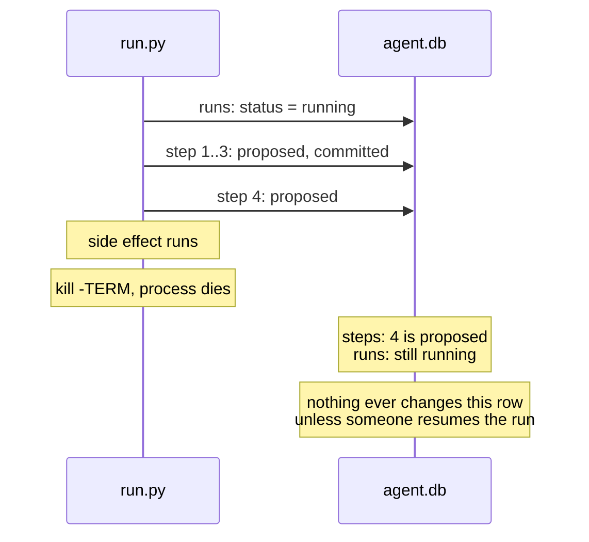

# Work completed

Items moved here from `todo.md` once done. Newest first.

## Does the worker leave a task's command running when SIGKILLed?

Completed 2026-11-10. Moved from `todo.md`:

Found while fixing the same gap in `fleet/run.py` (see `work-completed.md`). `fleet/worker.py` runs shell tasks in their own process group and kills it only on a timeout, from inside the worker. A SIGKILLed worker cannot, so its task's command probably keeps running while the lease expires and another worker reclaims the task. Not checked: reproduce with `fleet.kill_drill` and a task that outlives the lease before changing anything.

**Outcome: yes.** On a scratch database, one task ran `echo $$ >> pids; echo start >> runs; sleep 45; echo end >> runs`. Its command writes only to files, never stdout. Times are seconds after the victim worker's Python process was SIGKILLed, sampled every 5 seconds:

- +1s: the victim was dead; the task's group (`sh` and `sleep 45`) was alive, and the task stayed `in_progress`.
- +36s: a rescuer worker had reaped the expired lease, and the task was `ready`.
- +41s: the rescuer had started a second copy in a new group. `runs` read `start start`, and the first group was still alive.
- +46s: the first copy had finished (`start start end`).
- +87s: the task was `done`, and `runs` read `start start end end`.

The two copies overlapped for at least 5 seconds. The ledger shows `task.added, task.claimed, task.reaped, task.claimed, task.done`, the same clean sequence `fleet.kill_drill` expects, so nothing records the overlap.

`fleet.kill_drill` passes because its task sleeps 2 seconds, so the leftover command ends long before the 30-second lease expires.

Not tested: whether a command that writes to stdout after the worker dies is killed by SIGPIPE.

The fix is a new todo, "A SIGKILLed worker's task command overlaps the rescuer's rerun".

## A killed run.py leaves its step's command running

Completed 2026-11-10. Moved from `todo.md`:


Found in the `kill -9` test (see `work-completed.md`). `shell()` starts each step with `subprocess.run(cmd, shell=True)`. After `kill -9` on run.py mid step 5, `/bin/sh -c sleep 20 && echo summary > out/summary.txt` and its `sleep 20` were still alive, reparented, and later wrote `out/summary.txt`. A resume before that finishes runs step 5 a second time while the first copy is still going. Reproduced 2026-11-10: SIGKILL 8 seconds into the drill, then `--resume` at once. Two seconds later two `sleep 20` processes were alive, started 07:42:45 and 07:42:50, matching the two `step.proposed` events for step 5. The resume ran to `done` without noticing.

`--resume` now refuses a run whose heartbeat is fresh (see `work-completed.md`). That narrows this gap but does not close it. The drill's leftover `sleep 20` ran about 15 seconds past the kill, well inside the 60-second expiry, but a step that runs longer than the expiry after a kill (a `claude_step()` can take minutes) would still overlap with the resume. Reproduced 2026-11-10 with a one-step plan, `sleep 60 && echo done >> out/long.txt`, and `ITERUM_IDLE_SECONDS=15`: SIGKILL at 07:49:58, `--resume` without `--force` accepted at 07:50:15. Two `sleep 60` processes were alive at 07:50:17 (started 07:49:55 and 07:50:15), step 1 has two `step.proposed` events, and `out/long.txt` holds `done` twice: the side effect ran twice.

Copying the worker's process group would not fix this. The worker's group only helps on a timeout, when the worker itself calls `os.killpg` (`fleet/worker.py`); a SIGKILLed process calls nothing. A resume would have to detect the leftover command itself, for example by storing the step's process group id in `steps` and refusing to resume while that group is alive. Untested idea; refusing avoids killing a reused process id. The worker likely has the same gap under SIGKILL; not checked.

**Change.** `shell()` starts each command with `start_new_session=True` and stores its process group id in the new `steps.pgid` column (added to older databases by `db.init()`). `check_resumable()` refuses, unless `--force`, while an uncommitted step's group still has a process in it, checked with `os.killpg(pgid, 0)`. `PermissionError` counts as alive. Nothing is killed: a stale group id reused by another process only causes a refusal.

**Probe.** On this Mac, `os.killpg(pgid, 0)` succeeded for a live group and for a group whose `sh` leader had exited while its child ran on; it raised `ProcessLookupError` once the group was empty and `PermissionError` for pid 1's group.

**After.** The long-step reproduction again: SIGKILL at 07:53:33, `--resume` at 07:53:50 refused with "step 1 may still be running: process group 14051 exists", with one `sleep 60` alive. Once the group was empty (07:54:31), the resume ran step 1 and finished `done`. `out/long.txt` has 2 lines, one from the leftover and one from the resume, written one after the other. Running an uncommitted step again is expected; only the overlap is gone. A failing command still marks the step and run `failed`, and the drill still finishes `done`.

**Ctrl-C.** In its own group, the command no longer gets a terminal Ctrl-C. Simulated by sending SIGINT to `run.py`'s group: `run.py` exited 130, step 5's `sh` and `sleep 20` kept running, and the resume refused. `shell()` now catches `KeyboardInterrupt`, kills the group with `os.killpg(..., SIGKILL)` and re-raises. Same simulation after: the group was empty right away, step 5 stayed `proposed`, and the resume went straight through to `done`.

**SIGTERM.** `kill -TERM` on `run.py` mid step 5 left the step's `sh` and `sleep 20` running, and the resume refused until they exited. Before this change SIGTERM also reached only `run.py`, so this is not new; what is new is that the resume notices. Left as a todo.

## `--resume` refuses a run that may still be alive

Completed 2026-11-10. From the todo "A killed run.py leaves its step's command running": "`check_resumable()` does not read `heartbeat_at`, so `--resume` also does not wait for the run to look dead. Seen in the code, not tested against a live run."

**Before.** On a scratch database, `--resume` 8 seconds into a live drill started a second `run.py` on the same run. Both processes were alive, two `sleep 20` step commands ran at once, and both processes ran steps 5 and 6 and printed `done`.

**Change.** `check_resumable()` exits when the run is `running` with a heartbeat younger than `recovery.IDLE_SECONDS`, unless `--force`. Runs without a heartbeat (from before heartbeats) are not checked.

**After.** With `ITERUM_IDLE_SECONDS=30`: a resume 8 seconds into a live drill exits 1 with "may still be alive: its heartbeat is 8s old", and one `run.py` keeps running. A resume right after `kill -9` is refused the same way. A resume 32 seconds later skips steps 1 to 4 and finishes `done` without `--force`.

## Heartbeat: tried with `kill -9`

Completed 2026-11-10. From the heartbeat leftovers: "**Not yet tried with `kill -9`.** Verification used Ctrl-C mid-step."

On a scratch database, the drill was SIGKILLed 14 seconds in, during step 5 (`sleep 20`):

1. Before the kill, `fleet.recovery --idle-seconds 30` listed nothing; `heartbeat_at` was 4 seconds old and step 5 was `proposed`.
2. After the kill, `heartbeat_at` stayed at the same value. 45 seconds later the run was still `running`, and `fleet.recovery --idle-seconds 30` listed it as `RESUME ... idle 46s ... (ok)`.
3. `fleet.run --resume <run_id>` without `--force` skipped steps 1 to 4, ran 5 and 6, and marked the run `done`. Afterwards recovery listed nothing. The ledger shows step 5 `step.proposed` twice, then `step.committed`.

Two things to know when repeating it:

- Kill the `.venv/bin/python3 -u -m fleet.run` process, not `uv run`. A first attempt that SIGKILLed the `uv run` process left the Python child running, and it finished the run to `done`.
- The step's shell command outlives the kill. See the todo "A killed run.py leaves its step's command running".

## Telemetry: what does a killed session lose?

Completed 2026-11-10 in the commit that sets `OTEL_LOGS_EXPORT_INTERVAL` in `.env.example`.

`fleet/telemetry.py` records spend, but a session killed with `kill -9` may drop events still in its 5-second export buffer, and the docs say nothing about flushing on exit. Start `fleet.telemetry` on a scratch database, run a session that makes several requests, kill it partway, and compare the requests in its transcript with the `spend.reported` events that arrived. If too much is lost, try a shorter `OTEL_LOGS_EXPORT_INTERVAL`.

**Outcome.** Two runs on a scratch database, each a Haiku session reading files one per turn, killed with SIGKILL at 10 s after three completed requests (counted by `requestId` in the session transcript). With the default 5000 ms interval, 1 of 3 requests reached the ledger: the two that finished 2.3 s and 4.2 s after the first were still buffered. With 1000 ms, 3 of 3 arrived. `.env.example` now sets `OTEL_LOGS_EXPORT_INTERVAL=1000`. Not covered: a request still running at the kill appears in neither the transcript nor telemetry, and a graceful exit was not tested.

## Upgrade SQLite past 3.51.2

Completed 2026-11-08 in the commit that adds `fleet/claim.py`.

`uv run python -c "import sqlite3; print(sqlite3.sqlite_version)"` reports 3.50.4, and `fleet/db.py` uses WAL mode. The [SQLite WAL docs](https://www.sqlite.org/wal.html) describe a WAL-reset bug likely present through 3.51.2 and fixed in 3.51.3. It affects WAL databases with two or more connections, in separate threads or processes, that write or checkpoint at the same instant. It has not been observed here.

Find out what sets the SQLite version in this environment, move to 3.51.3 or later, and confirm with the command above.

**Outcome.** The version comes from the SQLite bundled in the uv-managed Python build. `.python-version` now pins 3.14.10, which bundles SQLite 3.53.1, and the command above reports 3.53.1. uv 0.11.7 does not offer 3.14.10, so it was installed with `uvx uv@latest python install 3.14.10`. Another device needs the same step.

## Killed runs stay `running` (heartbeat and expiry)

Completed 2026-11-07 in commit 472d943.

### Bug: a killed run stays `running` forever

#### What happens

`fleet/run.py` sets a run's status in only two ways: `record_failure()` marks it `failed` when a step's command fails, and `db.finish_run()` marks it `done` when every step has committed. Both run inside the process. When the process itself is killed (SIGTERM, SIGKILL, out-of-memory, power loss), neither runs, so the `runs` row keeps saying `running` until someone resumes it. If nobody does, it says `running` forever, and nothing in the repo looks for such rows.



#### How to reproduce

From the repo root (the drill's step 2 lists `fleet/`). The drill writes an `out/` folder there; delete it afterwards.

```bash
export ITERUM_DB=/tmp/stale.db ITERUM_DEVICE=test
uv run python -u -m fleet.run & sleep 2
pkill -TERM -f fleet.run
sqlite3 /tmp/stale.db "SELECT run_id, status FROM runs"
```

The run is listed as `running`, although no process is working on it. Step 4 is `proposed`, and `out/step4.txt` exists.

#### Why a shutdown handler is not enough

Catching SIGTERM and marking the run on the way out would cover a polite `kill`, but not SIGKILL, an out-of-memory kill or a power cut. The state has to be correct without the dying process doing anything.

### Plan: a heartbeat and an expiry

Status: done. Verified: a live run in a long step is not listed; a run interrupted with Ctrl-C mid-step stays `running`, is listed after the cutoff, and resumes to `done` without `--force`. Not yet tried with `kill -9`.

A running process keeps proving it is alive. A row whose proof has gone stale is treated as dead, whatever its status says.

```mermaid
sequenceDiagram
    participant R as run.py
    participant H as heartbeat thread
    participant DB as agent.db
    participant Q as fleet.recovery
    R->>DB: runs: status = running, heartbeat_at = now
    R->>H: start
    loop every HEARTBEAT seconds
        H->>DB: UPDATE runs SET heartbeat_at = now
    end
    Note over R,H: kill: process and heartbeat die together
    Note over DB: heartbeat_at stops moving
    Q->>DB: status = running AND heartbeat_at older than EXPIRY
    DB-->>Q: the killed run
    Note over Q: reported as dead; status stays running
```

#### Steps

1. **Schema.** Add `heartbeat_at REAL` to `runs` in `fleet/schema.sql`.
2. **Migration.** `CREATE TABLE IF NOT EXISTS` does not add columns to an existing table, and `ALTER TABLE ... ADD COLUMN` fails if the column is already there. In `db.init()`, check `PRAGMA table_info(runs)` and run the `ALTER TABLE` only when `heartbeat_at` is missing.
3. **Heartbeat.** In `run.py`, set `heartbeat_at` when the run starts or resumes, and run a daemon thread that updates it every `HEARTBEAT` seconds until `execute()` returns. It needs its own connection, since SQLite connections are not shared across threads by default. A thread is needed because a single step can run far longer than the expiry (the drill's step 5 sleeps 20 seconds; a `claude_step()` call can take minutes).
4. **Find stale runs.** In `fleet/recovery.py`, `dead_runs()` compares the last event time to `--idle-seconds`. Compare `heartbeat_at` instead.
5. **Do not mark them.** A stale run keeps its `running` status. `halted` means "a human must look", and `check_resumable()` refuses it without `--force`. A run that died once and is under the retry cap is safe to resume, so it should not need `--force`. `resume_is_safe()` still halts runs that are over the cap.
6. **Verify.** Kill the drill, wait past the expiry, and confirm the run is listed and resumes to `done` without `--force`. Also confirm that a live run with a long step (the drill's step 5) is never listed.

#### Open questions

- **Values for `HEARTBEAT` and `EXPIRY`.** The expiry must be several heartbeats long, so one slow write is not mistaken for a death.
- **Who runs `fleet.recovery`:** by hand, at the start of every `run.py` invocation, or a scheduler.
- **Not the `leases` table.** `leases` already has `heartbeat_at` and `expires_at`, but it is keyed by `task_id` and references `tasks`, so it does not cover rows in `runs`.
