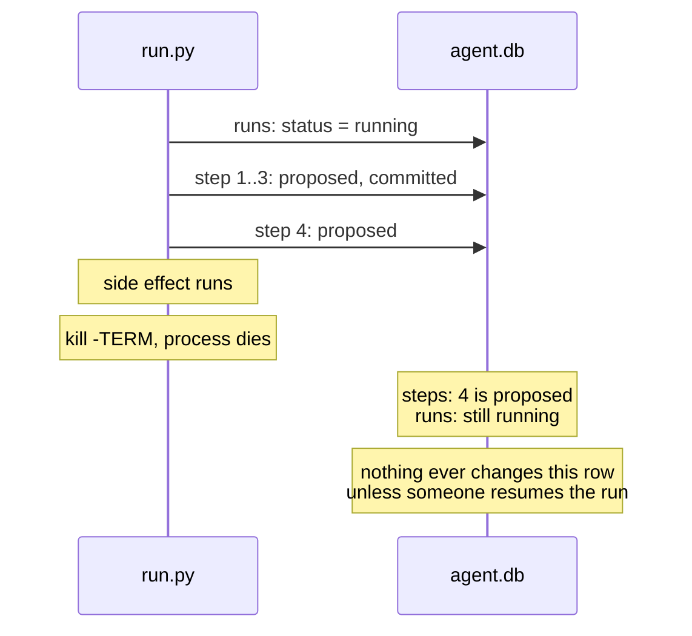

# Work completed

Items moved here from `todo.md` once done. Newest first.

## Telemetry: what does a killed session lose?

Completed 2026-11-10 in the commit that sets `OTEL_LOGS_EXPORT_INTERVAL` in `.env.example`.

`fleet/telemetry.py` records spend, but a session killed with `kill -9` may drop events still in its 5-second export buffer, and the docs say nothing about flushing on exit. Start `fleet.telemetry` on a scratch database, run a session that makes several requests, kill it partway, and compare the requests in its transcript with the `spend.reported` events that arrived. If too much is lost, try a shorter `OTEL_LOGS_EXPORT_INTERVAL`.

**Outcome.** Two runs on a scratch database, each a Haiku session reading files one per turn, killed with SIGKILL at 10 s after three completed requests (counted by `requestId` in the session transcript). With the default 5000 ms interval, 1 of 3 requests reached the ledger: the two that finished 2.3 s and 4.2 s after the first were still buffered. With 1000 ms, 3 of 3 arrived. `.env.example` now sets `OTEL_LOGS_EXPORT_INTERVAL=1000`. Not covered: a request still running at the kill appears in neither the transcript nor telemetry, and a graceful exit was not tested.

## Upgrade SQLite past 3.51.2

Completed 2026-11-08 in the commit that adds `fleet/claim.py`.

`uv run python -c "import sqlite3; print(sqlite3.sqlite_version)"` reports 3.50.4, and `fleet/db.py` uses WAL mode. The [SQLite WAL docs](https://www.sqlite.org/wal.html) describe a WAL-reset bug likely present through 3.51.2 and fixed in 3.51.3. It affects WAL databases with two or more connections, in separate threads or processes, that write or checkpoint at the same instant. It has not been observed here.

Find out what sets the SQLite version in this environment, move to 3.51.3 or later, and confirm with the command above.

**Outcome.** The version comes from the SQLite bundled in the uv-managed Python build. `.python-version` now pins 3.14.10, which bundles SQLite 3.53.1, and the command above reports 3.53.1. uv 0.11.7 does not offer 3.14.10, so it was installed with `uvx uv@latest python install 3.14.10`. Another device needs the same step.

## Killed runs stay `running` (heartbeat and expiry)

Completed 2026-11-07 in commit 472d943.

### Bug: a killed run stays `running` forever

#### What happens

`fleet/run.py` sets a run's status in only two ways: `record_failure()` marks it `failed` when a step's command fails, and `db.finish_run()` marks it `done` when every step has committed. Both run inside the process. When the process itself is killed (SIGTERM, SIGKILL, out-of-memory, power loss), neither runs, so the `runs` row keeps saying `running` until someone resumes it. If nobody does, it says `running` forever, and nothing in the repo looks for such rows.



#### How to reproduce

From the repo root (the drill's step 2 lists `fleet/`). The drill writes an `out/` folder there; delete it afterwards.

```bash
export ITERUM_DB=/tmp/stale.db ITERUM_DEVICE=test
uv run python -u -m fleet.run & sleep 2
pkill -TERM -f fleet.run
sqlite3 /tmp/stale.db "SELECT run_id, status FROM runs"
```

The run is listed as `running`, although no process is working on it. Step 4 is `proposed`, and `out/step4.txt` exists.

#### Why a shutdown handler is not enough

Catching SIGTERM and marking the run on the way out would cover a polite `kill`, but not SIGKILL, an out-of-memory kill or a power cut. The state has to be correct without the dying process doing anything.

### Plan: a heartbeat and an expiry

Status: done. Verified: a live run in a long step is not listed; a run interrupted with Ctrl-C mid-step stays `running`, is listed after the cutoff, and resumes to `done` without `--force`. Not yet tried with `kill -9`.

A running process keeps proving it is alive. A row whose proof has gone stale is treated as dead, whatever its status says.

```mermaid
sequenceDiagram
    participant R as run.py
    participant H as heartbeat thread
    participant DB as agent.db
    participant Q as fleet.recovery
    R->>DB: runs: status = running, heartbeat_at = now
    R->>H: start
    loop every HEARTBEAT seconds
        H->>DB: UPDATE runs SET heartbeat_at = now
    end
    Note over R,H: kill: process and heartbeat die together
    Note over DB: heartbeat_at stops moving
    Q->>DB: status = running AND heartbeat_at older than EXPIRY
    DB-->>Q: the killed run
    Note over Q: reported as dead; status stays running
```

#### Steps

1. **Schema.** Add `heartbeat_at REAL` to `runs` in `fleet/schema.sql`.
2. **Migration.** `CREATE TABLE IF NOT EXISTS` does not add columns to an existing table, and `ALTER TABLE ... ADD COLUMN` fails if the column is already there. In `db.init()`, check `PRAGMA table_info(runs)` and run the `ALTER TABLE` only when `heartbeat_at` is missing.
3. **Heartbeat.** In `run.py`, set `heartbeat_at` when the run starts or resumes, and run a daemon thread that updates it every `HEARTBEAT` seconds until `execute()` returns. It needs its own connection, since SQLite connections are not shared across threads by default. A thread is needed because a single step can run far longer than the expiry (the drill's step 5 sleeps 20 seconds; a `claude_step()` call can take minutes).
4. **Find stale runs.** In `fleet/recovery.py`, `dead_runs()` compares the last event time to `--idle-seconds`. Compare `heartbeat_at` instead.
5. **Do not mark them.** A stale run keeps its `running` status. `halted` means "a human must look", and `check_resumable()` refuses it without `--force`. A run that died once and is under the retry cap is safe to resume, so it should not need `--force`. `resume_is_safe()` still halts runs that are over the cap.
6. **Verify.** Kill the drill, wait past the expiry, and confirm the run is listed and resumes to `done` without `--force`. Also confirm that a live run with a long step (the drill's step 5) is never listed.

#### Open questions

- **Values for `HEARTBEAT` and `EXPIRY`.** The expiry must be several heartbeats long, so one slow write is not mistaken for a death.
- **Who runs `fleet.recovery`:** by hand, at the start of every `run.py` invocation, or a scheduler.
- **Not the `leases` table.** `leases` already has `heartbeat_at` and `expires_at`, but it is keyed by `task_id` and references `tasks`, so it does not cover rows in `runs`.
