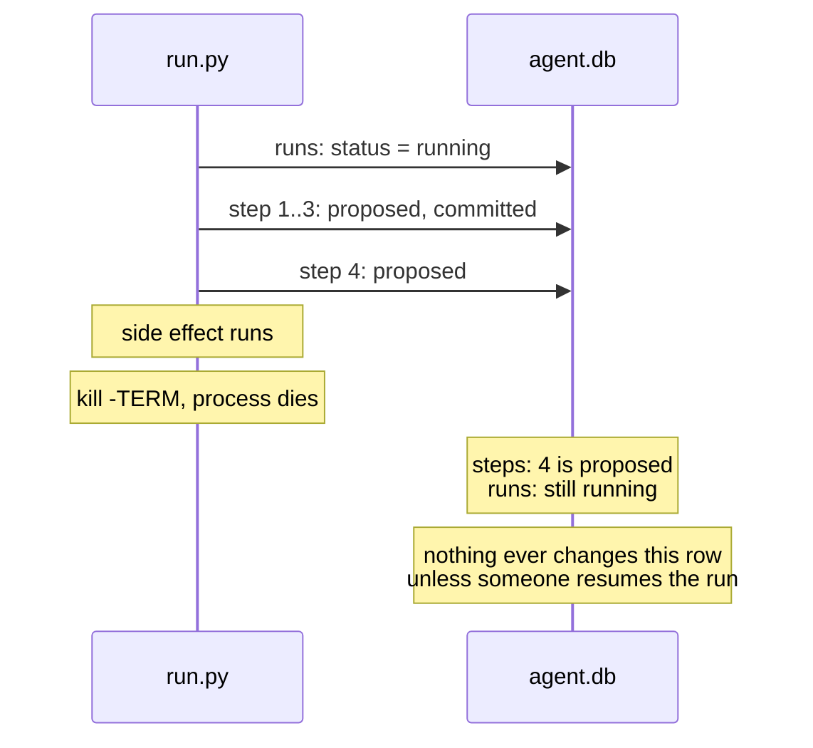

# Work completed

Items moved here from `todo.md` once done. Newest first.

## Write a design note for wiring `claude_step()` into `fleet/run.py`

Completed 2026-11-10. Moved from `todo.md`:

**Write a design note for wiring `claude_step()` into `fleet/run.py`, before any code.** Every call is billed to the user, so get the note agreed first. Drafted in `claude-step-design.md` (proposed, not agreed). It should answer:
   - How a plan marks a step as a prompt rather than a shell command, and how resume and `check_resumable()` treat it.
   - How the step is made opt-in (a flag or plan field), so the built-in plan and drills never spend.
   - The `iterum.run_id` todo below (start Claude Code with `.env.example` settings plus `OTEL_RESOURCE_ATTRIBUTES=iterum.run_id=<run_id>`).
   - Whether it runs through `commit_once()`, which brings in the open questions on settling `in_flight` receipts, `REFUSED` Claude Code errors, and which actions can prove nothing ran.
   - Where the edits happen: in the run's own branch, under its declared claims, so they land through `fleet.merge`.
   - A test plan that spends as little as possible (one short prompt), run only with the user's go-ahead.

**Outcome.** `claude-step-design.md`, agreed with the five decisions at its end (see the decision log). No code changed and no `claude` call was made. Flags were checked against `claude --help` (2.1.322) and the CLI reference and headless docs. Writing it turned up that `fleet.merge` already keeps unclaimed edits off the target whether or not `gate.py` runs in the session, which settled `-p` over `--bare`.

## Who runs `fleet.recovery`?

Completed 2026-11-10. Moved from `todo.md`:

`fleet.recovery` finds runs that died, but nothing calls it. At the start of `fleet.run`, after `db.init()`, print the dead runs (read-only) with the `fleet.recovery` command to act on them; list stale `running` runs and count `failed` ones.

**Outcome:** a read-only notice at every `fleet.run` start (see the decision log).

**Before.** On a scratch database with `ITERUM_IDLE_SECONDS=15`, a `fleet.run` with a `sleep 300` step had its Python process and the step's process group SIGKILLed. Its last output was `run ... started`; its row stayed `running` with a 24s-old heartbeat. The next `fleet.run` printed only its own lines; `fleet.recovery` listed the dead run. A first attempt that killed the `uv` wrapper instead did not count: `fleet.run` survived, saw its step die and marked the run `failed`.

**Change.** `notice_dead_runs()` in `fleet/run.py`, called after `db.init()`, uses `recovery.dead_runs()`.

**After.** With one failed run and one SIGKILLed run, the next run printed `1 run(s) look dead (no heartbeat for over 15s):`, the run id with `idle 25s`, `1 failed run(s).` and `see: uv run python -m fleet.recovery`. Both rows, including `heartbeat_at`, were unchanged. A clean database printed no notice. The built-in plan, `fleet.merge_drill`, `fleet.claims_drill` and `fleet.kill_drill` passed. No drill check was added: the notice is output, not state.

## Should SIGTERM stop a step's command?

Completed 2026-11-10. Moved from `todo.md`:

`kill -TERM` on `fleet/run.py` mid-step leaves the step's command running (tested 2026-11-10, see `work-completed.md`); the resume guard waits for it. It did the same before steps had their own group. A SIGTERM handler that raises like Ctrl-C would let `shell()` kill the group on a polite stop. Decide whether a polite stop should end the step; SIGKILL can never be covered this way.

**Outcome: yes**, for `fleet/run.py` and `fleet/worker.py` (see the decision log).

**Before.** On a scratch database, SIGTERM sent once the command's group was recorded: `fleet.run` (a `sleep 30` step) exited -15 with the group alive and the step `proposed`; `fleet.worker` (a `sleep 30` task) exited -15 with the group alive and the task `in_progress` with its lease.

**Change.** `proc.stop_on_sigterm()` installs `signal.default_int_handler` for SIGTERM, so it raises `KeyboardInterrupt` and runs the existing Ctrl-C cleanup: `shell()` in `fleet/run.py` and `_shell()` in `fleet/worker.py` kill the group. Both entry points call it first.

**After.** Both exited -2 with the group gone, the step still `proposed` and the task still `in_progress`, as after Ctrl-C. `fleet.claims_drill` and `fleet.kill_drill` each gained a SIGTERM case; with the handler disabled, both failed on "command killed". The built-in plan, `fleet.merge_drill` and both drills passed with it. `kill_drill` already stops its rescuer with `terminate()`, which now goes through the handler and still passes.

## `commit_once` logs nothing on an ambiguous failure

Completed 2026-11-10. Moved from `todo.md`:

When an action fails without a `REFUSED` category, `commit_once()` leaves the receipt `in_flight` and writes no event, so the ledger shows `action.claimed` with no outcome. `run_step()` covers this with `step.failed` and `run.halted`, but a direct caller of `commit_once()` leaves no record of why the receipt is stuck. Log an event (for example `action.uncertain`, with the category) before re-raising.

**Before.** On a scratch database, `commit_once()` with an action raising `StepError("timeout", ...)`, and one raising a plain `RuntimeError`, each left the receipt `in_flight` with only `action.claimed` in the ledger. A `rate_limit` refusal logged `action.refused`; a success logged `action.committed`.

**Change.** When the category is not in `REFUSED` (including no category), `commit_once()` logs `action.uncertain` with `category` and `error` (`<exception type>: <message>`) before re-raising. The receipt stays `in_flight`.

**After.** The timeout logged `action.uncertain` with category `timeout` and error `StepError: request timed out`; the `RuntimeError` logged it with no category and `RuntimeError: boom`. Calling `commit_once()` again for the timeout still raised `Uncertain`. The refusal and the success were unchanged. Through `run_step()`, a timeout gave `run.started, step.proposed, action.claimed, action.uncertain, step.failed, run.halted`, raised `StepError`, and left the run `halted`. No code reads `action.*` events.

## Build the merge gate that checks fences

Completed 2026-11-10. Moved from `todo.md`:

Status: open. Items 2 to 5 are done: `uv run python -m fleet.merge <branch> --run-id R --fence RESOURCE=FENCE ...` is the merge process, and `fleet.run` claims and renews a plan's declared files. Item 1 remains.

`land()` builds the merge with `git merge-tree --write-tree` and `git commit-tree`, so no working tree is touched. It lists the changed files with `--no-renames` (a rename needs claims on both paths). Then, in one `db.write()` block, it calls `require_claim()` for each file and either logs `merge.landed` and runs `git update-ref` with the old value, or logs `merge.refused` and raises. Checked: a live claim landed; a file with no claim, an expired claim and a stale fence after a takeover were refused with `main` unchanged; a conflict raised `Conflict`; a target moved between build and update raised `CalledProcessError` and left no `merge.landed` event; a retry then landed.

Found while testing: the target branch must not be checked out in any working tree. `update-ref` moves the branch but not that tree's index, so the next commit made there reverted the landed change (seen in the scratch repo: an "edit b" commit also reverted `a.txt`).

A fence protects nothing unless whatever accepts the write checks it. An agent cannot check its own fence, because it can pause right after checking. A `PreToolUse` hook has the same gap, and one that times out does not block the call.

1. Done 2026-11-10: agents edit only in their own git worktrees. Narrowed to a branch check; see below.
2. A single merge process lands each change on the shared branch. It builds the merge outside any transaction. Then, inside one `db.write()` block, it calls `claim.require_claim()` and moves the branch with `git update-ref` and the expected old value, so no newer fence can be issued between the check and the update. Do not hold the write lock for the whole merge: other writers fail after the 5-second busy timeout.
3. Done 2026-11-10: `land()` writes `merge.started` ahead, and `merge.reconcile()` settles a crash when the merge process starts (see the decision log). `python -m fleet.merge` takes an exclusive `flock` on `iterum-merge.lock` in the repo's git common dir, refuses if the target is checked out in any worktree, then calls `reconcile()` and `land()`. Tested 2026-11-10 against a shared repo with a detached HEAD and one worktree per agent: a checked-out `main` was refused; a live claim landed (exit 0); no fence and a paused agent's stale fence after a takeover were refused (exit 1); a second merge waited about 2 seconds for a process holding the lock, then landed; after a crash right after `update-ref`, the next merge logged `merge.landed` recovered before landing its own branch.
4. Done 2026-11-10: moved to `work-completed.md`.
5. Done 2026-11-10: `uv run python -u -m fleet.merge_drill` covers the paused-agent case, the other refusals, the lock, a crash after `update-ref` and a moved target, in about 3.5 seconds. Removing the live-claim check from `require_claim()` made it fail on the expired claim; removing `reconcile()` from the merge process made it fail on the crash.

File claims do not catch changes in different files that break each other, even when the merge is clean. Tests or CI still have to catch those.

**Item 1, before.** In a scratch repo with `main` checked out, `fleet.run` with a plan declaring `file:a.txt` committed `edit-a` straight onto `main` and printed a merge command with nothing left to merge.

**Item 1, change.** `run_branch()` in `fleet/run.py`: a plan that declares files must run on a branch, and not on the target (`--target`, default `main`). It exits before the run is recorded. Plans that declare nothing are not checked, so the built-in drill still runs from the repo root on `main`. The printed merge command now names the branch, and passes `--target` when it is not `main`.

**Item 1, after.** On `main`: exit 1, `main` unchanged, no run recorded. Detached HEAD: exit 1, "HEAD is detached". Outside a repo: exit 1 with git's "not a git repository". On its own branch: the run finished and printed `fleet.merge work ...`. `fleet.claims_drill` gained the target-branch and detached cases (27 checks, about 46 seconds); with `run_branch()` disabled they failed. The built-in plan and `fleet.merge_drill` still passed.

## Wire claims into `fleet/run.py` and renew them

Completed 2026-11-10. Moved from `todo.md` (merge-gate item 4):

Wire claims into `fleet/run.py`, and renew them while a step runs. A step longer than `claim.DEFAULT_TTL` (300 seconds) would otherwise lose its lease.
   - Done 2026-11-10: plans declare resources and `fleet.run` claims them all before any step (see the decision log).
   - Still to do: renew the claims from the heartbeat thread, with `renew()` refusing an expired claim and a refused renewal failing the step. Claims are released on landing (see the decision log).

**Before.** With a new `ITERUM_CLAIM_TTL` of 20 seconds (default `claim.DEFAULT_TTL`, 300), a plan with one 35-second step logged no `claim.renewed` events, and `fleet.merge` refused its branch: "the claim under fence 1 was released or has expired". With a 60-second step, the claim expired after about 20 seconds, another run took `b.txt` at 22 seconds, and the first run still wrote `b2`, committed, and finished `done`. `renew()` also accepted an expired claim.

**Change.** `renew()` matches only an unexpired claim. `fleet/run.py`'s heartbeat thread renews every claim the run holds once half of `CLAIM_TTL` has passed since the last renewal. A refused renewal records the reason, kills the proposed step's process group, and ends the thread. `run_steps()` checks for a lost claim after proposing each step and after it runs, so the step and the run are marked `failed` with "claim lost: ...".

**After.** The 35-second step logged 3 renewals and its branch landed. For the takeover, `run.py` was paused with SIGSTOP 1 second in; another run took `b.txt` at 22 seconds; on SIGCONT the renewal was refused, the step's `sleep 60` was killed (exit -9), the step and the run were `failed` with "claim lost: file:b.txt: the claim under fence 1 expired or is no longer yours", and `b.txt` in the worktree was unchanged. `renew()` refused an expired claim. The built-in drill plan, `fleet.merge_drill` and the declared-claims script still passed.

## Refuse an empty merge

Completed 2026-11-10. Moved from `todo.md` (a bullet under merge-gate item 4):

Found while testing: `fleet.merge` lands a branch with no changes left as an empty merge commit, with no fences needed. Refuse or skip when the branch is already in the target.

**Before.** A new `fleet.merge_drill` check merged the already-landed `live` branch again with no fences: it exited 0 and moved `main`.

**Change.** `build()` in `fleet/merge.py` raises a new `merge.Empty` when the merged tree equals the target's tree, before the write-ahead, so nothing is logged, as with a conflict. The merge process exits 1 with "refused". Comparing trees, not ancestry, also catches a branch whose change the target already has from a cherry-pick.

**After.** All 33 drill checks passed. On a scratch repo where `main` moved on and then cherry-picked branch `side`, `side` was not an ancestor of `main` (`merge-base --is-ancestor` exit 1) and `build()` raised `Empty`; a branch adding a new file still built.

## Enforce the `fences` rules in the database

Completed 2026-11-10. Moved from `todo.md`:

Status: open. Do this before anything relies on `fleet/claim.py`, which writes `fences` through `acquire()`.

`fleet/schema.sql` says `fences` rows are never deleted and `high` only counts up, but nothing enforces it. A reset is silent: a stale agent's fence can match or beat the new one.

1. Add these after the `fences` table in `fleet/schema.sql`:

   ```sql
   CREATE TRIGGER IF NOT EXISTS fences_no_delete BEFORE DELETE ON fences
   BEGIN SELECT RAISE(ABORT, 'fences rows are never deleted'); END;

   CREATE TRIGGER IF NOT EXISTS fences_only_up BEFORE UPDATE ON fences
   WHEN NEW.high <= OLD.high OR NEW.resource IS NOT OLD.resource
   BEGIN SELECT RAISE(ABORT, 'fences.high only counts up'); END;
   ```

2. Add `con.execute("PRAGMA recursive_triggers = ON")` to `connect()` in `fleet/db.py`. Without it, `INSERT OR REPLACE` resets a fence without firing either trigger (tested against the schema in memory, SQLite 3.50.4). `steps` is the only table written with `REPLACE` today and has no triggers, so nothing else changes.

`claim.acquire()` already raises the fence in the same `db.write()` block as the `claims` update, and issued 1, 2, 3, 4 with these triggers and the `PRAGMA` in place.

These guard against bugs, not a hostile agent: anything with shell access can still drop the triggers or connect without the `PRAGMA`.

**Before.** On a scratch database, `UPDATE fences SET high=1` lowered a fence of 5, `INSERT OR REPLACE` reset it to 0, and `DELETE` removed it. None raised.

**Change.** Both triggers are in `fleet/schema.sql` after `fences`, and `connect()` in `fleet/db.py` sets `PRAGMA recursive_triggers = ON`. The item above says `steps` is the only table written with `REPLACE`; `leases` is too (`fleet/queue.py`). Neither has triggers, so the `PRAGMA` changes nothing for them.

**After.** Lowering, setting an equal value, renaming the resource, `INSERT OR REPLACE` and `DELETE` each raised `IntegrityError`; raising 5 to 6 worked. `db.init()` ran twice without error. `claim.acquire()` across a reclaim by the same holder, a release, and an expired lease taken over by another agent issued 1, 2, 3, 4, and `guard()` refused fence 3 and accepted 4. The `fleet.run` drill committed all six steps, and `fleet.kill_drill` passed.

## A SIGKILLed worker's task command overlaps the rescuer's rerun

Completed 2026-11-10. Moved from `todo.md`:

Reproduced 2026-11-10 (see `work-completed.md`). `_shell()` in `fleet/worker.py` kills the task's process group only on a timeout, from inside the worker, and stores the group id nowhere, so nothing else can check it. A command that outlives the 30-second lease is still running when another worker reaps the task and starts it again.

Possible fix, untested: the same shape as `fleet/run.py`. Store the group id with the lease, and have `queue.reap()` leave a task alone while that group still has a process in it (`os.killpg(pgid, 0)`). It would inherit the `pgid` write window above. `fleet.kill_drill` cannot catch this: its task sleeps 2 seconds, well inside the lease, so it needs a case whose command outlives the lease.

**Drill first.** `fleet.kill_drill`'s parent task now sleeps `LEASE_TTL + 15` seconds on its first run and finishes at once on the rerun, writing `start` and `end` around each. A new check expects `start end start end child`. On the old code it failed with `start start end child`: the rerun ran inside the first copy, and the drill exited, deleting its directory, before the first copy could write its `end`.

**Change.** `leases.pgid` is a new column (added to older databases by `db.init()`). `_shell()` stores the command's group with `queue.record_pgid()`, which checks the fence and refuses if the lease is gone. `reap()` leaves an expired lease alone, reported as `waiting` and printed by the worker, while that group has a process in it. `group_alive()` moved from `fleet/run.py` to `fleet/proc.py` so both can use it. Only the default `do_work` is covered (see the decision log).

**After.** The drill passed in 51.5 seconds. The rescuer printed "lease expired but its command is still running" three times, then reaped and reran the task, and `runs.txt` read `start end start end child`. The ledger events and the single charged attempt are unchanged. A worker over three tasks on a scratch database still finished `echo hello` with result `"hello"`, dead-lettered `exit 3`, and dead-lettered `sleep 5` on a 1-second `FLEET_TASK_TIMEOUT_S` with no `sleep` left behind. `fleet/run.py`'s resume guard, now using `fleet/proc.py`, still refused: a one-step `sleep 60` plan, `run.py` SIGKILLed after 3 seconds, `--resume` 17 seconds later with `ITERUM_IDLE_SECONDS=15` exited 1 with "step 1 may still be running: process group 42035 exists".

**Ctrl-C.** `_shell()` now kills the group on any early exit, not only a timeout. SIGINT to a worker mid `sleep 37`: the old `worker.py` exited and left `sleep 37` running; the new one killed it at once. Testing this needs SIGINT restored first: a job started with `&` from a non-interactive shell inherits SIGINT as ignored (`signal.getsignal` printed `1`, `SIG_IGN`), so the first attempt never interrupted the worker.

## Does the worker leave a task's command running when SIGKILLed?

Completed 2026-11-10. Moved from `todo.md`:

Found while fixing the same gap in `fleet/run.py` (see `work-completed.md`). `fleet/worker.py` runs shell tasks in their own process group and kills it only on a timeout, from inside the worker. A SIGKILLed worker cannot, so its task's command probably keeps running while the lease expires and another worker reclaims the task. Not checked: reproduce with `fleet.kill_drill` and a task that outlives the lease before changing anything.

**Outcome: yes.** On a scratch database, one task ran `echo $$ >> pids; echo start >> runs; sleep 45; echo end >> runs`. Its command writes only to files, never stdout. Times are seconds after the victim worker's Python process was SIGKILLed, sampled every 5 seconds:

- +1s: the victim was dead; the task's group (`sh` and `sleep 45`) was alive, and the task stayed `in_progress`.
- +36s: a rescuer worker had reaped the expired lease, and the task was `ready`.
- +41s: the rescuer had started a second copy in a new group. `runs` read `start start`, and the first group was still alive.
- +46s: the first copy had finished (`start start end`).
- +87s: the task was `done`, and `runs` read `start start end end`.

The two copies overlapped for at least 5 seconds. The ledger shows `task.added, task.claimed, task.reaped, task.claimed, task.done`, the same clean sequence `fleet.kill_drill` expects, so nothing records the overlap.

`fleet.kill_drill` passes because its task sleeps 2 seconds, so the leftover command ends long before the 30-second lease expires.

Not tested: whether a command that writes to stdout after the worker dies is killed by SIGPIPE.

The fix is a new todo, "A SIGKILLed worker's task command overlaps the rescuer's rerun".

## A killed run.py leaves its step's command running

Completed 2026-11-10. Moved from `todo.md`:


Found in the `kill -9` test (see `work-completed.md`). `shell()` starts each step with `subprocess.run(cmd, shell=True)`. After `kill -9` on run.py mid step 5, `/bin/sh -c sleep 20 && echo summary > out/summary.txt` and its `sleep 20` were still alive, reparented, and later wrote `out/summary.txt`. A resume before that finishes runs step 5 a second time while the first copy is still going. Reproduced 2026-11-10: SIGKILL 8 seconds into the drill, then `--resume` at once. Two seconds later two `sleep 20` processes were alive, started 07:42:45 and 07:42:50, matching the two `step.proposed` events for step 5. The resume ran to `done` without noticing.

`--resume` now refuses a run whose heartbeat is fresh (see `work-completed.md`). That narrows this gap but does not close it. The drill's leftover `sleep 20` ran about 15 seconds past the kill, well inside the 60-second expiry, but a step that runs longer than the expiry after a kill (a `claude_step()` can take minutes) would still overlap with the resume. Reproduced 2026-11-10 with a one-step plan, `sleep 60 && echo done >> out/long.txt`, and `ITERUM_IDLE_SECONDS=15`: SIGKILL at 07:49:58, `--resume` without `--force` accepted at 07:50:15. Two `sleep 60` processes were alive at 07:50:17 (started 07:49:55 and 07:50:15), step 1 has two `step.proposed` events, and `out/long.txt` holds `done` twice: the side effect ran twice.

Copying the worker's process group would not fix this. The worker's group only helps on a timeout, when the worker itself calls `os.killpg` (`fleet/worker.py`); a SIGKILLed process calls nothing. A resume would have to detect the leftover command itself, for example by storing the step's process group id in `steps` and refusing to resume while that group is alive. Untested idea; refusing avoids killing a reused process id. The worker likely has the same gap under SIGKILL; not checked.

**Change.** `shell()` starts each command with `start_new_session=True` and stores its process group id in the new `steps.pgid` column (added to older databases by `db.init()`). `check_resumable()` refuses, unless `--force`, while an uncommitted step's group still has a process in it, checked with `os.killpg(pgid, 0)`. `PermissionError` counts as alive. Nothing is killed: a stale group id reused by another process only causes a refusal.

**Probe.** On this Mac, `os.killpg(pgid, 0)` succeeded for a live group and for a group whose `sh` leader had exited while its child ran on; it raised `ProcessLookupError` once the group was empty and `PermissionError` for pid 1's group.

**After.** The long-step reproduction again: SIGKILL at 07:53:33, `--resume` at 07:53:50 refused with "step 1 may still be running: process group 14051 exists", with one `sleep 60` alive. Once the group was empty (07:54:31), the resume ran step 1 and finished `done`. `out/long.txt` has 2 lines, one from the leftover and one from the resume, written one after the other. Running an uncommitted step again is expected; only the overlap is gone. A failing command still marks the step and run `failed`, and the drill still finishes `done`.

**Ctrl-C.** In its own group, the command no longer gets a terminal Ctrl-C. Simulated by sending SIGINT to `run.py`'s group: `run.py` exited 130, step 5's `sh` and `sleep 20` kept running, and the resume refused. `shell()` now catches `KeyboardInterrupt`, kills the group with `os.killpg(..., SIGKILL)` and re-raises. Same simulation after: the group was empty right away, step 5 stayed `proposed`, and the resume went straight through to `done`.

**SIGTERM.** `kill -TERM` on `run.py` mid step 5 left the step's `sh` and `sleep 20` running, and the resume refused until they exited. Before this change SIGTERM also reached only `run.py`, so this is not new; what is new is that the resume notices. Left as a todo.

## `--resume` refuses a run that may still be alive

Completed 2026-11-10. From the todo "A killed run.py leaves its step's command running": "`check_resumable()` does not read `heartbeat_at`, so `--resume` also does not wait for the run to look dead. Seen in the code, not tested against a live run."

**Before.** On a scratch database, `--resume` 8 seconds into a live drill started a second `run.py` on the same run. Both processes were alive, two `sleep 20` step commands ran at once, and both processes ran steps 5 and 6 and printed `done`.

**Change.** `check_resumable()` exits when the run is `running` with a heartbeat younger than `recovery.IDLE_SECONDS`, unless `--force`. Runs without a heartbeat (from before heartbeats) are not checked.

**After.** With `ITERUM_IDLE_SECONDS=30`: a resume 8 seconds into a live drill exits 1 with "may still be alive: its heartbeat is 8s old", and one `run.py` keeps running. A resume right after `kill -9` is refused the same way. A resume 32 seconds later skips steps 1 to 4 and finishes `done` without `--force`.

## Heartbeat: tried with `kill -9`

Completed 2026-11-10. From the heartbeat leftovers: "**Not yet tried with `kill -9`.** Verification used Ctrl-C mid-step."

On a scratch database, the drill was SIGKILLed 14 seconds in, during step 5 (`sleep 20`):

1. Before the kill, `fleet.recovery --idle-seconds 30` listed nothing; `heartbeat_at` was 4 seconds old and step 5 was `proposed`.
2. After the kill, `heartbeat_at` stayed at the same value. 45 seconds later the run was still `running`, and `fleet.recovery --idle-seconds 30` listed it as `RESUME ... idle 46s ... (ok)`.
3. `fleet.run --resume <run_id>` without `--force` skipped steps 1 to 4, ran 5 and 6, and marked the run `done`. Afterwards recovery listed nothing. The ledger shows step 5 `step.proposed` twice, then `step.committed`.

Two things to know when repeating it:

- Kill the `.venv/bin/python3 -u -m fleet.run` process, not `uv run`. A first attempt that SIGKILLed the `uv run` process left the Python child running, and it finished the run to `done`.
- The step's shell command outlives the kill. See the todo "A killed run.py leaves its step's command running".

## Telemetry: what does a killed session lose?

Completed 2026-11-10 in the commit that sets `OTEL_LOGS_EXPORT_INTERVAL` in `.env.example`.

`fleet/telemetry.py` records spend, but a session killed with `kill -9` may drop events still in its 5-second export buffer, and the docs say nothing about flushing on exit. Start `fleet.telemetry` on a scratch database, run a session that makes several requests, kill it partway, and compare the requests in its transcript with the `spend.reported` events that arrived. If too much is lost, try a shorter `OTEL_LOGS_EXPORT_INTERVAL`.

**Outcome.** Two runs on a scratch database, each a Haiku session reading files one per turn, killed with SIGKILL at 10 s after three completed requests (counted by `requestId` in the session transcript). With the default 5000 ms interval, 1 of 3 requests reached the ledger: the two that finished 2.3 s and 4.2 s after the first were still buffered. With 1000 ms, 3 of 3 arrived. `.env.example` now sets `OTEL_LOGS_EXPORT_INTERVAL=1000`. Not covered: a request still running at the kill appears in neither the transcript nor telemetry, and a graceful exit was not tested.

## Upgrade SQLite past 3.51.2

Completed 2026-11-08 in the commit that adds `fleet/claim.py`.

`uv run python -c "import sqlite3; print(sqlite3.sqlite_version)"` reports 3.50.4, and `fleet/db.py` uses WAL mode. The [SQLite WAL docs](https://www.sqlite.org/wal.html) describe a WAL-reset bug likely present through 3.51.2 and fixed in 3.51.3. It affects WAL databases with two or more connections, in separate threads or processes, that write or checkpoint at the same instant. It has not been observed here.

Find out what sets the SQLite version in this environment, move to 3.51.3 or later, and confirm with the command above.

**Outcome.** The version comes from the SQLite bundled in the uv-managed Python build. `.python-version` now pins 3.14.10, which bundles SQLite 3.53.1, and the command above reports 3.53.1. uv 0.11.7 does not offer 3.14.10, so it was installed with `uvx uv@latest python install 3.14.10`. Another device needs the same step.

## Killed runs stay `running` (heartbeat and expiry)

Completed 2026-11-07 in commit 472d943.

### Bug: a killed run stays `running` forever

#### What happens

`fleet/run.py` sets a run's status in only two ways: `record_failure()` marks it `failed` when a step's command fails, and `db.finish_run()` marks it `done` when every step has committed. Both run inside the process. When the process itself is killed (SIGTERM, SIGKILL, out-of-memory, power loss), neither runs, so the `runs` row keeps saying `running` until someone resumes it. If nobody does, it says `running` forever, and nothing in the repo looks for such rows.



#### How to reproduce

From the repo root (the drill's step 2 lists `fleet/`). The drill writes an `out/` folder there; delete it afterwards.

```bash
export ITERUM_DB=/tmp/stale.db ITERUM_DEVICE=test
uv run python -u -m fleet.run & sleep 2
pkill -TERM -f fleet.run
sqlite3 /tmp/stale.db "SELECT run_id, status FROM runs"
```

The run is listed as `running`, although no process is working on it. Step 4 is `proposed`, and `out/step4.txt` exists.

#### Why a shutdown handler is not enough

Catching SIGTERM and marking the run on the way out would cover a polite `kill`, but not SIGKILL, an out-of-memory kill or a power cut. The state has to be correct without the dying process doing anything.

### Plan: a heartbeat and an expiry

Status: done. Verified: a live run in a long step is not listed; a run interrupted with Ctrl-C mid-step stays `running`, is listed after the cutoff, and resumes to `done` without `--force`. Not yet tried with `kill -9`.

A running process keeps proving it is alive. A row whose proof has gone stale is treated as dead, whatever its status says.

```mermaid
sequenceDiagram
    participant R as run.py
    participant H as heartbeat thread
    participant DB as agent.db
    participant Q as fleet.recovery
    R->>DB: runs: status = running, heartbeat_at = now
    R->>H: start
    loop every HEARTBEAT seconds
        H->>DB: UPDATE runs SET heartbeat_at = now
    end
    Note over R,H: kill: process and heartbeat die together
    Note over DB: heartbeat_at stops moving
    Q->>DB: status = running AND heartbeat_at older than EXPIRY
    DB-->>Q: the killed run
    Note over Q: reported as dead; status stays running
```

#### Steps

1. **Schema.** Add `heartbeat_at REAL` to `runs` in `fleet/schema.sql`.
2. **Migration.** `CREATE TABLE IF NOT EXISTS` does not add columns to an existing table, and `ALTER TABLE ... ADD COLUMN` fails if the column is already there. In `db.init()`, check `PRAGMA table_info(runs)` and run the `ALTER TABLE` only when `heartbeat_at` is missing.
3. **Heartbeat.** In `run.py`, set `heartbeat_at` when the run starts or resumes, and run a daemon thread that updates it every `HEARTBEAT` seconds until `execute()` returns. It needs its own connection, since SQLite connections are not shared across threads by default. A thread is needed because a single step can run far longer than the expiry (the drill's step 5 sleeps 20 seconds; a `claude_step()` call can take minutes).
4. **Find stale runs.** In `fleet/recovery.py`, `dead_runs()` compares the last event time to `--idle-seconds`. Compare `heartbeat_at` instead.
5. **Do not mark them.** A stale run keeps its `running` status. `halted` means "a human must look", and `check_resumable()` refuses it without `--force`. A run that died once and is under the retry cap is safe to resume, so it should not need `--force`. `resume_is_safe()` still halts runs that are over the cap.
6. **Verify.** Kill the drill, wait past the expiry, and confirm the run is listed and resumes to `done` without `--force`. Also confirm that a live run with a long step (the drill's step 5) is never listed.

#### Open questions

- **Values for `HEARTBEAT` and `EXPIRY`.** The expiry must be several heartbeats long, so one slow write is not mistaken for a death.
- **Who runs `fleet.recovery`:** by hand, at the start of every `run.py` invocation, or a scheduler.
- **Not the `leases` table.** `leases` already has `heartbeat_at` and `expires_at`, but it is keyed by `task_id` and references `tasks`, so it does not cover rows in `runs`.
